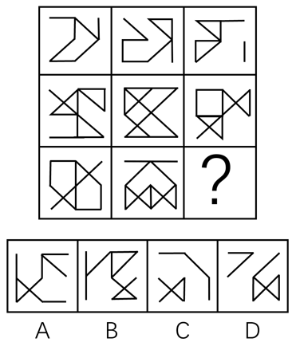

# 样式规律-加减同异（线条去同存异-求异）

考点：[[20-考点/判断推理/图形推理/样式规律-加减同异（线条去同存异-求异）|图形推理 / 样式规律-加减同异（线条去同存异/求异）]]

**问法模型**：九宫格问'最合适的一个填入问号处使之呈现规律性'且图形元素相似、线条重复出现 → 按行做'图1⊕图2去同存异（求异）=图3'的线段运算

## 推理链
1. 第1步：九宫格按行观察，各图形元素组成相似、相同线条重复出现，优先锁定样式类'加减同异'规律，而非数量或位置规律
2. 第2步：假设第一行规律为'图1与图2相同线条去掉、不同线条保留'（求异），叠加结果为图3
3. 第3步：用第二行验证：将第二行图1与图2逐线比对，消去重合线段、保留独有线段，所得图形与图3一致，规律成立
4. 第4步：第三行应用规律：把图1（外框折线+内部交叉线图形）与图2（'屋顶'形轮廓+内部交叉线）中重合的线段消去
5. 第5步：逐项对照：消去公共线后剩余线条的位置与走向组合，与B项完全吻合；A项多余左下交叉线、C项缺少右上折线、D项线条组合不符，均排除
6. 第6步：与选项对照得出结论，问号处填B

**最快解法**：⚡ 口诀'相似+线条重复→去同存异'：直接对第三行图1、图2逐线比对，先找公共线段划掉，再数剩余线段的数量与方位，与四个选项快速匹配即得B

## 易错点
- ⚠ 把'去同存异'误当作'去异存同'或直接两图叠加，方向搞反
- ⚠ 逐线比对时只数线条总数量、忽略线条位置和方向，容易误选线条数相同的干扰项
- ⚠ 跳过第二行验证步骤，凭第三行图形'看起来像'直接选答案，易被内部交叉线迷惑

## 母题抽象
> 🧩 当九宫格（或两组图）图形元素相似、相同线条重复出现时，按行做'图1⊕图2=图3'的去同存异运算，用第二行验证后在第三行应用即可锁定答案

**同类特征**：九宫格3×3、元素组成相似、相同线条重复出现、线条求异（去同存异）、第二行验证第三行应用、问号处求第三行图3

## 相关题
- [[10-真题/判断推理/图形推理/12019768 样式规律-加减同异（求同）与位置旋转的复合规律|12019768]]（浙江 2026，相关度2）
- [[10-真题/判断推理/图形推理/14403686 样式规律-黑白叠加（重叠为白、非重叠为黑）|14403686]]（山东 2025，相关度2）
- [[10-真题/判断推理/图形推理/16070178 样式规律-加减同异（翻转+去同存异）|16070178]]（重庆 2026，相关度2）
- [[10-真题/判断推理/图形推理/17056529 样式规律-求同求异（分元素：直线求同、小圆圈求异）|17056529]]（上海 2026，相关度2）
- [[10-真题/判断推理/图形推理/17058551 样式规律-加减同异（多图相加-叠加）|17058551]]（选调 2023，相关度2）

---

### 题干

从所给的四个选项中，选择最合适的一个填入问号处，使之呈现一定的规律性：

### 选项
- A. A
- B. B　✅
- C. C
- D. D

### 官方解析
元素组成相似，相同线条重复出现，优先考虑加减同异。第一行图1和图2相同线条去掉，不同线条保留，求异得到图3，第二行验证此规律成立，第三行应用此规律，只有B项成立。
故正确答案为B。

### 给定材料
（无）
