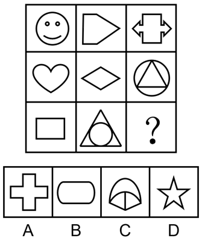

# 图形推理-对称性（对称轴数量的行内加和规律）

考点：[[20-考点/判断推理/图形推理/图形推理-对称性（对称轴数量的行内加和规律）|图形推理 / 图形推理-对称性（对称轴数量的行内加和规律）]]

**问法模型**：九宫格问'填入问号处使之呈现规律性'且图形元素组成不同→按行数每个图形的对称轴条数，寻找行内数量运算规律（图1+图2=图3）

## 推理链
1. 第1步：题干九宫格中各图形元素组成不同，优先考虑属性规律；题干出现笑脸、箭头、心形、三角形等典型对称特征图，优先数对称轴
2. 第2步：第一行数对称轴：笑脸1条（竖直）、向右箭头形1条（水平）、带箭头十字形2条（横+竖），发现前两图之和等于第三图：1+1=2
3. 第3步：第二行验证规律：心形1条、菱形2条、圆内接三角形3条（三角形三条对称轴均过圆心），1+2=3，规律成立
4. 第4步：第三行应用规律：长方形2条、圆内接等边三角形3条，故问号处图形应具有2+3=5条对称轴
5. 第5步：逐项数对称轴：A十字形2条、B圆角长方形2条、C穹顶扇形1条、D五角星5条
6. 第6步：只有D满足5条对称轴，故选D

**最快解法**：⚡ 数对称轴法+行规律口诀：九宫格按行看，对称轴数量'前两图相加等于第三图'；第三行为2、3，直接锁定需5条对称轴的图形，五角星=5条，秒选D

## 易错点
- ⚠ 只判断'是否轴对称'而不数对称轴的具体条数，误以为规律是'均为轴对称图形'而选错
- ⚠ 行列方向看反：按列看数量为1、1、2（1+1≠2）无规律，本题规律只在行内成立
- ⚠ 圆内接三角形误认为'圆有无数条对称轴'，实际组合图形的对称轴取外框三角形与圆的共同对称轴，为3条

## 母题抽象
> 🧩 当九宫格图形元素组成不同且含等腰三角形、箭头、心形等对称特征图时，用'数对称轴条数+按行加和（图1+图2=图3）'的方法，在选项中找对称轴数等于前两图之和的图形

**同类特征**：九宫格、元素组成不同、等腰三角形/箭头/心形等对称特征图、对称轴数量逐行递变、行内数量加和规律、选项含五角星（5条对称轴）

## 相关题
- [[10-真题/判断推理/图形推理/11367791 属性类-对称性（对称轴方向与条数、轴对称+中心对称）＋数量类-面数量（九宫格横行复合规律）|11367791]]（江苏 2025，相关度2）
- [[10-真题/判断推理/图形推理/11881082 属性规律-对称性（对称轴方向）|11881082]]（黑龙江 2024，相关度2）
- [[10-真题/判断推理/图形推理/12881896 属性规律-曲直性（九宫格横行遍历）|12881896]]（新疆 2025，相关度2）
- [[10-真题/判断推理/图形推理/14993416 数量规律-点数量（黑点个数按行求和恒值）|14993416]]（选调 2024，相关度2）
- [[10-真题/判断推理/图形推理/17097275 图形间关系-点相交（点接触 vs 线接触）|17097275]]（山西 2024，相关度2）

---

### 题干

从所给的四个选项中，选择最合适的一个填入问号处，使之呈现一定的规律性：

### 选项
- A. A
- B. B
- C. C
- D. D　✅

### 官方解析
图形元素组成不同，优先考虑属性规律。观察题干图形发现出现了等腰三角形、箭头等特征图，优先考虑对称性。题干第一行图形的对称轴数量依次为1、1、2，即前两幅图对称轴的数量之和等于第三幅图对称轴的数量。第二行验证此规律，对称轴数量依次为1、2、3，验证后该规律成立。第三行应用此规律，对称轴数量依次是2、3、？，则“？”处应选择对称轴数量为5的选项，符合该规律的只有D选项。
故正确答案为D。

### 给定材料
（无）
