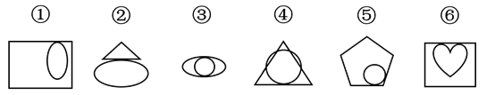

# 图形推理-位置关系（两图相切的切点数量）

考点：[[20-考点/判断推理/图形推理/图形推理-位置关系（两图相切的切点数量）|图形推理 / 图形推理-位置关系（两图相切的切点数量）]]

**问法模型**：六个图形分为两类且各有共同特征 → 分组分类模型：先排除样式类，再从图形间位置关系（相切/相交/包含）中找可二分的数量规律

## 推理链
1. 第1步：元素组成不同，六个图形均由两个图形组合而成（外框/整体图形+内部或相贴图形），且两图之间均存在明显的'相切'关系
2. 第2步：确定分组依据为'两图形相切时切点的个数'这一数量特征
3. 第3步：逐图数切点——图①椭圆与长方形右边缘只有1个切点；图②三角形底边与椭圆上方只有1个切点；图④圆与三角形只有1个切点
4. 第4步：图③圆与椭圆左右相切有2个切点；图⑤圆与五边形两条边相切有2个切点；图⑥心形顶部两瓣与长方形上边相切有2个切点
5. 第5步：按切点个数二分：①②④均为1个切点一组，③⑤⑥均为2个切点一组
6. 第6步：对照选项，①②④一组、③⑤⑥一组，只有B项符合

**最快解法**：⚡ 数切点法：锁定每图两图形的'相切'位置，快速数切点个数，①②④=1个切点，③⑤⑥=2个切点，直接锁定B

## 易错点
- ⚠ 只识别出'相切'这一定性关系就停止，未进一步数切点个数这一可分组的数量特征
- ⚠ 图④圆在三角形内易误当成内切圆而数出多个切点，应以图中实际画出的接触点为准
- ⚠ 被外框形状（长方形/三角形/五边形）和内部图形形状差异带偏，错误转向'图形种类''直曲性'等其他规律

## 母题抽象
> 🧩 当分组分类题中每个图形都由两个图形相切（或相贴）组合而成时，优先数'切点/接触点个数'，按数量（1个 vs 2个）完成二分

**同类特征**：元素组成不同、两图相切、切点个数不同、内外/上下两图形组合、分组分类题、直曲图形混合

## 相关题
- [[10-真题/判断推理/图形推理/2133620 图形推理-数量规律（一笔画-奇点数）|2133620]]（国考 2018，相关度2）
- [[10-真题/判断推理/图形推理/2725321 数量规律-角的计数（直角个数）|2725321]]（四川 2020，相关度2）
- [[10-真题/判断推理/图形推理/2725328 数量规律-部分数（相同图形的连通性）|2725328]]（四川 2020，相关度2）
- [[10-真题/判断推理/图形推理/4767997 数量规律-面数量（框内交点数、笔画数均可替代，属多规律收敛题）|4767997]]（四川 2017，相关度2）
- [[10-真题/判断推理/图形推理/5408661 数量规律-笔画数（一笔画与多笔画，奇点计数）|5408661]]（四川 2022，相关度2）

---

### 题干

把下面的六个图形分为两类，使每一类图形都有各自的共同特征或规律，分类正确的一项是：

### 选项
- A. ①③④，②⑤⑥
- B. ①②④，③⑤⑥　✅
- C. ①④⑤，②③⑥
- D. ①③⑤，②④⑥

### 官方解析
本题为分组分类题目。元素组成不同，观察发现，图形相切明显，图①②④中两个图形之间只有一个切点，图③⑤⑥中两个图形之间存在两个切点，故图①②④一组，图③⑤⑥一组。
故正确答案为B。

### 给定材料
（无）
