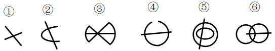

# 数量规律-笔画数（奇点计数）

考点：[[20-考点/判断推理/图形推理/数量规律-笔画数（奇点计数）|图形推理 / 数量规律-笔画数（奇点计数）]]

**问法模型**：六个图形分组分类且元素组成不同、无属性规律、出现大量端点→数奇点定笔画数分组

## 推理链
1. 第1步：六图元素组成不同，封闭、对称等属性规律不明显，转向数量规律。
2. 第2步：图形中出现大量线段端头（如②的C形开口、④的圆弧缺口），端点必为奇点，优先考虑笔画数。
3. 第3步：奇点=引出奇数条线的点；端点是奇点，直线穿曲线的交点引出4条线为偶点不计。逐图数：图①交叉线段共4个奇点；图②C形两端点+直线两端点共4个奇点；图④圆弧两端点+横线两端点共4个奇点。
4. 第4步：图③蝴蝶结形加横线仅左右2个奇点；图⑤直线穿双同心圆仅线段两端2个奇点（圆线交点为偶点）；图⑥双圆相交加横线仅线段两端2个奇点。
5. 第5步：按规律'奇点数为2→一笔画，奇点数为4→两笔画（笔画数=奇点数÷2）'归类：①②④为两笔画，③⑤⑥为一笔画。
6. 第6步：对照选项，①②④一组、③⑤⑥一组，对应B项。

**最快解法**：⚡ 奇点计数法+排除法：直接数每个图形的'线头'（端点）数量——①②④各有4个端头（4个奇点，两笔画），③⑤⑥只有2个端头（2个奇点，一笔画），秒选B。

## 易错点
- ⚠ 把所有交点都当奇点：十字交叉（引出4条线）是偶点，只有T字交叉和端点才是奇点，图⑤⑥中直线与圆的交点勿误计为奇点
- ⚠ 误用'封闭区域数'或'线条数'分组：图③⑤⑥与①②④的面数/线段数不成规律，易被干扰
- ⚠ 一笔画误判：图形必须是连通图才能按奇点数定笔画，勿把不连通部分漏算笔画

## 母题抽象
> 🧩 当分组分类图形中出现明显'线头/端点'或'直线穿曲线、开口曲线'特征时，数奇点定笔画：奇点0或2个→一笔画一组，奇点4个→两笔画一组，据此两分。

**同类特征**：分组分类问法、元素组成不同无属性规律、大量端点/线头、直线与曲线相交、开口圆弧、奇点数2与4两组

## 相关题
- [[10-真题/判断推理/图形推理/2444739 数量规律-笔画数（奇点计数）|2444739]]（四川 2019，相关度2）
- [[10-真题/判断推理/图形推理/10297098 功能元素-黑点标记交点的发射线数|10297098]]（天津 2025，相关度1）
- [[10-真题/判断推理/图形推理/10297262 数量规律-面的形状种类（封闭面种类数分组）|10297262]]（浙江 2025，相关度1）
- [[10-真题/判断推理/图形推理/12019737 数量规律-相同元素的位置关系（相对-相邻）分组|12019737]]（浙江 2026，相关度1）
- [[10-真题/判断推理/图形推理/12536392 数量规律-黑色区域面积（宫格面积折算）|12536392]]（四川 2024，相关度1）

---

### 题干

把下面的六个图形分为两类，使每一类图形都有各自的共同特征或规律，分类正确的一项是：

### 选项
- A. ①②③，④⑤⑥
- B. ①②④，③⑤⑥　✅
- C. ①③⑤，②④⑥
- D. ①③⑥，②④⑤

### 官方解析
本题为分组分类题目。元素组成不同，无明显属性规律，考虑数量规律。观察发现，图形中有大量的端点出现，优先考虑笔画数，图①②④的奇点数为4个，是两笔画图形，图③⑤⑥的奇点数为2个，是一笔画图形，即图①②④一组，图③⑤⑥一组。
故正确答案为B。

### 给定材料
（无）
