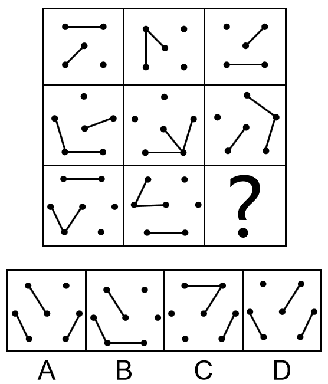

# 位置规律（内外分开看：外框线条平移＋内部线条旋转）

考点：[[20-考点/判断推理/图形推理/位置规律（内外分开看：外框线条平移＋内部线条旋转）|图形推理 / 位置规律（内外分开看：外框线条平移＋内部线条旋转）]]

**问法模型**：'填入问号处使之呈现一定的规律性'且各格元素组成相同 → 九宫格横行对比，采用'内外分开看'的双轨迹位置模型（外线沿框平移＋内线绕顶点旋转）

## 推理链
1. 第1步：九宫格每格均由两层构成——'沿外框分布的线条'和'指向框内的线条'，元素组成相同，优先考虑位置规律并横行观察；第一行外框为4个顶点，第二行5个顶点，第三行6个顶点。
2. 第2步：内外分开看——第一行外部线条沿外框每次逆时针平移一步（上边横线→左边竖线→下边横线），内部线条沿外框4个顶点每次顺时针旋转一个顶点（左下→左上→右上）。
3. 第3步：第二行验证规律：外框5个顶点，外部线条仍沿外框逆时针平移一步，内部线条沿5个顶点顺时针旋转一个顶点，规律成立，且'一步/一个点'随每行顶点数（4→5→6）同步变化。
4. 第4步：将规律应用到第三行：？处外部线条应在第三行图2的基础上沿6顶点外框逆时针再平移一步。
5. 第5步：对照选项外部线条位置：B、C的外线落点不符合逆时针平移一步的结果，排除B、C。
6. 第6步：？处内部线条应沿外框6个顶点顺时针再旋转一个顶点，落到左上方顶点；D的内线不在左上方，排除；A的外线落点与内线位于左上方均吻合，故选A。

**最快解法**：⚡ 位置规律口诀'内外分开看'＋排除法：先按外线沿外框逆时针平移一步排除B、C，再按内线沿6个顶点顺时针旋转到左上方排除D，直接锁定A。

## 易错点
- ⚠ 只用外线排除了B、C就仓促选答案，未再用内线位置验证，易误选内线不在左上方的D
- ⚠ 两条轨迹方向记混：外线是逆时针平移、内线是顺时针旋转，方向相反易看反
- ⚠ 忽略三行外框顶点数递变（4→5→6），把'平移一步/旋转一个点'的落点按固定多边形套用而判断错位

## 母题抽象
> 🧩 当九宫格图形元素组成相同且明显由'外框线条＋内部线条'双层构成时，用'内外分开看'法：外线沿框逆时针平移一步、内线绕顶点顺时针转一点，按行验证后定位问号处两层线条的落点。

**同类特征**：九宫格、元素组成相同、图形分内外两层、外框顶点数逐行4/5/6递变、外线平移＋内线旋转、横行观察

## 相关题
- [[10-真题/判断推理/图形推理/12334416 图形推理-位置规律（旋转-翻转组合变换）|12334416]]（江苏 2024，相关度2）
- [[10-真题/判断推理/图形推理/17056528 位置规律-旋转（九宫格V形开口顺时针旋转90°）|17056528]]（上海 2026，相关度2）
- [[10-真题/判断推理/图形推理/1758954 图形推理-位置规律（翻转：先左右翻转、再上下翻转）|1758954]]（上海 2016，相关度2）
- [[10-真题/判断推理/图形推理/1796366 位置规律-平移（小圆沿三角形三边逆时针移动）＋图形间相对位置（内外分布规律）|1796366]]（黑龙江 2016，相关度2）
- [[10-真题/判断推理/图形推理/19283837 样式规律-求异（去同存异）+位置规律-左右翻转（复合规律）|19283837]]（国考 2025，相关度2）

---

### 题干

请从所给四个选项中选择一个最合适的选项填入问号处，使之呈现一定的规律性。

### 选项
- A. A　✅
- B. B
- C. C
- D. D

### 官方解析
元素组成相同，优先考虑位置规律。九宫格优先横行看，图形都是分内外的，内外分开看，观察外框发现，外部线条沿外框每次逆时针平移一步，观察内部发现，内部线条沿外框4个顶点每次顺时针旋转一个点；第二行满足此规律，外部线条沿外框每次逆时针平移一步，内部线条沿外框5个顶点每次顺时针旋转一个点；因此？处，外部线条应逆时针平移一步，排除BC项，内部线条应沿外框6个顶点每次顺时针旋转一个点，旋转到左上方，排除D项。故正确答案为A。

### 给定材料
（无）
