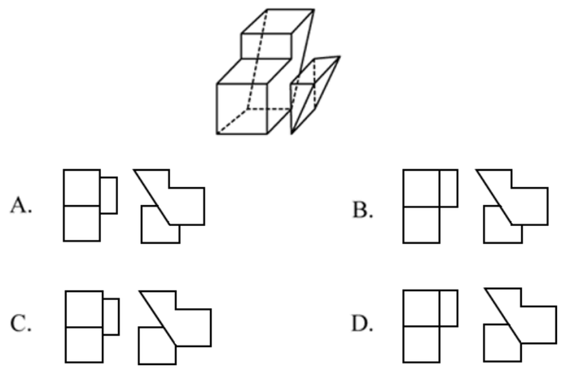
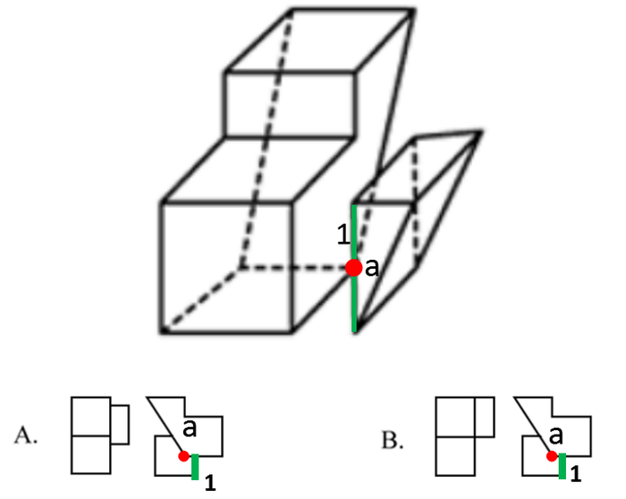
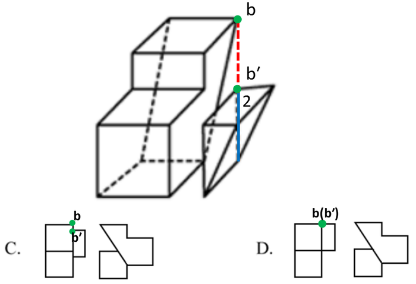

# 三视图（俯视图-左视图的点线投影对应）

考点：[[20-考点/判断推理/图形推理/三视图（俯视图-左视图的点线投影对应）|图形推理 / 三视图（俯视图/左视图的点线投影对应）]]

**问法模型**：给出拼接立体图形，问哪个选项的俯视图和左视图均正确 → 先由视图反推两体相对位置，再以图中标记点/边为锚做投影位置验证，排除法锁定答案

## 推理链
1. 第1步：观察题干立体图形，由左侧多面体与右侧楔形小块拼接而成，图中标定点a、点b、点b′及边1、边2等关键要素
2. 第2步：由各选项给出的俯视图形状反推，题干中两个立体图形应是相邻（贴合）关系，据此确定俯视图上点与边的相对位置
3. 第3步：验证点a——既然两体相邻，点a应落在边1上；对照选项，A项和B项的点a均不在边1上，排除A、B
4. 第4步：验证点b——点b应在边2的延长线上，故从上往下（俯视方向）观察时，点b与点b′应重合
5. 第5步：对照选项，C项中点b与点b′并未重合，排除C；仅D项俯视图与左视图均满足上述投影关系
6. 第6步：结论——正确答案为D

**最快解法**：⚡ 关键点排除法：先读俯视图确定'两体相邻'，用'点a必在边1上'一步排除A、B，再用'俯视方向点b与b′重合'排除C，直接锁定D

## 易错点
- ⚠ 误判两个立体图形的相对位置（相邻还是分离），导致点a、点b的投影位置全盘算错
- ⚠ 忽略俯视方向上的投影重合关系：点b在边2延长线上，与点b′从上往下看应重合，易漏验此项
- ⚠ 只核对了俯视图就匆忙选择，未再验证左视图中楔形斜边（斜面）的投影走向与点b′位置

## 母题抽象
> 🧩 当题干给出两体拼接的立体图形并要求选出'俯视图+左视图均正确'的选项时，先由视图反推相对位置关系，再抓图中标记的点/边做投影对应验证，逐项排除

**同类特征**：两体拼接且相邻的立体图形、图中标注点a、点b、点b′与边1、边2、要求俯视图与左视图同时正确、选项差异集中在关键点的投影位置、含楔形/斜面结构的三视图问题

## 相关题
（暂无）

---

### 题干

下面四个选项分别为立体图形的俯视图和左视图，均正确的是：

### 选项
- A. A
- B. B
- C. C
- D. D　✅

### 官方解析

本题考查三视图。

根据每个选项第一个俯视图可以得知，题干中两个立体图形应该是相邻的。

既然是相邻的，那么点a应该在边1上，而A选项和B选项的点a没有在边1上，排除。（如图1所示）

既然是相邻的，那么点b应该在边2的延长线上，因此从上往下观察该图形，点b与点b′应该是重合的。而C选项的点b与点b′并没有重合，排除。（如图2所示）

故正确答案为D。

### 给定材料
（无）
