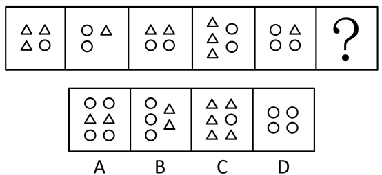

# 数量规律-元素换算（等差替换，两种小元素）

考点：[[20-考点/判断推理/图形推理/数量规律-元素换算（等差替换，两种小元素）|图形推理 / 数量规律-元素换算（等差替换，两种小元素）]]

**问法模型**：一组含两种小元素的图形问'？'处规律 → 用等差中项公式'图1+图3=2×图2'求换算比，换算后验证数量等差

## 推理链
1. 第1步：题干五幅图均由三角形和圆两种小元素组成，个数（3△1○、1△2○、2△2○、3△2○、1△3○）单独看均无单调规律，考虑元素间换算
2. 第2步：套用等差中项换算公式'图1+图3=2×图2'：(3△+1○)+(2△+2○)=2×(1△+2○)，化简得3△=1○，即1圆=3三角
3. 第3步：将每幅图的圆全部换算成三角形：图1=3+3=6△，图2=1+6=7△，图3=2+6=8△，图4=3+6=9△，图5=1+9=10△
4. 第4步：换算后三角形个数依次为6、7、8、9、10，呈公差为1的等差数列，故'？'处应换算为11个三角形
5. 第5步：逐项换算对照——A项2△+4○=14△排除，B项2△+3○=11△保留，C项5△+1○=8△排除，D项4○=12△排除
6. 第6步：只有B项换算后为11个三角形，符合等差规律，故选B

**最快解法**：⚡ 元素换算法：直接套'图1+图3=2×图2'求出1圆=3三角，再逐项把圆折算成三角形相加，数到11个的即是B（排除法收尾）

## 易错点
- ⚠ 只数某一种元素的个数（如只数三角形：3、1、2、3、1）找不到规律，忽略'两种元素需换算'这一特征
- ⚠ 换算比方向搞反（误得1三角=3圆），换算后数量不成等差还硬凑
- ⚠ 逐项换算时漏加圆的折算值，如把D项4个圆当作'0个三角形'而误判

## 母题抽象
> 🧩 当一组图形仅出现两种小元素且各自个数无单调规律时，用等差中项公式'图1+图3=2×图2'求出换算比，统一换算后验证数量构成等差数列，再按公差定答案

**同类特征**：每幅图仅两种小元素（三角形与圆）、元素个数直接看无规律、连续五图加问号求第六项、等差中项换算公式图1+图3=2×图2、换算后数量呈等差数列

## 相关题
（暂无）

---

### 题干

从所给的四个选项中，选择最合适的一个填入问号处，使之呈现一定的规律性：

### 选项
- A. A
- B. B　✅
- C. C
- D. D

### 官方解析
通过观察题干发现，每个图形都只出现了两种小元素，考虑元素间的换算关系，根据基本换算公式“图1+图3=2*图2”，最后换算的结果为1圆=3三角形，代入题干，将圆全部换算成三角形可知，分别有6、7、8、9、10个三角形，故“？”处图形应有11个三角形。A项换算为14个三角形，排除；B项换算为11个三角形，保留；C项换算为8个三角形，排除；D项换算为12个三角形，排除。
故正确答案为B。

### 给定材料
（无）
