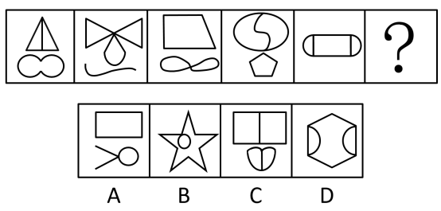

# 数量规律-面数量（封闭区域数）

考点：[[20-考点/判断推理/图形推理/数量规律-面数量（封闭区域数）|图形推理 / 数量规律-面数量（封闭区域数）]]

**问法模型**：'选择最合适的一个填入问号处，使之呈现一定的规律性'且元素组成不同、无明显属性规律 → 优先考虑数量规律，本题数每幅图的封闭区域（面）数，找常数规律

## 推理链
1. 第1步：题干五图元素组成不同，对称、曲直等属性无统一规律，且每幅图都含多个'窟窿'（封闭区域），锁定数量规律中的数面
2. 第2步：明确数面口径——由线条围成的封闭区域计为1个面，开曲线/开线段（如图2下方的波浪线）不构成面
3. 第3步：逐图验证：图2蝴蝶结2个三角面+水滴1面=3；图3梯形1面+∞形2面=3；图4圆内S曲线分2面+五边形1面=3；图5胶囊形被两条竖线分为3面；图1上下部分合计3面，题干面数恒为3
4. 第4步：数选项：A项矩形1面+小圆1面=2面（剪刀状为开线不计面）；B项五角星外轮廓1面+内部小圆1面=2面；C项矩形被竖线分2面+下方心形被竖线分2面=4面
5. 第5步：D项六边形1面，左右两条弧线与六边形边各围出1个新月形面，共3面，与题干常数3一致，故选D

**最快解法**：⚡ 数面法+排除法：题干五图面数恒为3，快速数选项面数——A=2、B=2、C=4、D=3，直接锁定D

## 易错点
- ⚠ 把开曲线误计为面：图2下方波浪线、A项剪刀状线条均不封闭，不能算作面
- ⚠ D项左右弧线与六边形边围成的新月形小面易漏数，误以为D只有1个面而错选A或B
- ⚠ B项五角星若按'线段交叉构成多个三角形区域'的模型数面会多算，应按本题单一外轮廓+内部小圆计为2面

## 母题抽象
> 🧩 当图形元素组成不同、属性无规律且每幅图都含明显封闭区域（窟窿）时，优先数面数量；题干面数呈常数n时，选面数等于n的选项

**同类特征**：元素组成不同、无明显属性规律、每图含多个封闭区域、多部分组合小图形、面数量恒定为3、存在开曲线干扰元素

## 相关题
- [[10-真题/判断推理/图形推理/12100999 数量规律-面数量（封闭区域数）|12100999]]（江苏 2025，相关度4）
- [[10-真题/判断推理/图形推理/2097182 数量规律-面数量（封闭区域数）|2097182]]（四川 2017，相关度4）
- [[10-真题/判断推理/图形推理/2255600 数量规律-面数量（封闭区域数）|2255600]]（江西 2016，相关度4）
- [[10-真题/判断推理/图形推理/2280966 数量规律-面数量（封闭区域数）|2280966]]（四川 2018，相关度4）
- [[10-真题/判断推理/图形推理/2452827 数量规律-面数量（封闭区域数）|2452827]]（河南 2019，相关度4）

---

### 题干

从所给的四个选项中，选择最合适的一个填入问号处，使之呈现一定的规律性：

### 选项
- A. A
- B. B
- C. C
- D. D　✅

### 官方解析
元素组成不同，且无明显属性规律，优先考虑数量规律。每个图形中都有多个窟窿，故可以考虑数面。题干所有图形面的数量均为3，四个选项面的数量分别为2、2、4、3，只有D项符合规律。
故正确答案为D。

### 给定材料
（无）
