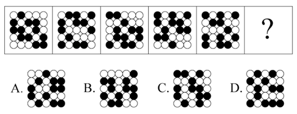

# 位置规律-黑白点平移（相邻两图黑点不变行数-不变黑点个数恒定）

考点：[[20-考点/判断推理/图形推理/位置规律-黑白点平移（相邻两图黑点不变行数-不变黑点个数恒定）|图形推理 / 位置规律-黑白点平移（相邻两图黑点不变行数/不变黑点个数恒定）]]

**问法模型**：“选择最合适的一个填入问号处，使之呈现一定的规律性”，且五幅图元素组成相同、仅黑白点位置不同→采用“位置类-相邻对比”模型：数相邻两图之间黑点位置不变的行数与不变黑点个数，要求该恒定规律在问号处延续。

## 推理链
1. 第1步：题干五幅图均为同一网格中黑、白圆点的排布，圆点总数不变、只有黑点位置逐图改变→定位为位置类规律，而非数量或样式规律。
2. 第2步：观察图一与图二——只有第二行的黑点位置不变，其余各行黑点全部移动；换算成点的口径，即两图之间恰有7个黑点位置未变（“行”与“个数”是同一规律的两种计数口径）。
3. 第3步：向后逐对验证：图二→图三、图三→图四、图四→图五均满足“相邻两图只有一行黑点位置不变（即7个黑点不动）”，规律在全序列成立。
4. 第4步：将图五与四个选项逐一对比：A、C、D每一行黑点位置均发生改变（位置不变的黑点分别只有6个、6个、5个），不满足“仅一行不变”，排除。
5. 第5步：B项与图五对比只有一行（第四行）黑点位置不变，且恰有7个黑点位置未动，与题干规律完全吻合，故选B。

**最快解法**：⚡ 相邻对比法（数“不动点”）：不必从图一逐对推起，直接拿图五与四个选项比对——找“仅一行黑点原样未动、且未动黑点恰为7个”的那一项；A、C、D每行均有变动（不动黑点仅6/6/5个），只有B第四行原样未动、7个黑点未变，可直接锁定B。

## 易错点
- ⚠ 只去验证每幅图黑点总数是否一致，忽略真正的规律藏在“相邻两图之间不变行数/不变黑点个数”这一动态关系中
- ⚠ 拿图一（而非相邻的图五）与选项对比，隔图比较找不到规律而误选或放弃
- ⚠ 误把解析一“按行数”与解析二“按个数”两种口径当成矛盾：实为同一现象的两种计数（不变的那一行恰含7个未动黑点）；A、C“每行都有变动”与“仍有6个黑点未动”并不冲突——同行的其他黑点动了，该行即算发生变动

## 母题抽象
> 🧩 当题干出现多幅“元素组成相同、仅黑白点位置不同”的点阵图时，用相邻图对比法数“不变行数”或“不动黑点个数”，若该数值恒定（如本题“仅一行不变/7个黑点不动”），则在选项中找唯一满足该恒定值者。

**同类特征**：黑白圆点网格（点阵图）、五幅图元素组成相同、仅黑点位置逐图改变、相邻两图对比找不变量、不变行数恒定/不动黑点个数为7、序列末尾问号求规律延续

## 相关题
（暂无）

---

### 题干

从所给的四个选项中，选择最合适的一个填入问号处，使之呈现一定的规律性：

### 选项
- A. A
- B. B　✅
- C. C
- D. D

### 官方解析
解析一：观察发现，图一和图二之间只有一行（第二行）黑点位置不变，继续观察，题干相邻的两幅图之间都满足只有一行黑点位置不变，ACD项每一行均发生变化，B项只有一行（第四行）黑点位置不变。 
故正确答案为B。
解析二：观察发现，图一和图二之间有7个黑点位置没变，继续观察，题干相邻的两幅图之间都满足7个黑点位置不变，A项只有6个位置不变，B项满足7个黑块位置不变，C项只有6个位置不变，D项只有5个位置不变。
故正确答案为B。

### 给定材料
（无）
