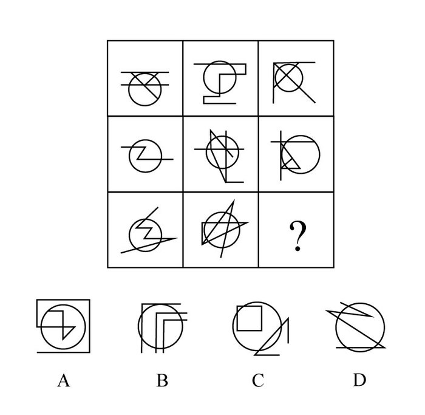

# 数量规律-交点计数（细化：圆内交点）

考点：[[20-考点/判断推理/图形推理/数量规律-交点计数（细化：圆内交点）|图形推理 / 数量规律-交点计数（细化：圆内交点）]]

**问法模型**：九宫格问'填入问号处使之呈现规律性' → 元素组成不同且线线相交明显时优先数交点，整体无规律则细化为公共元素（圆）内部的局部交点，按行找常数/递增规律

## 推理链
1. 第1步：题干为3×3九宫格，每格图形均由一个圆加若干直线构成，线线相交特征明显
2. 第2步：各图元素组成不同，对称、封闭等属性规律不明显，按'属性不行数数量'优先考虑数量规律中的数交点
3. 第3步：直接数每个图形的整体交点，各行无一致规律，属于'整体数不出'的情形
4. 第4步：抓住所有图形的共同元素'圆'，把计数范围细化为'圆内交点'（只数落在圆内部区域内的线线交点，不含圆周上的交点）
5. 第5步：按行统计：第一行三图圆内交点均为1，第二行三图均为2，第三行前两图均为3，呈'按行常数1/2/3'规律
6. 第6步：故问号处图形圆内交点应为3
7. 第7步：逐项验证圆内交点数：A为4、B为2、C为3、D为1，仅C满足圆内交点=3，故选C

**最快解法**：⚡ 细化计数法（圆内交点）：锁定公共元素圆，按行数圆内交点得1、2、3的常数规律，直接挑圆内交点为3的选项C

## 易错点
- ⚠ 整体数交点无规律后误以为数量规律走不通而转投属性规律，漏掉'细化局部交点'这一步
- ⚠ 把直线与圆相交落在圆周上的点也计入'圆内交点'，导致计数偏大、规律错乱
- ⚠ 九宫格只按列或整体看，忽略按行观察的常数规律（1、2、3逐行递增）

## 母题抽象
> 🧩 当九宫格各图均含同一公共元素（如圆）且线线相交明显、整体交点无规律时，应细化为公共元素内部的交点数，按行（或列）寻找常数/递增规律并逐项验证选项

**同类特征**：九宫格、每图均含圆、线线相交明显、元素组成不同、整体交点数无规律、按行呈圆内交点1/2/3规律

## 相关题
- [[10-真题/判断推理/图形推理/2187823 图形推理-数量规律（交点计数-内外交点分开数并作差）|2187823]]（山东 2018，相关度3）
- [[10-真题/判断推理/图形推理/11367791 属性类-对称性（对称轴方向与条数、轴对称+中心对称）＋数量类-面数量（九宫格横行复合规律）|11367791]]（江苏 2025，相关度2）
- [[10-真题/判断推理/图形推理/11881082 属性规律-对称性（对称轴方向）|11881082]]（黑龙江 2024，相关度2）
- [[10-真题/判断推理/图形推理/12881896 属性规律-曲直性（九宫格横行遍历）|12881896]]（新疆 2025，相关度2）
- [[10-真题/判断推理/图形推理/14993416 数量规律-点数量（黑点个数按行求和恒值）|14993416]]（选调 2024，相关度2）

---

### 题干

从所给的四个选项中，选择最合适的一个填入问号处，使之呈现一定的规律性：

### 选项
- A. A
- B. B
- C. C　✅
- D. D

### 官方解析
元素组成不同，且无明显属性规律，优先考虑数量规律。题干图形线线相交明显，故优先考虑数交点。观察题干发现，直接数交点并无规律，但每个图形都有一个圆，故细化观察交点。发现第一行所有图形圆内的交点都为1，第二行所有图形圆内的交点都为2，第三行前两幅图形圆内的交点都为3，故“？”处图形圆内的交点也应为3。A、B、C、D项分别为4、2、3、1，C项当选。
故正确答案为C。

### 给定材料
（无）
