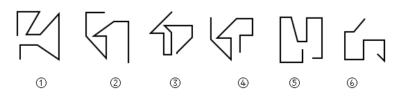

# 图形推理-线段方向关系（起始线与结束线的平行-垂直）

考点：[[20-考点/判断推理/图形推理/图形推理-线段方向关系（起始线与结束线的平行-垂直）|图形推理 / 图形推理-线段方向关系（起始线与结束线的平行/垂直）]]

**问法模型**：六个图形分两类且各自有共同规律 → 优先排除属性与数量规律后，寻找每条折线'首段与尾段'的位置（方向）关系

## 推理链
1. 第1步：六图均由连续的直线折线构成，无封闭区域，元素组成不同，属性规律（对称、开闭、曲直）无明显分类特征
2. 第2步：先验证数量规律，数各图直线数量，发现无一致的数量分组规律，需另找位置/方向关系
3. 第3步：把每个图形视为一条有起点的折线，锁定'起始线段'（最开头一笔）与'结束线段'（最末一笔）两个端点处的线段
4. 第4步：观察方向：图①、图③、图④的起始线与结束线呈平行关系；图②、图⑤、图⑥的起始线与结束线呈垂直关系
5. 第5步：按此规律分成①③④一组、②⑤⑥一组，与选项C完全对应

**最快解法**：⚡ 首尾方向法：先找每条折线最开头一笔的方向，再找最末一笔的方向，两段'平行'归①③④，'垂直'归②⑤⑥，直接锁定C

## 易错点
- ⚠ 只顾数直线数量、交点数等数量规律，忽略首尾线段方向关系这一隐蔽考点
- ⚠ 判断斜线段的平行/垂直时看错方向，把图③、图④中含斜线的首尾段关系误判
- ⚠ 误将图形整体轮廓的对称性、凹凸性当作分类依据而选错

## 母题抽象
> 🧩 当题干为多个连续折线图形且数量、属性规律均失效时，观察折线'起始线段与结束线段'的方向关系（平行/垂直/共线）进行分类

**同类特征**：图形均由一条连续直线折线构成、无封闭区域、元素组成不同且数量无规律、折线存在明显的起点端和终点端、考查首尾线段的方向关系、平行与垂直两组分类

## 相关题
（暂无）

---

### 题干

把下面的图形分为两类，使每一类图形都有各自的共同规律或特征，分类正确的一项是：

### 选项
- A. ①②④，③⑤⑥
- B. ①④⑤，②③⑥
- C. ①③④，②⑤⑥　✅
- D. ①②⑥，③④⑤

### 官方解析
元素组成不同，且无明显属性规律，优先考虑数量规律。图形均由直线组成，但直线数量没有规律。继续观察图形发现，图1、图3和图4的起始线和结束线为平行关系，图2、图5和图6的起始线和结束线为垂直关系。因此①③④一组，②⑤⑥一组。
故正确答案为C。

### 给定材料
（无）
