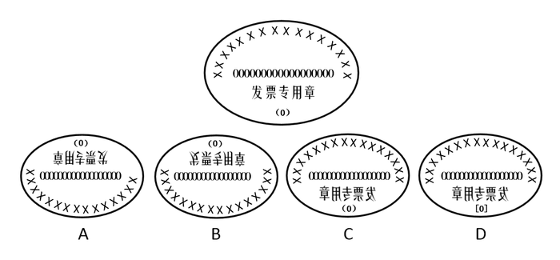

# 位置规律（旋转-翻转）+ 元素数量验证

考点：[[20-考点/判断推理/图形推理/位置规律（旋转-翻转）+ 元素数量验证|图形推理 / 位置规律（旋转/翻转）+ 元素数量验证]]

**问法模型**：问'能由所给图形旋转/转动而成'→ 旋转与翻转不改变元素种类和数量，逐项核对元素个数与符号细节后排除

## 推理链
1. 第1步：提取题干图形四类元素：汉字'发票专用章'、括号'（0）'、16个'X'、18个'0'，数量固定
2. 第2步：所用规则：图形无论旋转还是翻转，只改变元素的位置与方向，元素种类和数量不变，符号形态也不变
3. 第3步：对照A项：'X'只有15个，比原图少1个，虽姿态近似180°旋转但数量不符，排除
4. 第4步：对照B项：'0'只有17个，比原图少1个，排除；对照D项：'（0）'被改成'[0]'，符号形态改变，排除
5. 第5步：对照C项：四类元素齐全、数量一致，'发票专用章'呈镜像'章用专票发'且'（0）'仍在下方，为左右翻转所得，与官方答案一致选C

**最快解法**：⚡ 元素计数排除法：先数特征元素'X'与'0'的个数——A项X少1个、B项0少1个秒排除，再扫一眼细节符号，D项'（0）'变'[0]'排除，直接锁定C

## 易错点
- ⚠ 只盯'旋转'二字，误认为翻转图形（C项）不能选，错选A——联考省份问法已改为'转动'，包含旋转与翻转
- ⚠ 不数元素个数，凭姿态像180°旋转就选A，忽略A项比原图少1个'X'
- ⚠ 忽略小符号细节，没发现D项'（0）'已变成'[0]'

## 母题抽象
> 🧩 当题干为印章/徽章类多元素图形且问'旋转/转动而成'时，用元素计数法：先数各类元素数量（旋转翻转不增不减），再核对小符号形态，数量或形态不符者直接排除

**同类特征**：椭圆印章式图形、元素数量明确（16个X、18个0）、汉字方向指示翻转/旋转方式、含细节符号'（0）'、选项间仅元素数量或符号微差、问法为'旋转/转动而成'

## 相关题
（暂无）

---

### 题干

下列四个选项的图形，能由所给图形旋转而成的是：

### 选项
- A. A
- B. B
- C. C　✅
- D. D

### 官方解析
首先观察题干图形特征，包括汉字“发票专用章”、“（0）”、16个“X”，以及18个“0”，共四类元素。
观察选项：
A项：图形包含15个“X”，比原图少一个“X”，故不可能是题干图形旋转180度而来，排除；
B项：图形包含17个“0”，比原图少一个“0”，故不可能是题干图形上下翻转而来，排除；
C项：所有元素齐全，为题干图形左右翻转而来，当选；
D项：将原图中的“（0）”改成了“[0]”，故不可能通过原图转动得到，排除；
故正确答案为C。
注：本题有同学认为选A，理由是要求找一个由题干图形“旋转”而来的选项，因此看似是A项，但经过仔细核对，A选项确实比原图少一个“X”，因此不严谨。且本题除2019河南省考考查，2019云南及其他联考省份也考查了，而其他省考卷恰好对提问方式进行了修改，改为“下列四个选项的图形，能由所给图形‘转动’而成的是”。明显改动了题干中“旋转”二字，改为了“转动”，但是选项没有任何变化。因此粉笔推测本题并非是只能“旋转”，题干要求选“转动”，其实可以包括旋转或者翻转（上下翻转或左右翻转，类似于“翻书页”）两种形式。因此，经过反复教研，认为本题题目不是很严谨，同时对比其他省份的同一道题，恰巧在提问方式上做了改变，粉笔还是倾向C选项。

### 给定材料
（无）

> [!warning] 疑点（官方解析可能有误，待人工复核）
> 官方问法为'旋转'，严格意义上平面内旋转无法实现镜像，C项实为左右翻转而成；官方解析自身亦承认本题不严谨（部分联考省份已将问法改为'转动'），但依据官方唯一指定答案仍选C。

<!-- CODEX-ANSWER-REVIEW:BEGIN -->
### 本次独立复核

**复核状态：** `resolved`（答案与解析已核定）

**计分答案：** C（可计分）

**复核解析：**

按修订后的操作范围，C为唯一正确项。先核验不随旋转或镜像改变的元素：题图有“发票专用章”字样、括号“（0）”、16个X和18个0。A少1个X，B少1个0，D把圆括号“（0）”换成方括号“[0]”，均不能由允许的操作得到。C包含全部元素和相同数量，文字呈左右镜像，符合修订题干明确允许的镜像翻转。原河南回忆版把操作写为“旋转”，按几何学严格定义不包含镜像；2019年同题联考版本把“旋转”改为“转动”，原解析据此说明应包括旋转和上下/左右翻转。因此这里明确修订题干，答案C对应可判分的修订版，不把原措辞的缺陷隐去。

**修订题干：**

下列四个选项的图形，能由所给图形经平面旋转或镜像翻转（上下或左右翻转）得到的是：

**相关信息：**

图形推理—位置变化与元素恒定。旋转保持朝向关系但不产生镜像；镜像翻转必须由题干明示允许。遇多元素图形先核对元素种类、数量和括号等局部符号，再判断位置变换。

**题源依据：** [固定版本原题](https://github.com/Mentat-Uran/kaogongzhentizhengliu/blob/84ab93d4b64b61d897bece8a1c0a5bab06b4feb2/10-%E7%9C%9F%E9%A2%98/%E5%88%A4%E6%96%AD%E6%8E%A8%E7%90%86/%E5%9B%BE%E5%BD%A2%E6%8E%A8%E7%90%86/2389784%20%E4%BD%8D%E7%BD%AE%E8%A7%84%E5%BE%8B%EF%BC%88%E6%97%8B%E8%BD%AC-%E7%BF%BB%E8%BD%AC%EF%BC%89%2B%20%E5%85%83%E7%B4%A0%E6%95%B0%E9%87%8F%E9%AA%8C%E8%AF%81.md)；固定内容 commit `84ab93d4b64b61d897bece8a1c0a5bab06b4feb2`，Markdown blob `1d93a286e0114e12ce2e9c2640e10e078b6381d2`。
<!-- CODEX-ANSWER-REVIEW:END -->
