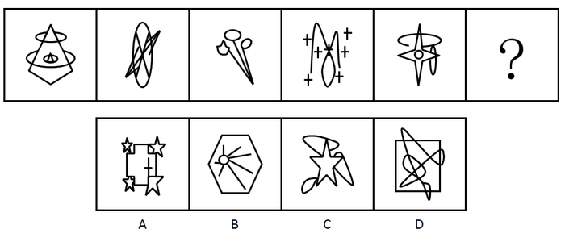

# 属性规律＋数量规律复合（曲直性＋相同小元素重复出现）

考点：[[20-考点/判断推理/图形推理/属性规律＋数量规律复合（曲直性＋相同小元素重复出现）|图形推理 / 属性规律＋数量规律复合（曲直性＋相同小元素重复出现）]]

**问法模型**：问号处选最合适图形呈现规律 → 元素组成不同时先查属性（曲直性）排除，再查数量（相同小元素重复）锁定

## 推理链
1. 第1步：题干五幅图元素组成各不相同（菱形+椭圆、椭圆+双直线、气球状曲线、M形曲线+多个'+'、四角星+椭圆），优先考虑属性规律
2. 第2步：属性筛查——题干每幅图均'由直线和曲线组成'（如第2幅椭圆为曲线、穿过的为直线；第4幅曲线配直线加号）
3. 第3步：A项为矩形+多个五角星，全部由直线构成、无曲线，与题干'曲直均有'不符，排除
4. 第4步：递进数量规律——题干每幅图内部都含'相同的小元素'重复出现（最典型如第4幅图中多个相同的'+'号）
5. 第5步：C项（五角星配弧形块）、D项（矩形内曲线）均找不出题干式的相同重复元素，排除
6. 第6步：B项六边形+曲线，内部有多条相同的独立直线（放射状等长直线），符合'含相同重复元素'规律，当选

**最快解法**：⚡ 两步排除法：第一步按'曲直均有'属性秒杀排除纯直线的A项；第二步按'图含相同小元素重复'排除C、D，只剩B（多条相同放射直线）直接锁定

## 易错点
- ⚠ 只做曲直性一步筛查，发现C、D也是直线+曲线混合后无下一步抓手，漏掉'相同小元素重复'的数量递进规律
- ⚠ 误把B项的'相同独立直线'不当作'相同重复元素'，误以为小元素必须是封闭小图形（如加号、圆圈）
- ⚠ 把A项五角星或C项弧形误判为符合题干曲直特征，忽略A项整体为纯直线构成

## 母题抽象
> 🧩 当题干图形元素杂乱、组成不同时，先用'曲直性'等属性规律排除明显不符项，若仍剩多个候选，再找'每图含相同小元素重复出现'的数量规律锁定答案

**同类特征**：元素组成不同、每图均直线+曲线混合、图内含相同小元素重复（多个'+'号）、问号处求一致规律、选项A为纯直线图形可先排除

## 相关题
- [[10-真题/判断推理/图形推理/10204454 数量规律-部分数（黑白球连通区域数做和）|10204454]]（甘肃 2024，相关度1）
- [[10-真题/判断推理/图形推理/10204604 数量规律-线数量（汉字横线数）|10204604]]（辽宁 2024，相关度1）
- [[10-真题/判断推理/图形推理/10297050 数量规律-特殊计数（线条穿过小白球的数量）|10297050]]（天津 2025，相关度1）
- [[10-真题/判断推理/图形推理/10297127 图形间关系-相交图形中不相交边数量（黑白图形相交）|10297127]]（天津 2025，相关度1）
- [[10-真题/判断推理/图形推理/10297148 数量规律-线的细化（端点连线穿过线条数；备选：平行线组数）|10297148]]（天津 2025，相关度1）

---

### 题干

从所给的四个选项中，选择最合适的一个填入问号处，使之呈现一定的规律性。

### 选项
- A. A
- B. B　✅
- C. C
- D. D

### 官方解析
元素组成不同，优先考虑属性规律。题干图形均由直线和曲线组成，而A项是直线图形，排除；其次考虑数量规律，观察发现，题干每幅图内部都有相同的小元素，排除C、D，B项有相同的独立直线，当选。
故正确答案为B。

### 给定材料
（无）
