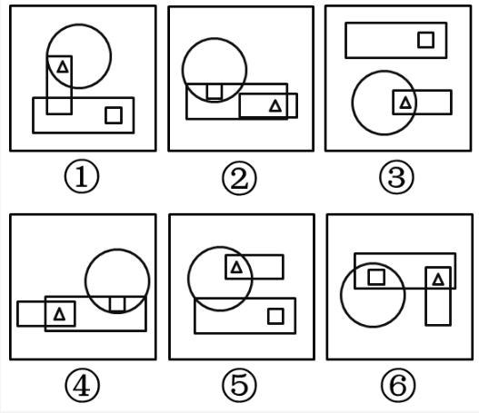

# 位置规律-图形间相对位置（小元素与相交区域的关系）

考点：[[20-考点/判断推理/图形推理/位置规律-图形间相对位置（小元素与相交区域的关系）|图形推理 / 位置规律-图形间相对位置（小元素与相交区域的关系）]]

**问法模型**：『六个图形分为两类，使每一类都有各自共同特征』→ 元素组成相同的分组题，优先考查图形间相对位置，聚焦小元素是否落在两图形相交区域内

## 推理链
1. 第1步：六图均由大图形（圆、矩形）加两个小元素（△、□）构成，元素组成相同，但各图整体无平移、旋转等位置移动规律，排除常规位置类规律
2. 第2步：转向图形间的相对位置，锁定『小元素与两图形相交区域』的关系作为分组标准
3. 第3步：检查①③⑤：图①中△位于竖直矩形与圆的相交区域内，□单独在下方矩形内；图③中△位于圆与横向矩形的相交区域内，□单独在上方矩形内；图⑤中△位于上方矩形与圆的相交区域内，□单独在下方矩形内——均只有△落在相交区域
4. 第4步：检查②④⑥：图②中□位于圆与矩形相交区域、△位于两矩形相交区域；图④中△位于两矩形相交区域、□位于圆与矩形相交区域；图⑥中□位于圆与横向矩形相交区域、△位于横向矩形与竖直矩形相交区域——△与□均在相交区域内
5. 第5步：归纳规律：①③⑤只有小三角形在两图形相交区域内；②④⑥小三角形和小正方形均在两图形相交区域内
6. 第6步：对照选项，①③⑤一组、②④⑥一组对应C项，故选C

**最快解法**：⚡ 图形规律口诀『元素相同看相对位置，小元素看相交』：逐图快速标记△、□是否处于两大图形的重叠（相交）区域内，按『仅△在相交区 / △□均在相交区』二分，直接锁定C

## 易错点
- ⚠ 只看小元素『在某图形内部』，忽略『是否在两图形相交区域内』这一关键限定条件
- ⚠ 图④②中矩形重叠区域多，容易看漏△也位于两矩形的相交区域内，误判其只属于单一大图形
- ⚠ 误从整体构图方向（横放/竖放、上/下位置）找规律，陷入位置移动类思路而无法二分

## 母题抽象
> 🧩 当分组题中六个图形元素组成完全相同但无移动规律时，改看小元素与大图形的相对位置，验证『小元素是否位于两图形相交区域内』即可二分归类

**同类特征**：元素组成相同、无明显位置移动规律、两图形相交/重叠区域、小三角形△的位置、小正方形□的位置、六图分两类问法

## 相关题
- [[10-真题/判断推理/图形推理/2633409 位置规律-两组元素奇偶格间隔分布（正六边形六分格编号）|2633409]]（选调 2016，相关度2）
- [[10-真题/判断推理/图形推理/2172768 位置规律（旋转-翻转）|2172768]]（海南 2021，相关度1）
- [[10-真题/判断推理/图形推理/10204457 面数量+最大面的对称性（中心对称与轴对称分组）|10204457]]（甘肃 2024，相关度1）
- [[10-真题/判断推理/图形推理/10204458 位置规律-平移（特征交点沿内圈循环平移）|10204458]]（甘肃 2024，相关度1）
- [[10-真题/判断推理/图形推理/10204614 图形推理-位置规律（旋转+翻转交替循环）|10204614]]（黑龙江 2024，相关度1）

---

### 题干

把下面的六个图形分为两类，使每一类图形都有各自的共同特征或规律，分类正确的一项是：

### 选项
- A. ①④⑥，②③⑤
- B. ①④⑤，②③⑥
- C. ①③⑤，②④⑥　✅
- D. ①②③，④⑤⑥

### 官方解析
本题图形组成元素相同，但无明显的位置移动规律，考虑图形间的相对位置。观察题干图形发现在图①③⑤中，只有小三角形在两个图形相交区域内，而在②④⑥中，小三角形和小正方形均在两个图形相交区域内，因此①③⑤为一组，②④⑥为一组。
故正确答案为C。

### 给定材料
（无）
