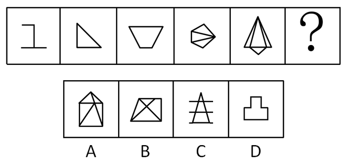

# 数量规律-交点数（等差递增）

考点：[[20-考点/判断推理/图形推理/数量规律-交点数（等差递增）|图形推理 / 数量规律-交点数（等差递增）]]

**问法模型**：“选择最合适的一个填入问号处使之呈现规律性”且图形组成元素不同 → 走数量类路线，按面→线→点顺序数数，本题数交点

## 推理链
1. 第1步：题干五幅图依次为折线、直角三角形、倒梯形、内含线的五边形、内含线的组合三角形，组成元素不同，先验证属性（对称/开闭/曲直）无统一规律
2. 第2步：数面、数线均无递增规律，转向数点——数图形中‘线与线的交点’（含顶点与交叉点）
3. 第3步：逐图数交点：图1折线2个、图2三角形3个顶点、图3梯形4个顶点、图4五边形加内线5个、图5组合三角形6个
4. 第4步：交点数2、3、4、5、6构成公差为1的等差数列，问号处应填有7个交点的图形
5. 第5步：逐项数交点：A项6个、B项6个，排除；C项三角形被两条横线穿过，3个顶点+4个线线交叉点=7个，符合；D项凸形轮廓8个顶点，排除
6. 第6步：仅C项满足7个交点，锁定答案C

**最快解法**：⚡ 数交点法：快速数题干交点得2、3、4、5、6的等差数列，锁定目标7；再数选项：A=6、B=6排除，C=7（三角形3顶点+两横线4个交叉点）直接选C

## 易错点
- ⚠ 只数多边形顶点、漏数内部线段与边的交叉点（如C项两条横线与三角形两腰的4个交点）
- ⚠ 把线段外伸的端头误当作交点，导致多算
- ⚠ 在面、线数量上久攻不下，未及时按‘面→线→点’顺序换考点

## 母题抽象
> 🧩 当题干图形组成元素不同且属性（对称、开闭、曲直）无规律时，按‘面→线→点’顺序数数量；若交点数构成等差数列，按公差外推问号处的数值再逐项排除

**同类特征**：图形组成元素不同、属性无规律、面、线数量无规律、交点数2、3、4、5、6等差递增、数量类-点数量

## 相关题
- [[10-真题/判断推理/图形推理/2615983 数量规律-交点数（等差递增）|2615983]]（云南 2020，相关度3）
- [[10-真题/判断推理/图形推理/2262871 数量规律-交点数（等差递增）|2262871]]（选调 2016，相关度2）
- [[10-真题/判断推理/图形推理/4678594 数量规律-交点数（等差递增）|4678594]]（选调 2020，相关度2）
- [[10-真题/判断推理/图形推理/2029964 数量规律-数面（封闭区域数）纵向求和|2029964]]（四川 2016，相关度1）
- [[10-真题/判断推理/图形推理/2047736 数量规律-特定元素（笔画“丿”）计数构成等差数列|2047736]]（广东 2017，相关度1）

---

### 题干

从所给的四个选项中，选择最合适的一个填入问号处，使之呈现一定的规律性。

### 选项
- A. A
- B. B
- C. C　✅
- D. D

### 官方解析
图形组成元素不同，属性无规律，考虑数量规律。面、线数量均无规律，考虑点数量。题干图形交点依次为：2、3、4、5、6个，则“？”处应该填入有7个交点的图形。
A项：有6个交点，排除；
B项：有6个交点，排除；
C项：有7个交点，当选；
D项：有8个交点，排除。
故正确答案为C。

### 给定材料
（无）
