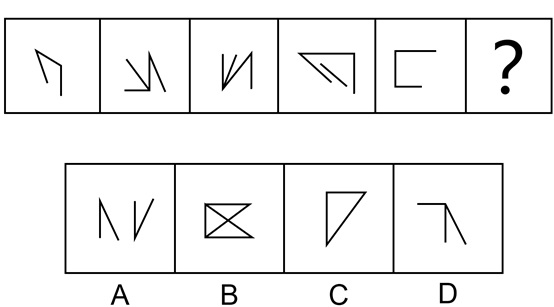

# 图形推理-数量规律（交点数）

考点：[[20-考点/判断推理/图形推理/图形推理-数量规律（交点数）|图形推理 / 图形推理-数量规律（交点数）]]

**问法模型**：问号处填入最合适图形使之呈现规律性 → 元素组成不同先查属性，属性无规律时数数量（本题锁定交点数）

## 推理链
1. 第1步：观察题干五幅图，元素组成不同，且无对称、封闭、曲直等明显属性规律
2. 第2步：图形线条交叉明显（如第2、3、4图均有多条直线相交），按'属性不行数数量'的思路，优先考虑数交点
3. 第3步：逐图清点线条相交形成的交点数：图1两线相接处2个，图2、图3、图4线条交叉各形成2个交点，图5开口折线的两处拐角相接点亦为2个，题干五图交点数恒为2
4. 第4步：由此确定规律为'交点数=2'，问号处图形交点数也应为2
5. 第5步：对照选项清点交点：B项矩形加内交叉线交点远多于2，C项三角形有3个顶点交点，D项折线加斜线交点为3个，均排除；A项交点恰为2个，符合规律

**最快解法**：⚡ 数交点法+排除法：题干线条交叉明显，快速数得各图交点均为2；对比选项，C为3、B明显多于2、D为3，直接锁定A

## 易错点
- ⚠ 把端点、线段头尾误当交点，或漏数折线拐角处两线相接的交点（如题干图1、图5）
- ⚠ 见到B项'矩形+X'误往封闭区域数、C项三角形误数面或线，偏离交点规律
- ⚠ 交点与切点、顶点混数时口径不统一，导致题干计数前后矛盾

## 母题抽象
> 🧩 当图形元素组成不同、属性规律（对称/封闭/曲直/直角）均不成立且线条交叉明显时，优先数交点，验证题干各图交点数是否恒定，再选交点数相同的选项

**同类特征**：元素组成不同、无属性规律、线条交叉明显、由多条直线/折线构成、交点数量恒定、数量规律优先

## 相关题
- [[10-真题/判断推理/图形推理/2571740 图形推理-数量规律（交点数）|2571740]]（山东 2020，相关度4）
- [[10-真题/判断推理/图形推理/2042102 数量规律-交点数（点数量递增）|2042102]]（江苏 2017，相关度3）
- [[10-真题/判断推理/图形推理/2136734 数量规律-一笔画（奇点数与最少笔画数）|2136734]]（河南 2017，相关度3）
- [[10-真题/判断推理/图形推理/2452533 图形推理-数量规律（数交点）|2452533]]（江苏 2020，相关度3）
- [[10-真题/判断推理/图形推理/12019740 数量规律-交点数（曲直交点）|12019740]]（浙江 2026，相关度2）

---

### 题干

从所给的四个选项中，选择最合适的一个填入问号处，使之呈现一定的规律性。

### 选项
- A. A　✅
- B. B
- C. C
- D. D

### 官方解析
元素组成不同，且无明显属性规律，考虑数量规律。观察发现，图形线条交叉明显，考虑数交点，题干每个图形交点的数量都是2，故问号处图形交点的数量也应该为2，只有A项符合。
故正确答案为A。

### 给定材料
（无）
