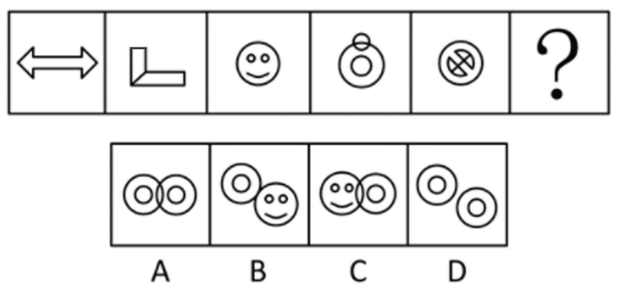

# 数量规律-数面（封闭区域数）

考点：[[20-考点/判断推理/图形推理/数量规律-数面（封闭区域数）|图形推理 / 数量规律-数面（封闭区域数）]]

**问法模型**：'填入问号处使之呈现规律性'且元素组成不同→先试属性规律（对称性），属性不通转数量规律，数封闭区域（面）找递增规律

## 推理链
1. 第1步：题干5个图形元素组成各不相同（空心双箭头、L形折角、笑脸、套圆、圆内X），无相同元素可考虑位置或样式规律
2. 第2步：按'元素组成不同优先属性规律'检查对称性：图1、3、4、5较规整似轴对称，但图2（L形折角）不是轴对称图形，对称规律被否定
3. 第3步：观察到每个图形'窟窿'（封闭区域）明显，转数面：图1空心箭头1个面、图2折角2个面、图3笑脸（外圆+两只眼睛小圆）3个面、图4（顶部小圆与大圆相交+圆内小圆）4个面、图5（圆内X分割含小圆）5个面，面数为1、2、3、4、5的等差递增数列
4. 第4步：由规律推定问号处图形应含6个面
5. 第5步：逐项数面：A项两个双圆相交共5个面，B项双圆(2)+笑脸(3)分离共5个面，D项两图分离共4个面，C项笑脸（大圆被相交分割成2块+两只眼）与双圆（外圆+内圆）相交合计6个面
6. 第6步：只有C项面数为6，符合等差规律，故选C

**最快解法**：⚡ 数面法：见'窟窿'明显图形直接数封闭区域，题干验证1~5递增后，快速数选项面数——A为5、B为5、D为4、C为6，唯一6个面的C即为答案

## 易错点
- ⚠ 先入为主走对称性：图1、3、4、5看似轴对称，容易在图2上反复纠结而延误切换到数量规律
- ⚠ 数面漏项：笑脸的两只眼睛小圆、图4顶部小圆与大圆相交多分割出的一块封闭区易漏数
- ⚠ 相交图形误算：C项两图相交处被分割出独立封闭面，若误按'两图面数简单相加（3+2=5）'会错选B

## 母题抽象
> 🧩 当图形元素组成不同且封闭空间（窟窿）明显时，先数面验证等差/常数规律，再按面数量筛选选项；含相交图形时重叠分割出的区域要单独计面

**同类特征**：元素组成不同、图形规整但图2破坏对称规律、每个图形窟窿（封闭区域）明显、面数量1~5等差递增、选项为两图形组合（分离/相交）

## 相关题
- [[10-真题/判断推理/图形推理/2742183 数量规律-面数量（封闭区域数）+图形种类数二级验证|2742183]]（江苏 2021，相关度2）
- [[10-真题/判断推理/图形推理/10204454 数量规律-部分数（黑白球连通区域数做和）|10204454]]（甘肃 2024，相关度1）
- [[10-真题/判断推理/图形推理/10204604 数量规律-线数量（汉字横线数）|10204604]]（辽宁 2024，相关度1）
- [[10-真题/判断推理/图形推理/10297050 数量规律-特殊计数（线条穿过小白球的数量）|10297050]]（天津 2025，相关度1）
- [[10-真题/判断推理/图形推理/10297127 图形间关系-相交图形中不相交边数量（黑白图形相交）|10297127]]（天津 2025，相关度1）

---

### 题干

从所给的四个选项中，选择最合适的一个填入问号处，使之呈现一定的规律性。

### 选项
- A. A
- B. B
- C. C　✅
- D. D

### 官方解析
元素组成不同，优先考虑属性规律，题干图形均比较规整，考虑对称性，但图二不是轴对称图形。继续观察发现，每个图形“窟窿”比较明显，考虑数面，面数量依次为1、2、3、4、5，故问号处图形应该有6个面，只有C项符合。
故正确答案为C。

### 给定材料
（无）
