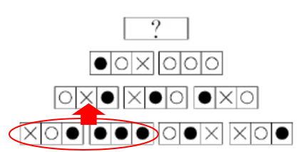

# 样式规律-图形叠加运算（金字塔型三符号'黑白叠加'）

考点：[[20-考点/判断推理/图形推理/样式规律-图形叠加运算（金字塔型三符号'黑白叠加'）|图形推理 / 样式规律-图形叠加运算（金字塔型三符号'黑白叠加'）]]

**问法模型**：金字塔式层叠符号图形，问号在塔顶 → 自下向上由相邻两图逐区域叠加得上层图，先归纳×、○、●三种符号的相加规则，再由顶层两侧图推出问号

## 推理链
1. 第1步：图形呈金字塔排列，底层4图依次为×○●、●●●、○●×、×○●，每图均由左、中、右三个区域构成，符号只有×、○、●三种，问号在最顶层
2. 第2步：按'下层相邻两图对应区域叠加得上层图'，用底层图1（×○●）与图2（●●●）对照第二层图5（○×●）：×+●=○、○+●=×、●+●=●
3. 第3步：再用图2与图3对照图6（×●○）、图3与图4对照图7（●×○）验证：●+○=×、●+×=○、○+×=●，归纳出规则——相异两号相加得第三种符号，相同两号相加仍得原号
4. 第4步：用第二层推第三层复核：图5（○×●）与图6（×●○）逐区叠加得●○×，图6与图7（●×○）叠加得○○○，与图中第三层两图完全一致，规则成立
5. 第5步：求问号＝第三层图8（●○×）与图9（○○○）逐区叠加：左区●+○=×，中区○+○=○，右区×+○=●
6. 第6步：问号图应为×○●；对照选项，A（○×●）、B（●○×）左区不符，D（×●○）中区不符，仅C（×○●）全部吻合

**最快解法**：⚡ 排除法＋逐格叠加：只需先算问号两图最左区'●+○'，由'异号相加得第三号'得×，即可排除A、B；再算中区'○+○'，由'同号相加得原号'得○，排除D，锁定C，无需完整验证全塔

## 易错点
- ⚠ 套用两图叠加的旧口诀（去同存异/去异存同），而未针对三种符号逐区域重新建立映射
- ⚠ 漏推同号相加规则（●+●=●、○+○=○），误判中间区域而错选D
- ⚠ 把运算方向弄反（自上而下）或找错'相邻两图'的对应区域导致规则归纳错误

## 母题抽象
> 🧩 当图形呈金字塔（三角形）层叠且每图由固定三格符号（×、○、●）构成时，用'下层相邻两图逐格叠加得上层图'模型：相异两号相加得第三号，同号相加仍得原号，最后对问号左右两侧图逐格运算即可定答案

**同类特征**：金字塔/三角形层叠排列、每图分左中右三格区域、符号仅×、○、●三种、相邻两图叠加运算、黑白叠加的扩展变式、自下向上推导

## 相关题
（暂无）

---

### 题干

从所给的四个选项中，选择最合适的一个填入问号处，使之呈现一定的规律性。

### 选项
- A. A
- B. B
- C. C　✅
- D. D

### 官方解析

本题为金字塔类题目，自下向上找规律，即下层相邻的两幅图之间进行运算得到上面的一幅图。

每幅图都由横向的三个区域构成，每个区域存在三种可能性：×、和。通过对应区域的运算可知：×+=，+=×，+=，+=×，+×=，+×=，+=。将从上往下数第二行两幅图形对应区域进行运算，最左侧区域：+=×，排除A、B两项；中间区域：+=，排除D项。

故正确答案为C。

### 给定材料
（无）

> [!warning] 疑点（官方解析可能有误，待人工复核）
> 官方解析中运算式符号显示缺失（如'×+=，+=×'等），且'●+×=○'重复罗列、未明确写出'同号相加得原号'的一般规则；但按图中图形逐区域验证，推导过程与答案C一致，不存在实质矛盾

<!-- CODEX-ANSWER-REVIEW:BEGIN -->
### 本次独立复核

**复核状态：** `resolved`（答案与解析已核定）

**计分答案：** C（可计分）

**复核解析：**

从下层相邻图形按三个对应位置逐位运算。固定公式图可恢复六条关系：×与●得○；○与●得×；●与●得●；○与×得●；●与×得○；○与○得○。将第二层两图逐位合成，左格为×、中格为○、右格为●，对应C。

**相关信息：**

图形叠加—逐位置建立有限符号运算表；应先用已知相邻单元确定规则，再逐位应用到缺项。

**题源依据：** [固定版本原题](https://github.com/Mentat-Uran/kaogongzhentizhengliu/blob/84ab93d4b64b61d897bece8a1c0a5bab06b4feb2/10-%E7%9C%9F%E9%A2%98/%E5%88%A4%E6%96%AD%E6%8E%A8%E7%90%86/%E5%9B%BE%E5%BD%A2%E6%8E%A8%E7%90%86/2395210%20%E6%A0%B7%E5%BC%8F%E8%A7%84%E5%BE%8B-%E5%9B%BE%E5%BD%A2%E5%8F%A0%E5%8A%A0%E8%BF%90%E7%AE%97%EF%BC%88%E9%87%91%E5%AD%97%E5%A1%94%E5%9E%8B%E4%B8%89%E7%AC%A6%E5%8F%B7'%E9%BB%91%E7%99%BD%E5%8F%A0%E5%8A%A0'%EF%BC%89.md)；固定内容 commit `84ab93d4b64b61d897bece8a1c0a5bab06b4feb2`，Markdown blob `c07b647f84746fe7157c2b489f0cfdff2164f992`。
<!-- CODEX-ANSWER-REVIEW:END -->
