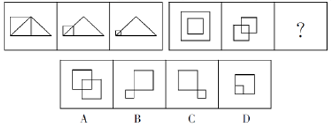

# 图形推理-动态位置规律（元素以固定基点缩放，参照元素不变）

考点：[[20-考点/判断推理/图形推理/图形推理-动态位置规律（元素以固定基点缩放，参照元素不变）|图形推理 / 图形推理-动态位置规律（元素以固定基点缩放，参照元素不变）]]

**问法模型**：两组图对照类比填问号 → 先在第一组找'谁变谁不变+变化方式'，再将规律原样套到第二组验证选项

## 推理链
1. 第1步：第一组三个图均由'正方形+三角形'两个元素构成，三角形大小、位置逐图不变，正方形逐图变小
2. 第2步：细看缩放方式——正方形以左下角为基点缩小，即锚定左下角不动、仅尺寸收缩，并非整体平移
3. 第3步：第二组图1为'外框大正方形内嵌中间小正方形'，图2中外框正方形以左下角为基点缩小后移到左下位置，中间正方形不动，两图由内嵌变为部分重叠
4. 第4步：按规律类推图2到问号处：左边（原外框）正方形继续以左下角为基点缩小，中间正方形保持不变
5. 第5步：逐项对照——D项两方为内嵌关系（等于退回图1状态，排除）；C项两方仅角接触、无重叠（缩小过度或位置不符，排除）；A项左下方形未继续缩小、重叠区域偏大（排除）；B项左下小正方形比图2更小、与不变的大正方形仍保持轻微重叠，完全吻合
6. 第6步：故问号处应填B

**最快解法**：⚡ 动态缩放定位法：先锁定'不变元素'作参照（第一组三角形、第二组中间正方形），再确认变化元素'以左下角为基点逐图缩小'；第二组问号处小正方形应比图2更小且仍与大正方形轻微重叠，直接排除内嵌的D、分离的C、未缩小的A，锁定B

## 易错点
- ⚠ 把规律误判为'图形平移'而忽略是'以基点缩放（尺寸逐图变小）'
- ⚠ 忽略基点位置：缩放锚定在左下角而非中心，按中心缩小的思路会误选C或D
- ⚠ 忽略重叠程度的渐变：问号处小正方形应比图2更小但仍与大正方形有轻微重叠，误选完全分离不接触的C

## 母题抽象
> 🧩 当两组图中每幅图都由两个元素构成且其中一元素逐图变小时，先找'不变元素'作参照，再定位变化元素的缩放基点（如左下角），第二组按同款'基点缩放'规律检验选项的相对大小与位置关系（内嵌/重叠/分离）即可秒杀

**同类特征**：两组图对照类比、每图两个元素（正方形+三角形 / 双正方形）、一元素不变、一元素逐图缩小、缩放基点固定为左下角、位置关系渐变：内嵌→重叠→更小重叠

## 相关题
- [[10-真题/判断推理/图形推理/17619288 图形推理-元素种类与个数（求同规律-公共元素保留）|17619288]]（上海 2021，相关度1）
- [[10-真题/判断推理/图形推理/2262897 样式规律-元素组合（上中下部位拼合：形状与阴影分源传递）|2262897]]（选调 2016，相关度1）
- [[10-真题/判断推理/图形推理/2374819 样式规律-黑白运算（阴影叠加求并）|2374819]]（广东 2019，相关度1）
- [[10-真题/判断推理/图形推理/2461701 两组图类比-位置规律（整体顺时针旋转90°）+数量规律（圆圈-短线个数递变）综合|2461701]]（选调 2020，相关度1）

---

### 题干

从所给的四个选项中，选择最合适的一个填入问号处，使之呈现一定的规律性。

### 选项
- A. A
- B. B　✅
- C. C
- D. D

### 官方解析
观察第一组图形发现，图1到图2，正方形以左下角为基点缩小，三角形不变；图2到图3，正方形以左下角为基点继续缩小，三角形不变。第二组也应遵循此规律，从图1到图2外框正方形以左下角为基点缩小，中间的正方形不变；从图2到？处，左边的正方形继续以左下角为基点缩小，中间的正方形不变，只有B项符合。
故正确答案为B。

### 给定材料
（无）
