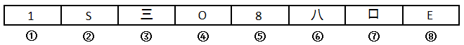

# 属性规律-曲直性（全直线-全曲线分组）

考点：[[20-考点/判断推理/图形推理/属性规律-曲直性（全直线-全曲线分组）|图形推理 / 属性规律-曲直性（全直线/全曲线分组）]]

**问法模型**：‘八个图形分为两类，使每一类都有自己的特性和规律’→ 分组分类题，找每组图形共同属性（本题按线条曲直二分）

## 推理链
1. 第1步：题干八个图形为数字/字母/汉字/方框等字符类图形，元素组成不同，优先考虑属性规律（对称、曲直、开闭）
2. 第2步：逐图观察线条构成——①数字'1'为竖直直线、③汉字'三'为三条水平直线、⑦方框'□'为四条直线段、⑧字母'E'为直线段组成
3. 第3步：②字母'S'、④字母'O'、⑤数字'8'均由曲线构成，⑥汉字'八'的撇、捺为曲线笔画，四图皆为全曲线图形
4. 第4步：按曲直性二分：全直线组①③⑦⑧，全曲线组②④⑤⑥
5. 第5步：对照选项，B项'①③⑦⑧，②④⑤⑥'与该分组完全一致

**最快解法**：⚡ 属性规律口诀（对称、曲直、开闭）中的‘曲直扫描’：快速判定每个图形‘只含直线’还是‘只含曲线’——①③⑦⑧全直线，②④⑤⑥全曲线，直接锁定B

## 易错点
- ⚠ 把汉字'八'的撇、捺笔画误认为直线笔画而分入直线组，易误选D
- ⚠ 元素组成不同时未优先考虑属性规律，转而纠结对称性或封闭区域个数（如O、8、□封闭，1、S、三、八、E开放）导致无法两分
- ⚠ 数字'8'与方框'□'同为字符且外形相近，易混淆其线条属性（8为曲线、□为直线）

## 母题抽象
> 🧩 当分组分类题中图形元素组成差异明显、数量规律不统一时，优先用‘曲直性扫描’（全直线/全曲线/直+曲）对图形二分，再对照选项验证

**同类特征**：八个图形元素分为两类、字符类图形（数字/字母/汉字/方框）、图形元素组成不同、属性规律优先、全直线图形、全曲线图形

## 相关题
- [[10-真题/判断推理/图形推理/5833625 图形推理-属性规律（曲直性）|5833625]]（选调 2020，相关度2）
- [[10-真题/判断推理/图形推理/11367775 属性规律-对称性（对称轴数量等差递减）|11367775]]（江苏 2025，相关度1）
- [[10-真题/判断推理/图形推理/1791814 属性规律-对称性（中心对称）|1791814]]（江苏 2016，相关度1）
- [[10-真题/判断推理/图形推理/2037764 数量规律-数三角形个数（可重合计数，等差递增）；辅以一笔画属性验证|2037764]]（浙江 2016，相关度1）
- [[10-真题/判断推理/图形推理/2037766 属性规律-对称性（中心对称判定）|2037766]]（浙江 2016，相关度1）

---

### 题干

将下面八个图形元素分为两类，使每一类都有自己的特性和规律、则分类正确的是：

### 选项
- A. ①②③⑦⑧，④⑤⑥
- B. ①③⑦⑧，②④⑤⑥　✅
- C. ①②⑦，③④⑤⑥⑧
- D. ①②⑧，③④⑤⑥⑦

### 官方解析
图形元素组成不同，优先考虑属性规律。观察题干图形发现，图②④⑤⑥为全曲线图形，图①③⑦⑧为全直线图形，故①③⑦⑧分为一组，②④⑤⑥分为一组。
故正确答案为B。

### 给定材料
（无）
