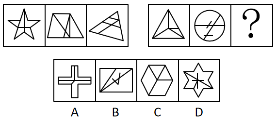

# 数量规律-面数量与内部直线数（两级复合数数）

考点：[[20-考点/判断推理/图形推理/数量规律-面数量与内部直线数（两级复合数数）|图形推理 / 数量规律-面数量与内部直线数（两级复合数数）]]

**问法模型**：两组图类比填问号且元素组成不同 → 先数封闭区域（面）做第一级排除，剩余选项再数局部细节（内部直线数）做第二级定位

## 推理链
1. 第1步：题干两组图元素组成不同、样式各异，且无明显对称/曲直等属性规律，但每幅图都有明显'白色窟窿'（封闭区域），提示优先考虑数面
2. 第2步：数面——第一组三图（五角星、梯形分割图、大三角形分割图）面数量均为5；第二组前两图（三角形分割图、圆形分割图）面数量均为4，故问号处图形面数量应为4
3. 第3步：逐项数面排除——D项面数量不为4，予以排除，剩余A、B、C进入二级辨析
4. 第4步：面数量无法唯一确定答案，转向数局部细节——第一组图内部的直线数均为3，第二组前两图内部直线数均为4，故问号处图形内部直线数应为4
5. 第5步：逐项数内部直线——C项（六边形）内部仅3条直线，不符合；A项内部直线数不为4；B项（矩形）内部含对角线及折线段共4条直线，符合
6. 第6步：面数量4+内部直线数4双重规律均被B项满足，故选B

**最快解法**：⚡ 两级数数排除法：先数面，第一组均5、第二组均4，排除D；再数内部直线，第一组均3、第二组均4，B项内部直线恰为4条，直接锁定B

## 易错点
- ⚠ 只数面数量，发现A、B、C面数均为4后便无从下手，漏掉'内部直线数'这一二级规律
- ⚠ 数内部直线时误把外部轮廓边计入，或漏数B项中的折线（'人'字形）线段
- ⚠ 圆形、星形等图形被分割后的封闭区域易漏数或多数

## 母题抽象
> 🧩 当两组图元素杂乱且每图都有明显封闭区域时，先数面排除明显错误项；若剩余多个选项，再数内部线数、交点数等局部细节做二次定位

**同类特征**：两组图类比填问号、元素组成不同且无属性规律、每图均有明显白色窟窿（封闭区域）、数面后仍有多个候选、需数内部直线数、两级复合数量规律

## 相关题
- [[10-真题/判断推理/图形推理/10204622 图形推理-数量规律-笔画数（一笔画判定）|10204622]]（辽宁 2024，相关度1）
- [[10-真题/判断推理/图形推理/11367773 数量规律-一笔画（奇点数）+面的形状（三角形面个数）双规律|11367773]]（江苏 2025，相关度1）
- [[10-真题/判断推理/图形推理/12019817 数量规律-面的细化（面的形状：所有面均为四边形）|12019817]]（浙江 2026，相关度1）
- [[10-真题/判断推理/图形推理/13504266 数量规律-交点数（曲直交点数量+交点形态交替规律）|13504266]]（云南 2025，相关度1）
- [[10-真题/判断推理/图形推理/13504600 数量规律-多边形元素边数递减（等差数列）|13504600]]（辽宁 2025，相关度1）

---

### 题干

从所给的四个选项中，选择最合适的一个填入问号处，使之呈现一定的规律性：

### 选项
- A. A
- B. B　✅
- C. C
- D. D

### 官方解析
元素组成不同，且无明显属性规律，考虑数量规律。题干图形均出现明显“白色窟窿”，优先考虑数面。第一组图的面数量均为5，第二组图的面数量依次为：4、4、？，故？处应该选择一个面数量为4的图形，排除D项。继续观察发现，第一组图内部的直线数均为3，第二组图内部的直线数依次为：4、4、？，故？处应该选择一个内部的直线数为4的图形，只有B项符合。
故正确答案为B。

### 给定材料
（无）
