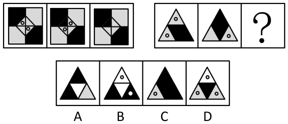
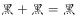
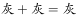
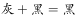

# 样式规律-黑白运算（黑-白-灰三色叠加）

考点：[[20-考点/判断推理/图形推理/样式规律-黑白运算（黑-白-灰三色叠加）|图形推理 / 样式规律-黑白运算（黑/白/灰三色叠加）]]

**问法模型**：两组图'第一组找规律、第二组应用'→ 样式规律之黑白（灰）运算：外部轮廓相同时按相同分割位置逐位叠加列公式，再用排除法代入验证

## 推理链
1. 第1步：两组图元素组成相似，外部轮廓相同（第一组均为'正方形+内接菱形'分割，第二组均为'大三角形内分四个小三角形'），但内部黑/白/灰填充个数不同→优先考虑样式规律中的黑白（灰）运算
2. 第2步：将第一组三个正方形按相同位置（左上、右上、左下、右下、中央菱形）逐一叠加，归纳运算公式：白+黑=黑、白+灰=灰、灰+灰=灰（异色相加取较深色，同色相加不变）
3. 第3步：第二组应用公式先看左下角小三角形：图1为白、图2为灰→白+灰=灰，而A、B项左下角均为黑，排除A、B两项
4. 第4步：再看上方小三角形：图1为白、图2为黑→白+黑=黑，C项上方为黑、D项上方为白（含小球），排除D项
5. 第5步：其余位置复核：中央倒三角形为灰+灰=灰、右下角为黑+白=黑，C项中央为灰、右下为黑，全部吻合
6. 第6步：辅助验证小球个数规律：第一组三图小球之和为4，第二组按规律运算后与C项小球情况相符，锁定C

**最快解法**：⚡ 黑白运算+排除法：先算左下角'白+灰=灰'排除A、B，再算上方'白+黑=黑'排除D，两步即可锁定C，无需验证全部区域

## 易错点
- ⚠ 忽略灰色：套用只有黑、白两色的普通黑白运算公式，导致公式对不上而误排正确选项
- ⚠ 只验证一个区域就下结论：如仅看中央倒三角'灰+灰=灰'无法唯一锁定，须对四个分割区域逐一叠加对照
- ⚠ 忽略小球数量这一辅助规律：当颜色运算后仍存多选项可能时，漏用'第一组小球之和为4'的二级验证易误选带小球的B、D

## 母题抽象
> 🧩 当两组图形外部轮廓相同、内部以相同方式分割且黑/白/灰填充位置个数不同时，用黑白（灰）运算逐位置叠加列公式，再用小球个数等辅助规律二次验证，分步排除锁定答案

**同类特征**：两组图类比、外部轮廓相同、内部黑/白/灰填充不同、分割区域一一对应、小球个数辅助验证、问号处求第三图

## 相关题
- [[10-真题/判断推理/图形推理/2047742 样式规律-黑白运算（同位置叠加）|2047742]]（广东 2017，相关度2）
- [[10-真题/判断推理/图形推理/2045672 样式规律-去同求异（两组图类比型）|2045672]]（广州市考 2017，相关度1）
- [[10-真题/判断推理/图形推理/2049830 图形推理-样式规律-黑白运算|2049830]]（山东 2017，相关度1）
- [[10-真题/判断推理/图形推理/2062790 样式规律-阴影去同存异叠加+旋转180°（两组图类比迁移）|2062790]]（广州市考 2016，相关度1）
- [[10-真题/判断推理/图形推理/2172125 位置规律（翻转+平移，两组图类比）|2172125]]（广州市考 2018，相关度1）

---

### 题干

从所给四个选项中，选择最合适的一个填入问号处，使之呈现一定的规律性：

### 选项
- A. A
- B. B
- C. C　✅
- D. D

### 官方解析

元素组成相似，优先考虑样式规律。外部轮廓相同，内部有黑有白，且黑白的个数不同，考虑黑白运算。第一组的运算公式为：、、；第二组应用规律，三角形左下角，排除A、B两项；三角形上方，排除D项。且观察小球的个数，第一组图小球之和为4，第二组图应用规律时，答案也对应C项。

故正确答案为C。

### 给定材料
（无）

> [!warning] 疑点（官方解析可能有误，待人工复核）
> 官方解析中第一组的运算公式以图片形式呈现、在本题文本中缺失（显示为'运算公式为：、、'），且'小球之和为4'与第二组及C项的具体对应关系表述简略、仅凭文字难以逐项核验小球规律；但左下'白+灰=灰'排除A、B、上方'白+黑=黑'排除D的颜色运算排除链条完整自洽，C为唯一符合项，不影响答案判定

<!-- CODEX-ANSWER-REVIEW:BEGIN -->
### 本次独立复核

**复核状态：** `confirmed`（独立复算确认答案）

**计分答案：** C（可计分）

**复核解析：**

第二组由前两幅图逐格进行黑、白、灰叠加运算。顶部分区：灰+黑→黑；中央倒三角：白+灰→灰；左下分区：灰+灰→灰；右下分区：黑+白→黑。因此目标图四色分区应为顶黑、中央灰、左下灰、右下黑，只有C匹配。圆点数也可独立验证：第一组每组三图共2+2+0=4点；第二组已给两图为2+1=3点，目标须补1点，C正好为1点，A、B、D分别为0、2、3点。两条规律共同唯一确定C。

**相关信息：**

判断推理—黑白灰运算与图形数量；先按对应分区建立颜色运算，再用圆点数作独立交叉验证。

**题源依据：** [固定版本原题](https://github.com/Mentat-Uran/kaogongzhentizhengliu/blob/84ab93d4b64b61d897bece8a1c0a5bab06b4feb2/10-%E7%9C%9F%E9%A2%98/%E5%88%A4%E6%96%AD%E6%8E%A8%E7%90%86/%E5%9B%BE%E5%BD%A2%E6%8E%A8%E7%90%86/2402408%20%E6%A0%B7%E5%BC%8F%E8%A7%84%E5%BE%8B-%E9%BB%91%E7%99%BD%E8%BF%90%E7%AE%97%EF%BC%88%E9%BB%91-%E7%99%BD-%E7%81%B0%E4%B8%89%E8%89%B2%E5%8F%A0%E5%8A%A0%EF%BC%89.md)；固定内容 commit `84ab93d4b64b61d897bece8a1c0a5bab06b4feb2`，Markdown blob `d25cf5f604dad5856a41db39ceca92b9d80ec502`。
<!-- CODEX-ANSWER-REVIEW:END -->
