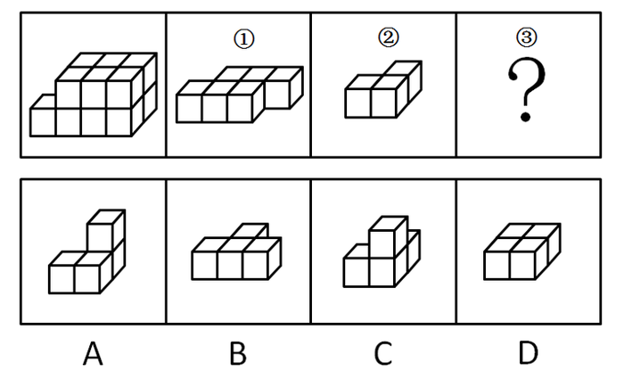
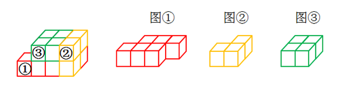

# 立体拼合（小方块组合的三维还原）

考点：[[20-考点/判断推理/图形推理/立体拼合（小方块组合的三维还原）|图形推理 / 立体拼合（小方块组合的三维还原）]]

**问法模型**：题干给出目标立体图及组件①②，问哪项'不能'填入问号处作③ → 选非题，逐项代入验证拼合，能拼合的排除，无法拼合的当选

## 推理链
1. 第1步：目标立体图形由①、②、③三块拼合而成，观察目标图可按'最下面一排'与'上面一排'拆分空位：最下面一排左侧放①，其'右下角'与'上面一排左侧'是另两个组件的落位
2. 第2步：本题为选非题，采用逐项代入验证法：固定图①在最下面一排左侧，再对图②和选项做平移、旋转、翻转、'立起来'等变换试拼
3. 第3步：A项代入——①放最下面一排左侧，②'左右翻转'后放上面一排左侧，A项'立'起来放①右下角的位置，可拼成目标图形，排除
4. 第4步：C项代入——①放最下面一排左侧，②'顺时针旋转'后放上面一排左侧，C项'上下翻转'使单独的方块在下面，放①右下角的位置，可拼成目标图形，排除
5. 第5步：D项代入——①放最下面一排左侧，②'立'起来使单独的方块在下面、放①右下角的位置，D项放上面一排左侧的位置，可拼成目标图形，排除
6. 第6步：B项代入——无论怎样平移、旋转或翻转，均无法与图①②拼成左边的立体图形，故B当选

**最快解法**：⚡ 逐项代入法：先固定图①于最下面一排左侧，再依次给②和选项尝试'平移+旋转+翻转+立起来'四种变换拼合，A/C/D均可拼成目标图形予以排除，唯一无法拼合的B即为答案

## 易错点
- ⚠ 选非题陷阱：问的是'不能填入'，误把能拼合的选项当答案
- ⚠ 三维变换只试平面内旋转而漏掉'翻转'（左右翻转/上下翻转）和'立起来'（竖直放置），导致误判某项拼不上
- ⚠ 未先固定图①的位置就盲目试拼，或忽视'单独的方块在下面'等朝向细节，拼合方向搞反

## 母题抽象
> 🧩 当题干出现'立体图形由①②③组成/哪项不能填入问号处'时，按选非题处理：先固定大块①的落位，再对小试块逐一尝试平移、旋转、翻转（含立起）等变换验证拼合，能拼合的全部排除，剩下的即为答案

**同类特征**：立体拼合、组件编号①②③、选非题（问'不能'）、小方块组合还原、旋转/翻转/立起来三种空间变换、逐项代入验证

## 相关题
- [[10-真题/判断推理/类比推理/10297432 对应关系-工具对应（填空式代入）|10297432]]（四川 2025，相关度1）
- [[10-真题/判断推理/类比推理/12882035 逻辑关系-种属关系与交叉关系辨析（两空式代入法）|12882035]]（内蒙古 2025，相关度1）
- [[10-真题/判断推理/类比推理/19181466 语义关系-种属关系（填空式代入验证）|19181466]]（吉林 2024，相关度1）
- [[10-真题/判断推理/类比推理/19283778 填空式类比-逻辑关系辨析（种属-并列-因果-属性-功能-条件对应）|19283778]]（国考 2025，相关度1）
- [[10-真题/判断推理/类比推理/2045612 填空式类比-代入验证（周期性属性与成像原理的弱对应择优）|2045612]]（广州市考 2017，相关度1）

---

### 题干

左边的立体图形是由①、②和③组成的，下列哪项<b>不能</b>填入问号处？

### 选项
- A. A
- B. B　✅
- C. C
- D. D

### 官方解析

本题考查立体拼合。逐一代入选项进行验证。

A项：图①放在最下面一排左侧的位置，将图②左右翻转，放在上面一排左侧的位置，选项“立”起来，放在图①右下角的位置，可以拼成左边的立体图形，排除；

B项：无法与图①②拼成左边的立体图形，当选；

C项：图①放在最下面一排左侧的位置，将图②顺时针旋转，放在上面一排左侧的位置，选项上下翻转，使得单独的方块在下面，并放在图①右下角的位置，可以拼成左边的立体图形，排除；

D项：图①放在最下面一排左侧的位置，将图②“立”起来，使得单独的方块在下面，并放在图①右下角的位置，选项放在上面一排左侧的位置，可以拼成左边的立体图形，排除。

本题为选非题，故正确答案为B。

### 给定材料
（无）
