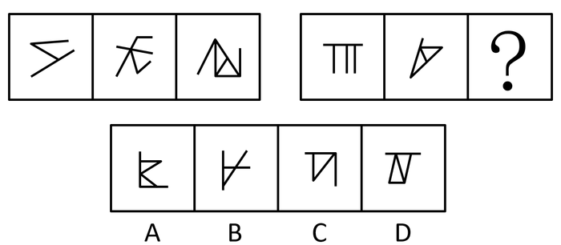

# 数量规律-交点数（线线交叉点计数）

考点：[[20-考点/判断推理/图形推理/数量规律-交点数（线线交叉点计数）|图形推理 / 数量规律-交点数（线线交叉点计数）]]

**问法模型**：两组图类推'填入问号处使之呈现规律性'→ 图形属性无规律时数交点，前组找数列规律，后组延续

## 推理链
1. 第1步：观察图形，元素组成不同、各图均为线段交叉构成，且无对称/封闭等明显属性规律，转向数量规律
2. 第2步：题干线条交叉明显（如第一组图2的十字交叉、图3的N与三角形交叠），优先考虑数交点
3. 第3步：数第一组交点数：图1两条折线交叉处共2个交点，图2共3个，图3共4个，呈2、3、4的等差递增
4. 第4步：第二组图1（п形加两竖线，T字接头）共3个交点，图2（三角形加穿线）共4个交点，延续等差规律，'？'处应为5个交点
5. 第5步：逐项数交点：A项5个，B项3个，C项3个，D项4个
6. 第6步：仅A项为5个交点，与规律吻合，故选A

**最快解法**：⚡ 数交点法：见'线条交叉明显+元素不同'即数交点，先数两组主体图得2、3、4 / 3、4，锁定'？'为5，再快速数选项，A的交叉点最多且恰为5，直接选A

## 易错点
- ⚠ 漏数T字形接头（一条线的端点搭在另一条线上）处的交点，如第二组图1的п形两处接头
- ⚠ 把端点、顶点（非线线交叉处）误计入交点数，导致计数偏差
- ⚠ 只看单图孤立找规律，未将两组图联系起来看等差递增（2、3、4→3、4、5）

## 母题抽象
> 🧩 当图形元素组成不同、属性（对称/封闭/曲直）无规律且线条交叉明显时，用数交点法，验证两组图交点数是否构成等差数列并延续到问号处

**同类特征**：元素组成不同、无明显属性规律、线条交叉明显、数交点、两组图等差递增、问号处补齐数列

## 相关题
- [[10-真题/判断推理/图形推理/12561847 数量规律-交点数（等差数列）|12561847]]（浙江 2024，相关度3）
- [[10-真题/判断推理/图形推理/16593132 数量规律-点数量（切点数）|16593132]]（甘肃 2024，相关度3）
- [[10-真题/判断推理/图形推理/17097256 数量规律-交点数（交点数相同再比交点分布位置）|17097256]]（山西 2024，相关度3）
- [[10-真题/判断推理/图形推理/17467550 数量规律-交点数（九宫格按行等差递增）|17467550]]（湖北 2026，相关度3）
- [[10-真题/判断推理/图形推理/1752676 数量规律-交点数（分组分类）|1752676]]（北京 2016，相关度3）

---

### 题干

从所给的四个选项中，选择最合适的一个填入问号处，使之呈现一定的规律性：

### 选项
- A. A　✅
- B. B
- C. C
- D. D

### 官方解析
图形元素组成不同，且无明显属性规律，优先考虑数量规律。观察发现，题干和选项均是线与线相交，线条交叉明显，考虑数点。题干第一组图形的交点数依次为2、3、4，第二组图形的交点数依次为3、4，“？”处图形应有5个交点。A项有5个交点，B项有3个交点，C项有3个交点，D有4个交点。
故正确答案为A。

### 给定材料
（无）
