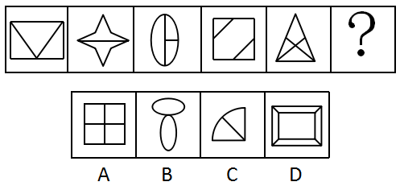

# 属性规律-对称性（对称轴数量周期交替）

考点：[[20-考点/判断推理/图形推理/属性规律-对称性（对称轴数量周期交替）|图形推理 / 属性规律-对称性（对称轴数量周期交替）]]

**问法模型**：问号处填入图形使整组呈现规律性 → 元素组成不同时优先看属性规律，本题数每幅图的对称轴条数找数量规律

## 推理链
1. 第1步：题干五图元素组成不同（矩形内嵌V形、横扁四角星、椭圆内加线、正方形切左上/右下两角、三角形内加线），位置与样式无明显规律，按'属性优先'思路考查对称性
2. 第2步：逐图数对称轴——图1矩形+V形仅1条竖直对称轴；图2横扁四角星有横、竖2条对称轴；图3椭圆加内线仅1条竖轴；图4切角正方形沿两条对角线各1条、共2条；图5等腰三角形加内线仅1条竖轴
3. 第3步：对称轴数量依次为1、2、1、2、1，呈周期交替规律，外推问号处图形对称轴数量应为2
4. 第4步：数选项对称轴——A项'田'字形有4条；B项上下同向双椭圆仅1条竖轴；C项扇形仅角平分线方向1条；D项双重矩形（大矩形套小矩形）有横、竖2条
5. 第5步：仅D项对称轴数量为2，符合'1、2、1、2、1、2'的交替规律，当选

**最快解法**：⚡ 对称轴计数法+周期外推：给题干各图快速标注对称轴条数得1、2、1、2、1，锁定问号处需2条对称轴，排除A(4条)、B(1条)、C(1条)，直接选D

## 易错点
- ⚠ 图2四角星被横向拉伸，易按'标准正四角星'经验误数成4条对称轴，实际只有横、竖2条
- ⚠ A项'田'字有4条对称轴，若只验证'是轴对称图形'而不核对'数量须为2'，易误选A
- ⚠ B项双椭圆外形似'8'字，易误判为横竖2条对称轴，实际上下两椭圆同向排列仅有1条竖轴

## 母题抽象
> 🧩 当一组图形元素组成不同且均为轴对称图形时，数每幅图的对称轴条数找数量规律（常数/递增/周期交替），按规律外推问号处的数量再去选项中匹配

**同类特征**：元素组成不同、全部为轴对称图形、对称轴数量1、2交替、属性规律优先、五图连排+问号顺推

## 相关题
- [[10-真题/判断推理/图形推理/11367775 属性规律-对称性（对称轴数量等差递减）|11367775]]（江苏 2025，相关度2）
- [[10-真题/判断推理/图形推理/2137206 属性规律-轴对称（对称轴数量递增）|2137206]]（上海 2018，相关度2）
- [[10-真题/判断推理/图形推理/2144525 属性规律-曲直性（线条的曲直组成分类）|2144525]]（选调 2018，相关度2）
- [[10-真题/判断推理/图形推理/2144539 属性规律-对称轴数量（按行递变）|2144539]]（选调 2018，相关度2）
- [[10-真题/判断推理/图形推理/2172151 属性规律-对称性（轴对称与非轴对称分组）|2172151]]（广州市考 2018，相关度2）

---

### 题干

从所给的四个选项中，选择最恰当的一个填入问号处，使之呈现一定的规律性（    ）。

### 选项
- A. A
- B. B
- C. C
- D. D　✅

### 官方解析
元素组成不同，优先考虑属性规律。观察发现，题干图形均为轴对称图形，并且对称轴的数量依次为1、2、1、2、1，则问号处对称轴的数量应为2。A项对称轴数量为4；B项对称轴数量为1；C项对称轴数量为1；D项对称轴数量为2。
故正确答案为D。

### 给定材料
（无）
