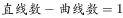
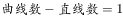

# 数量规律-线数量（直线数与曲线数做差运算）

考点：[[20-考点/判断推理/图形推理/数量规律-线数量（直线数与曲线数做差运算）|图形推理 / 数量规律-线数量（直线数与曲线数做差运算）]]

**问法模型**：六个图形分为两类、每类有各自共同特征 → 分组分类题，属性无规律时分别数直线数与曲线数，单独数不成组就考虑二者做差/做和运算。

## 推理链
1. 第1步：题干六个图形均'有曲有直'，如图①为带竖分隔线的半圆环、图③为缺口圆形、图④为带内弧的碗形。
2. 第2步：元素组成不同且无对称、开闭等属性规律，转向数量规律，分别数直线数与曲线数：直线数依次为3、2、2、1、1、3，曲线数依次为2、1、1、2、2、4。
3. 第3步：单看直线数（3、2、2、1、1、3）或单看曲线数（2、1、1、2、2、4）均无法分成3+3两组，需对二者做运算。
4. 第4步：做差验证——图①②③直线数-曲线数=1（3-2、2-1、2-1）；图④⑤⑥曲线数-直线数=1（2-1、2-1、4-3）。
5. 第5步：按'直-曲=1'与'曲-直=1'分成①②③一组、④⑤⑥一组，对照选项只有A符合。

**最快解法**：⚡ 数线做差法：先确认每图有直有曲，快速数出直线数与曲线数，发现单独数列分不成两组后立即做差，①②③为直-曲=1，④⑤⑥为曲-直=1，锁定A。

## 易错点
- ⚠ 数出直线数或曲线数后急于分组，漏掉'直曲数量做差'这一步运算
- ⚠ 数线遗漏：图①半圆环两端的切口线段及底部竖线易漏（直线数应为3），图③缺口圆的两条半径易漏（直线数应为2）
- ⚠ 误把'有曲有直'当作分组特征本身，或硬套对称性、面数量等其他规律

## 母题抽象
> 🧩 当分组分类题每个图形'有曲有直'且单独数直线或曲线都无法二分时，用'直线数与曲线数做差'，按差值的正负（或数值）分组验证。

**同类特征**：分组分类（六图分两类）、每个图形有直有曲、元素组成不同、无明显属性规律、直线数与曲线数单独均分不成组、直曲数量做差、差值正负各成一组

## 相关题
- [[10-真题/判断推理/图形推理/5510021 图形推理-数量规律（相同小元素的个数）|5510021]]（江西 2023，相关度2）
- [[10-真题/判断推理/图形推理/11454021 数量规律-小元素个数与边数的等量关系（叠加白色同形区域验证）|11454021]]（选调 2024，相关度1）
- [[10-真题/判断推理/图形推理/1752676 数量规律-交点数（分组分类）|1752676]]（北京 2016，相关度1）
- [[10-真题/判断推理/图形推理/19283883 分组分类-特殊元素位置规律（正方形居中-居边）|19283883]]（国考 2025，相关度1）
- [[10-真题/判断推理/图形推理/19283956 数量规律-笔画数（一笔画与多笔画）|19283956]]（国考 2025，相关度1）

---

### 题干

把下面的六个图形分为两类，使每类都有各自的共同特征或规律，分类正确的一项是（    ）。

### 选项
- A. ①②③，④⑤⑥　✅
- B. ①③④，②⑤⑥
- C. ①②④，③⑤⑥
- D. ①④⑥，②③⑤

### 官方解析

本题为分组分类题目。元素组成不同，无明显属性规律，考虑数量规律。观察发现，题干每个图形均有曲有直，分别数出直线数和曲线数发现，直线数依次为3、2、2、1、1、3，曲线数依次为2、1、1、2、2、4，分开看均无法分为两组，考虑二者做运算。图①②③为一组，，图④⑤⑥为一组，，只有A项符合。

故正确答案为A。

### 给定材料
（无）

> [!warning] 疑点（官方解析可能有误，待人工复核）
> 官方解析中'图①②③为一组，，图④⑤⑥为一组'处缺失了具体运算式，按其给出的直线数、曲线数数据可唯一补全为：①②③直-曲=1，④⑤⑥曲-直=1，解析不完整但不影响答案A的正确性。

<!-- CODEX-ANSWER-REVIEW:BEGIN -->
### 本次独立复核

**复核状态：** `confirmed`（独立复算确认答案）

**计分答案：** A（可计分）

**复核解析：**

逐图统计直线与曲线数量。①②③均满足直线数−曲线数=1；④⑤⑥均满足曲线数−直线数=1。按题意分成两类后，与选项A完全一致，故选A。

**相关信息：**

判断推理—数量分组；分别统计直线和曲线，再检查差值及符号，不可只数总线条数。

**题源依据：** [固定版本原题](https://github.com/Mentat-Uran/kaogongzhentizhengliu/blob/84ab93d4b64b61d897bece8a1c0a5bab06b4feb2/10-%E7%9C%9F%E9%A2%98/%E5%88%A4%E6%96%AD%E6%8E%A8%E7%90%86/%E5%9B%BE%E5%BD%A2%E6%8E%A8%E7%90%86/2434290%20%E6%95%B0%E9%87%8F%E8%A7%84%E5%BE%8B-%E7%BA%BF%E6%95%B0%E9%87%8F%EF%BC%88%E7%9B%B4%E7%BA%BF%E6%95%B0%E4%B8%8E%E6%9B%B2%E7%BA%BF%E6%95%B0%E5%81%9A%E5%B7%AE%E8%BF%90%E7%AE%97%EF%BC%89.md)；固定内容 commit `84ab93d4b64b61d897bece8a1c0a5bab06b4feb2`，Markdown blob `b9820a05fb588c5fea671fc624b0c547d9299de0`。
<!-- CODEX-ANSWER-REVIEW:END -->
