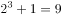
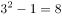
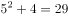
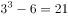
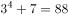
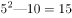

# 图形中的数字推理-幂运算规律（奇偶项交替：左下-顶+右下 - 右下-顶-左下）

考点：[[20-考点/判断推理/图形推理/图形中的数字推理-幂运算规律（奇偶项交替：左下-顶+右下 - 右下-顶-左下）|图形推理 / 图形中的数字推理-幂运算规律（奇偶项交替：左下^顶+右下 / 右下^顶-左下）]]

**问法模型**：图形框架内嵌数字'选最合适的一个呈现规律' → 把角上三个数与中间数建立运算等式，优先尝试幂运算（a^b±c），并按奇偶项交替验证选项

## 推理链
1. 第1步：五幅图均为三角形，角上有三个数字（顶角、左下角、右下角），中间有一个数字，四则运算（如(2+1)×3=9只对前两图成立）无法统一，考虑幂运算
2. 第2步：验证奇数项图：图一 2³+1=9，图三 5²+4=29，图五 3⁴+7=88，规律为'左下角数^顶角数+右下角数=中间数'
3. 第3步：验证偶数项图：图二 3²-1=8，图四 3³-6=21，规律为'右下角数^顶角数-左下角数=中间数'，即底数位置与加减号随奇偶项交替
4. 第4步：问号处为第6幅图（偶数项），应满足：右下角数^顶角数-左下角数=中间数
5. 第5步：逐项代入：A项 3¹-2=1≠10；B项 2²-3=1≠11；C项 1³-4=-3≠5；D项 5²-10=25-10=15，成立
6. 第6步：仅D项满足偶数项公式，故选D

**最快解法**：⚡ 规律口诀'奇加偶减、底换左右'：先用图一 2³+1=9、图二 3²-1=8 两个最简单图形锁定幂运算交替规律，再对问号直接套偶数项公式'右下^顶-左下'，D项 5²-10=15 一步锁定

## 易错点
- ⚠ 思维定式只试加减乘除四则运算，想不到角上数字的幂运算（2³、5²、3⁴），导致卡壳
- ⚠ 忽略奇偶项交替：奇数项以左下角为底做加法、偶数项以右下角为底做减法，若用单一公式统一验证会误判规律'不成立'
- ⚠ B项恰好满足奇数项规律（3²+2=11），若未确认问号处于第6幅（偶数项）位置，易误选B

## 母题抽象
> 🧩 当图形由几何框架加多个数字构成且常规四则运算拼不齐时，优先尝试'角上数字幂运算±第三个数'，并留意奇偶项交替或符号轮换，再代入选项验证

**同类特征**：三角形框架内嵌数字、三角数字+中心数字、中间数远大于/小于角上数字之和（如88、29）、幂运算特征、奇偶项交替规律、数字推理型图形题

## 相关题
（暂无）

---

### 题干

从所给的四个选项中，选择最合适的一个填入问号处，使之呈现一定的规律性。

### 选项
- A. A
- B. B
- C. C
- D. D　✅

### 官方解析

每幅图都有数字，考虑数字推理。观察发现，图一：，图二：，图三：，图四：，图五：，问号处，只有D项符合。

故正确答案为D。

### 给定材料
（无）

> [!warning] 疑点（官方解析可能有误，待人工复核）
> 官方解析中各图的具体计算式缺失（'图一：，图二：…'处为空白），无法逐式核对；但按还原规律（奇数项：左下^顶+右下，偶数项：右下^顶-左下）五幅已知图全部吻合且唯一指向D，与官方答案一致

<!-- CODEX-ANSWER-REVIEW:BEGIN -->
### 本次独立复核

**复核状态：** `confirmed`（独立复算确认答案）

**计分答案：** D（可计分）

**复核解析：**

奇数位图形：中心=左下^顶+右下。2^3+1=9，5^2+4=29，3^4+7=88。偶数位图形：中心=右下^顶−左下。第2图3^2−1=8，第4图3^3−6=21，因此第6图5^2−10=15；选项D顶部2、左下10、右下5、中心15，符合规律。

**相关信息：**

图形推理—奇偶项分组与幂运算；先确认奇偶序列，再检查公式中底数和指数位置。

**题源依据：** [固定版本原题](https://github.com/Mentat-Uran/kaogongzhentizhengliu/blob/84ab93d4b64b61d897bece8a1c0a5bab06b4feb2/10-%E7%9C%9F%E9%A2%98/%E5%88%A4%E6%96%AD%E6%8E%A8%E7%90%86/%E5%9B%BE%E5%BD%A2%E6%8E%A8%E7%90%86/2440214%20%E5%9B%BE%E5%BD%A2%E4%B8%AD%E7%9A%84%E6%95%B0%E5%AD%97%E6%8E%A8%E7%90%86-%E5%B9%82%E8%BF%90%E7%AE%97%E8%A7%84%E5%BE%8B%EF%BC%88%E5%A5%87%E5%81%B6%E9%A1%B9%E4%BA%A4%E6%9B%BF%EF%BC%9A%E5%B7%A6%E4%B8%8B-%E9%A1%B6%2B%E5%8F%B3%E4%B8%8B%20-%20%E5%8F%B3%E4%B8%8B-%E9%A1%B6-%E5%B7%A6%E4%B8%8B%EF%BC%89.md)；固定内容 commit `84ab93d4b64b61d897bece8a1c0a5bab06b4feb2`，Markdown blob `7a9aac63819a8935b523852b801dfd4b244b70b3`。
<!-- CODEX-ANSWER-REVIEW:END -->
