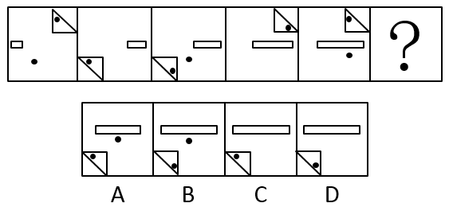
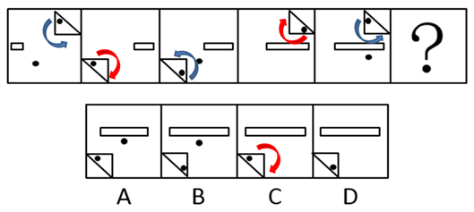

# 数量规律（小黑点个数2、1交替）＋位置规律（时针法判定三角形内黑点方向）

考点：[[20-考点/判断推理/图形推理/数量规律（小黑点个数2、1交替）＋位置规律（时针法判定三角形内黑点方向）|图形推理 / 数量规律（小黑点个数2、1交替）＋位置规律（时针法判定三角形内黑点方向）]]

**问法模型**：问号处填入最合适图形使之呈现规律 → 先找各图共同元素的数量交替规律排除，再对剩余选项的微观位置差异用时针法二级辨析

## 推理链
1. 第1步：题干五幅图均含'小黑点＋直角三角形＋小长方形'，先数小黑点个数：图1=2、图2=1、图3=2、图4=1、图5=2，呈2、1交替规律
2. 第2步：按交替规律，问号处（第6幅）应填小黑点个数为1的图形，先用数量规律排除黑点数为2的A、B
3. 第3步：剩余C、D唯一区别在于直角三角形内部黑点位置不同，需引入时针法作二级辨析
4. 第4步：从三角形内部的黑点出发，经过直角画向另一条直角边：图1、图3、图5均为逆时针，图2、图4均为顺时针，即奇数项逆、偶数项顺
5. 第5步：问号处为第6项（偶数项），时针方向应与图2、图4一致为顺时针
6. 第6步：对照C、D，只有C项'黑点→直角→另一条直角边'为顺时针方向，故选C

**最快解法**：⚡ 排除法＋时针法：先数黑点个数（2、1、2、1、2→？=1）排除A、B；再对C、D画时针——从三角形内黑点出发经直角画向另一条直角边，偶数项（图2、图4）为顺时针，锁定C

## 易错点
- ⚠ 只看到'每图都有黑点'而忽略数量2、1交替规律，误选含2个黑点的A或B
- ⚠ C、D仅三角形内黑点位置有微差，跳过时针方向二级辨析而误选D
- ⚠ 时针法起点与路径顺序画反（未严格按'黑点→直角→另一条直角边'），导致逆/顺判断颠倒而错选D

## 母题抽象
> 🧩 当一组图形含相同元素（如黑点、三角形）且其数量呈交替规律时，先用数量规律排除，再对剩余选项的细微位置差异用时针法（从特征点出发经某顶点画向另一要素）按奇偶项方向交替定答案

**同类特征**：每幅图均含小黑点与直角三角形、小黑点个数呈2、1交替、剩余两项仅三角形内黑点位置不同、时针法路径：黑点→直角→另一条直角边、奇数项逆时针、偶数项顺时针、问号处为第6项（偶数位）

## 相关题
（暂无）

---

### 题干

从四个选项中选最合适的一个填入问号处，使之呈现一定的规律性：

### 选项
- A. A
- B. B
- C. C　✅
- D. D

### 官方解析

题干每幅图均有小黑点，且小黑点的个数分别是：2、1、2、1、2、？，因此问号处应填入小黑点数量为1的选项，排除A、B，剩下C、D两项，对比选项发现唯一区别在于小三角形内部黑点位置不一样；继续观察题干发现，利用时针法从三角形内部的黑点出发，经过直角画向另一条直角边的时候，图1、图3和图5的时针方向一致，均为逆时针，图2、图4的时针方向一致，均为顺时针，如下图所示： 

 

因此问号处应填入和图2、图4时针方向一致的选项，只有C项符合。

故正确答案为C。

### 给定材料
（无）
