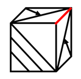

# 空间重构-折纸盒（画边法+公共边法判断相邻面相对位置）

考点：[[20-考点/判断推理/图形推理/空间重构-折纸盒（画边法+公共边法判断相邻面相对位置）|图形推理 / 空间重构-折纸盒（画边法+公共边法判断相邻面相对位置）]]

**问法模型**：‘左边给出的是纸盒的外表图，由它折叠而成的一项是’→ 空间重构折纸盒题，用画边法核对相邻面、用公共边图案核对相对位置，逐一排除。

## 推理链
1. 第1步：将展开图六个面标上序号（a~f），锁定特征面：c面、d面、b面、e面，各面图案为带箭头三角形、空白三角形、阴影斜线等
2. 第2步：方法为画边法（以特征面为起点、按统一时针方向给四条边编号确定相邻面）与公共边法（比对两相邻面公共边两侧的图案）
3. 第3步：B项正面是c面，从c面画边，展开图中边1对应的是d面，而B项中边1对应的不是d面，排除
4. 第4步：C项顶面和右面为面b和面e，展开图中两面公共边挨着面b中带箭头的三角形和面e中的空白三角形，而选项中公共边挨着两个空白三角形，图案细节不符，排除
5. 第5步：D项顶面为c面，从c面画边，展开图中边3对应的是b面，而D项中边3对应的不是b面，排除
6. 第6步：A项各面图案及相邻面相对位置与展开图完全一致，当选

**最快解法**：⚡ 画边法+公共边法：先找图案最独特的面（c面）定位，从该面按统一时针方向给边编号，逐一核对选项中各边对应的相邻面（排除B、D）；再对含三角形的两面看公共边两侧图案（箭头/空白/阴影，排除C），剩余A即正确。

## 易错点
- ⚠ 画边时针方向不一致：展开图与立体图必须从同一起点、按同一方向画边，方向反了会误判相邻面对应关系
- ⚠ 公共边图案细节看错：C项易忽略‘b面带箭头的三角形’与‘空白三角形’在公共边一侧的区别
- ⚠ 只看图案是否出现、不核对图案的指向与相对位置，漏掉B、D中边与面对应关系的错误

## 母题抽象
> 🧩 当题干给出正方体展开图并要求选折叠正确的一项时，用画边法（特征面起点、统一时针方向编号）与公共边法（比对公共边两侧图案及指向），验证每个选项相邻面的对应关系后排除。

**同类特征**：纸盒外表面展开图、‘由它折叠而成的一项是’问法、各面含三角形/箭头/阴影斜线等方向性图案、需判断相邻面相对位置、多个选项共用同一组特征面（如c面）、画边法/公共边法适用

## 相关题
- [[10-真题/判断推理/图形推理/12536419 空间折叠（六面体）-相对面排除与相邻面位置关系（画边法-公共点法）|12536419]]（四川 2024，相关度1）
- [[10-真题/判断推理/图形推理/16593173 空间重构-展开图折叠（相邻面公共边特征）|16593173]]（海南 2024，相关度1）
- [[10-真题/判断推理/图形推理/1805286 空间重构-立体折叠（五棱柱展开图，相邻面黑白关系排除）|1805286]]（上海 2016，相关度1）
- [[10-真题/判断推理/图形推理/18643899 空间重构-纸盒折叠（相邻面公共边定位法）|18643899]]（四川 2026，相关度1）
- [[10-真题/判断推理/图形推理/18650003 空间重构-六面体折叠（相对面关系判定）|18650003]]（选调 2025，相关度1）

---

### 题干

左边给出的是纸盒的外表图，由它折叠而成的一项是：

### 选项
- A. A　✅
- B. B
- C. C
- D. D

### 官方解析

将展开图的面标上序号，如下图所示：

A项：与题干展开图一致，当选；

B项：正面是c面，从c面画边， 如下图所示：

展开图中边1对应是的d面，而B项中边1对应的不是d面，选项与题干不一致，排除；

C项：选项中顶面和右面为面b和面e，如下图所示，题干展开图中面b和面e的公共边挨着面b中带箭头的三角形和面e中的空白三角形：

而选项中两个面的公共边挨着两个面中的空白三角形： 

选项与题干展开图不一致，排除；

D项：顶面为c面，从c面开始画边，如下图所示：

展开图中，边3对应的是b面，而D项中边3对应的不是b面，选项与题干不一致，排除。

故正确答案为A。

### 给定材料
（无）
