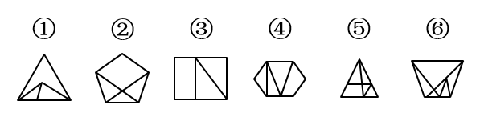

# 数量规律-点与面复合运算（面+点求和重构数列）

考点：[[20-考点/判断推理/图形推理/数量规律-点与面复合运算（面+点求和重构数列）|图形推理 / 数量规律-点与面复合运算（面+点求和重构数列）]]

**问法模型**：‘调换哪两个图形位置使呈现规律’→ 先统一量化每图的数量特征（单一维度不成规律时做面+点求和），找出能补全等差数列的乱序对并交换

## 推理链
1. 第1步：六图元素组成不同、对称/曲直等属性无明显规律，且均为多边形被内部分割、窟窿多、线条交叉明显，优先考虑面数量与点数量
2. 第2步：数面数量，依次为①3、②4、③3、④4、⑤5、⑥6，单独看无规律；再数交点数量，依次为①5、②6、③6、④7、⑤7、⑥7，单独看也无规律
3. 第3步：将两维度做‘面+点’运算，依次得①8、②10、③9、④11、⑤12、⑥13，恰为8~13六个连续整数的乱序排列
4. 第4步：要呈现8、9、10、11、12、13的递增等差规律，需把‘面+点=10’的图②与‘面+点=9’的图③对调，其余图序不动
5. 第5步：逐项验证——A项③④互换得8、10、11、9、12、13；C项③⑤互换得8、10、12、11、9、13；D项②⑤互换得8、12、9、11、10、13，均不能构成连续递增
6. 第6步：仅B项②③互换后得8、9、10、11、12、13的等差规律，与选项对照确定答案为B

**最快解法**：⚡ 面+点求和法+补数定位：快速数出六图面+点依次为8、10、9、11、12、13，发现只差9和10两数错位，直接交换‘和为9’的图③与‘和为10’的图②即可成等差，选B

## 易错点
- ⚠ 只数面或只数点，发现各自无规律便放弃，漏掉‘面+点’二次运算这一复合考点
- ⚠ 交点数漏数：只数外框顶点而漏掉内部分割线与边框或彼此的交叉点，导致求和错误
- ⚠ 凭直觉选交换对：不逐一验证A/C/D互换后的数列是否仍乱序，误以为多组互换都能成规律

## 母题抽象
> 🧩 当图形为‘多边形内部分割、线条交叉’且面数量、点数量单独均无规律时，做‘面+点’求和；若求和恰为一组连续整数的乱序，则交换乱序的两图即可还原等差规律

**同类特征**：‘调换两个图形位置’类问法、六图元素组成不同且属性无规律、多边形被内部分割、窟窿多、线条交叉明显、交点多、面数量单独看为乱序（3、4、3、4、5、6）、点数量单独看无规律（5、6、6、7、7、7）

## 相关题
（暂无）

---

### 题干

以下哪两个图形调换位置之后，使所有的图形能呈现出一定的规律性：

### 选项
- A. ③和④
- B. ②和③　✅
- C. ③和⑤
- D. ②和⑤

### 官方解析
元素组成不同，属性无明显规律，考虑数量规律。题干图形多边形被分割、窟窿较多，优先考虑面数量，各图面数量依次是3、4、3、4、5、6，无规律；题干图形特征还呈现出线条交叉明显，可以考虑点数量，各图点数量依次是5、6、6、7、7、7，单独看无规律，可考虑面和点数量相加做运算，“面+点”依次是8、10、9、11、12、13，所以只要图2和图3互换位置后，这道题就呈现“面+点”数量为8、9、10、11、12、13的规律，对应B项。
故正确答案为B。

### 给定材料
（无）
