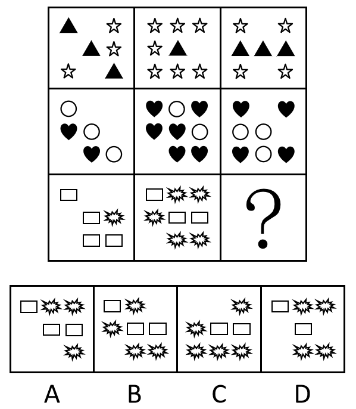

# 数量规律-小元素种类与个数（个数运算：图1+图3=图2＋行间总数递推）

考点：[[20-考点/判断推理/图形推理/数量规律-小元素种类与个数（个数运算：图1+图3=图2＋行间总数递推）|图形推理 / 数量规律-小元素种类与个数（个数运算：图1+图3=图2＋行间总数递推）]]

**问法模型**：九宫格'填入问号使之呈现规律性'→ 每格含多种小元素时，横行统计同类元素个数，找数量间的运算/递推规律并逐项排除

## 推理链
1. 第1步：九宫格每格由两类小元素构成（第一行黑色三角形+空心五角星，第二行黑色心形+空心圆形，第三行空心矩形+黑色爆炸形），元素组成不同且无明显属性规律，转向数量规律，优先数小元素的种类和个数
2. 第2步：九宫格优先横看。第一行五角星个数依次为3、7、4，发现3+4=7，即'图1+图3=图2'的个数运算规律
3. 第3步：第二行验证：心形个数为2、6、4，2+4=6，运算规律成立，确认可用
4. 第4步：第三行爆炸形：图1含1个，图2含5个，由1+？=5得？处应含4个爆炸形；A项3个、C项5个，排除A、C
5. 第5步：启用辅助规律辨析B、D：第一行三角形总数7、第二行圆形总数8，递推第三行矩形总数应为9；图1有4个矩形、图2有3个矩形，故？处应含9-4-3=2个矩形，B项3个矩形排除
6. 第6步：D项含4个爆炸形、2个矩形，同时满足两条规律，当选

**最快解法**：⚡ 元素计数法+排除法：先数第三行爆炸形，套用'图1+图3=图2'（1+?=5）锁定？处4个爆炸形，一步排除A、C；再比较B、D的唯一差别（矩形3个vs2个），用每行某元素总数7→8→9的递推，得出？处矩形应为2个，定D

## 易错点
- ⚠ 只验证出爆炸形的'图1+图3=图2'规律，面对B、D同含4个爆炸形时缺乏二级辨析，不知再看矩形总数
- ⚠ 每格小元素排布散乱，数数时漏数或重数（尤其第二行图2的6个心形、第三行图2的5个爆炸形）
- ⚠ 第二规律仅为7、8、9的等差递推（两个数推第三个数），若死守'每行总数相等'等严格规律，会认为无规律可循而卡壳

## 母题抽象
> 🧩 当九宫格每格由多种小元素堆叠且属性无规律时，按横行分别统计每类元素的个数：先验证'图1+图3=图2'型运算规律排除两项，再用行间同类元素总数的递推关系（如等差）对剩余两项做二级辨析

**同类特征**：九宫格、每格多个小元素且种类不同、黑色实心+空心两类元素搭配、属性无规律转数量、同类元素个数满足图1+图3=图2、选项差异仅在小元素数量

## 相关题
- [[10-真题/判断推理/图形推理/10204610 样式规律-加减同异（去同存异），九宫格列规律|10204610]]（辽宁 2024，相关度1）
- [[10-真题/判断推理/图形推理/10297349 样式规律-黑白运算|10297349]]（浙江 2025，相关度1）
- [[10-真题/判断推理/图形推理/10297407 样式规律-黑白运算（定义叠加）|10297407]]（四川 2025，相关度1）
- [[10-真题/判断推理/图形推理/10975255 数量规律-元素个数与部分数（黑白球连通堆数）|10975255]]（江苏 2024，相关度1）
- [[10-真题/判断推理/图形推理/11367791 属性类-对称性（对称轴方向与条数、轴对称+中心对称）＋数量类-面数量（九宫格横行复合规律）|11367791]]（江苏 2025，相关度1）

---

### 题干

从下列所给的四个选项中，选择最合适的一个填入问号内，使之呈现一定的规律性：

### 选项
- A. A
- B. B
- C. C
- D. D　✅

### 官方解析
元素组成不同，且无明显属性规律，考虑数量规律。观察发现，题干出现多个小元素，优先考虑元素的种类和个数。九宫格优先横着看，第一行中，五角星的个数分别为3、7、4，即3+4=7，满足五角星个数图1+图3=图2；第二行中，心形的个数别为2、6、4，即2+4=6；依据此规律，第三行中爆炸形的个数应满足图1+图3=图2（矩形数量无法满足此规律），即1+？=5，故？处应有4个爆炸形，排除A、C两项；再观察其他元素，发现第一行三角形的总数量为7，第二行圆形的总数量为8，依照此规律，第三行矩形的总数量应为9，故？处应有2个矩形，排除B项。
故正确答案为D。
注：本题第一行三角形总数为7，第二行圆形总数为8，从而得出第三行中矩形总数应为9。此规律不够严谨，一般情况2个数字不优先考虑存在等差规律，但本题B、D两项最明显的差别就是矩形数量，且考查元素的图形特征较为明显，在没有其他更优规律的情况下，只能接受每行元素之和存在的等差规律，其他题目尽量不考虑此种规律。

### 给定材料
（无）

> [!warning] 疑点（官方解析可能有误，待人工复核）
> 官方解析自注：由第一行三角形总数7、第二行圆形总数8推出第三行矩形总数9，仅凭两个数字构建等差，严谨性不足，属'无更优规律下的无奈接受'；但B、D差异确在矩形数量，此瑕疵不影响D为正确答案，备考中此类'两数推等差'规律应谨慎使用

<!-- CODEX-ANSWER-REVIEW:BEGIN -->
### 本次独立复核

**复核状态：** `resolved`（答案与解析已核定）

**计分答案：** D（可计分）

**复核解析：**

主图案数量给出：第一行3+4=7，第二行2+4=6，第三行1+?=5，因此问号处须有4个爆炸形。编辑版另明确给定行总量为7、8、9；第三行矩形须有9个，已知两格共7个，问号格须有2个。只有D同时含4个爆炸形和2个矩形。原题仅凭7、8推9并非严格推论；本答案只适用于补明规则的编辑版。

**修订题干：**

【编者修订版，非原题复原】保留原题九宫格与A—D图形。每行主要图案（五角星、心形、爆炸形）满足“左格数量＋右格数量＝中格数量”；此外，第1行三角形总数、第2行圆形总数、第3行矩形总数构成公差为1的等差数列。问号处选择哪项？

**相关信息：**

图形推理—小元素计数与数量运算。编辑版把跨行公差条件明确加入题干，不把原题两数外推误称为充分证据。

**题源依据：** [固定版本原题](https://github.com/Mentat-Uran/kaogongzhentizhengliu/blob/84ab93d4b64b61d897bece8a1c0a5bab06b4feb2/10-%E7%9C%9F%E9%A2%98/%E5%88%A4%E6%96%AD%E6%8E%A8%E7%90%86/%E5%9B%BE%E5%BD%A2%E6%8E%A8%E7%90%86/2444033%20%E6%95%B0%E9%87%8F%E8%A7%84%E5%BE%8B-%E5%B0%8F%E5%85%83%E7%B4%A0%E7%A7%8D%E7%B1%BB%E4%B8%8E%E4%B8%AA%E6%95%B0%EF%BC%88%E4%B8%AA%E6%95%B0%E8%BF%90%E7%AE%97%EF%BC%9A%E5%9B%BE1%2B%E5%9B%BE3%3D%E5%9B%BE2%EF%BC%8B%E8%A1%8C%E9%97%B4%E6%80%BB%E6%95%B0%E9%80%92%E6%8E%A8%EF%BC%89.md)；固定内容 commit `84ab93d4b64b61d897bece8a1c0a5bab06b4feb2`，Markdown blob `fc6493dcc98a9e1fb2e1280a46b9b9f5ecbffc8a`。
<!-- CODEX-ANSWER-REVIEW:END -->
