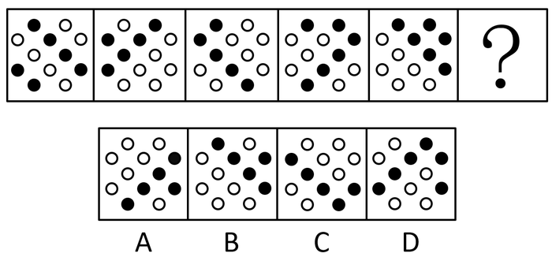

# 位置规律-旋转与平移（圆点阵黑点分组移动）

考点：[[20-考点/判断推理/图形推理/位置规律-旋转与平移（圆点阵黑点分组移动）|图形推理 / 位置规律-旋转与平移（圆点阵黑点分组移动）]]

**问法模型**：五幅图连续排列+问号求第6图→元素组成相同，按位置规律分组追踪黑点的旋转/平移轨迹

## 推理链
1. 第1步：五幅图均为同一圆点阵（内圈+外圈双层排布），每幅图黑点均为4个（内圈2个、外圈2个），元素组成相同→优先考虑位置规律
2. 第2步：将4个黑点按内/外圈拆成两组分别追踪：内部两个黑点沿内圈依次逆时针平移一格，外圈两个黑点连成的直线沿外圈依次顺时针平移一格
3. 第3步：逐图验证——图1到图5中内圈黑点位置依次逆时针移动一格、外圈黑点连线依次顺时针移动一格，轨迹吻合
4. 第4步：从图5出发续推一步：内圈黑点再逆时针平移一格、外圈黑点连线再顺时针平移一格，确定问号处黑点应处的位置
5. 第5步：逐项对照，A、B、C的黑点位置均无法同时满足内圈逆时针、外圈顺时针两条轨迹，只有D项符合

**最快解法**：⚡ 分组追踪法：把4个黑点按内外圈分成两组，对比图1、图2定方向定步长（内圈逆时针1格、外圈连线顺时针1格），从图5各再推一步即锁定D

## 易错点
- ⚠ 把4个黑点当整体观察，两个方向一逆一顺便误判'无规律'，漏掉按内外圈分组拆分这一步
- ⚠ 外圈两个黑点应作为'连线整体'平移一格，误当成两个点各自独立移动会推错位置
- ⚠ 只验证单一轨迹就选答案，忽略内圈与外圈方向、步长不同（内圈逆时针、外圈顺时针），误选A/B/C

## 母题抽象
> 🧩 当多幅图形元素组成相同、仅黑白点位置变化且呈内外圈（分区）结构时，按区域分组追踪各组的旋转/平移方向与步长，再从末图续推一步对照选项

**同类特征**：五图+问号的连续序列、黑白点圆点阵、元素组成相同仅位置改变、内外圈双层结构、黑点分组反向移动、需双重轨迹同时吻合

## 相关题
- [[10-真题/判断推理/图形推理/5676977 位置规律-平移（黑球定步长平移+白球与叉号相对距离等差递增）|5676977]]（上海 2018，相关度1）

---

### 题干

从所给四个选项中，选择最合适的一个填入问号处，使之呈现一定规律性：

### 选项
- A. A
- B. B
- C. C
- D. D　✅

### 官方解析

元素组成基本相同，优先考虑位置规律，如下图所示，四个黑点连成的直线依次逆时针旋转，且内部两个黑点在内圈依次逆时针平移一格，两个黑点连成的直线在外圈依次顺时针平移一格，只有D项符合。

故正确答案为D。

### 给定材料
（无）

> [!warning] 疑点（官方解析可能有误，待人工复核）
> 官方解析首句'四个黑点连成的直线依次逆时针旋转'与后文'外圈两个黑点连线顺时针平移一格'方向表述不一致，应为解析措辞笔误，实际规律应以分组规则'内圈逆时针、外圈顺时针'为准，不影响答案D
