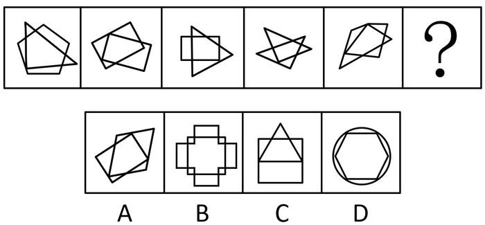

# 图形推理-图形间关系（两图相交，相交面的形状）

考点：[[20-考点/判断推理/图形推理/图形推理-图形间关系（两图相交，相交面的形状）|图形推理 / 图形推理-图形间关系（两图相交，相交面的形状）]]

**问法模型**：问号处填入最合适图形使之呈现规律性 → 题干均为两封闭图形相交，优先观察相交关系及相交面的形状规律

## 推理链
1. 第1步：题干五幅图元素组成不同，且每幅图均由两个封闭图形两两相交构成
2. 第2步：按'图形间关系'思路观察，发现两图均相交于一个封闭区域（相交于面），需进一步看相交面的形状
3. 第3步：逐一检查题干各图的重叠区域，相交面的轮廓均由五条边围成，即相交面形状均为五边形
4. 第4步：由此归纳规律：问号处图形的相交面也应为五边形
5. 第5步：逐项对照：A项两图形相交且重叠区域为五边形，符合；B项为多区域相交，相交面非五边形；C项三角形与矩形相交面非五边形；D项圆与六边形相交面非五边形
6. 第6步：仅A项满足'相交面为五边形'，故选A

**最快解法**：⚡ 相交面形状法——不看两图形本身，只盯两图重叠部分的轮廓数边：题干相交面均为五边形，直接在选项中找相交面为五边形者，仅A符合，一步锁定

## 易错点
- ⚠ 只识别出'两图相交'这一层关系就匆忙选答案，误选C、D等同样相交但相交面不是五边形的选项
- ⚠ 数相交面边数时出错：相交面的边由两图形各自的边线段拼接而成，需沿重叠区域轮廓逐边清点，不能想当然
- ⚠ 忽略B项是多个相交区域（相交于多个面），与题干'相交于一个面'的单一相交关系不符

## 母题抽象
> 🧩 当题干每幅图均为两个封闭图形相交（元素组成不同）时，用'图形间关系—相交面形状'法：先确认相交于面，再数相交面的边数/形状，按相交面形状排除选项验证答案

**同类特征**：两封闭图形相交、相交于一个面、元素组成不同、相交面形状、五边形、图形间关系考点

## 相关题
- [[10-真题/判断推理/图形推理/10297248 图形间关系-相交于面（相交面形状）|10297248]]（浙江 2025，相关度2）
- [[10-真题/判断推理/图形推理/10204454 数量规律-部分数（黑白球连通区域数做和）|10204454]]（甘肃 2024，相关度1）
- [[10-真题/判断推理/图形推理/10204604 数量规律-线数量（汉字横线数）|10204604]]（辽宁 2024，相关度1）
- [[10-真题/判断推理/图形推理/10297050 数量规律-特殊计数（线条穿过小白球的数量）|10297050]]（天津 2025，相关度1）
- [[10-真题/判断推理/图形推理/10297127 图形间关系-相交图形中不相交边数量（黑白图形相交）|10297127]]（天津 2025，相关度1）

---

### 题干

从所给四个选项中，选择最合适的一个填入问号处，使之呈现一定规律性：

### 选项
- A. A　✅
- B. B
- C. C
- D. D

### 官方解析
元素组成不同，且每幅图均为两个封闭图形相交，考虑图形间关系。观察发现，题干图形均是相交于面，考虑相交面的形状。题干所有图形相交面的形状均为五边形，故？处也应选择一个相交面的形状是五边形的图形，只有A项符合。
故正确答案为A。

### 给定材料
（无）
