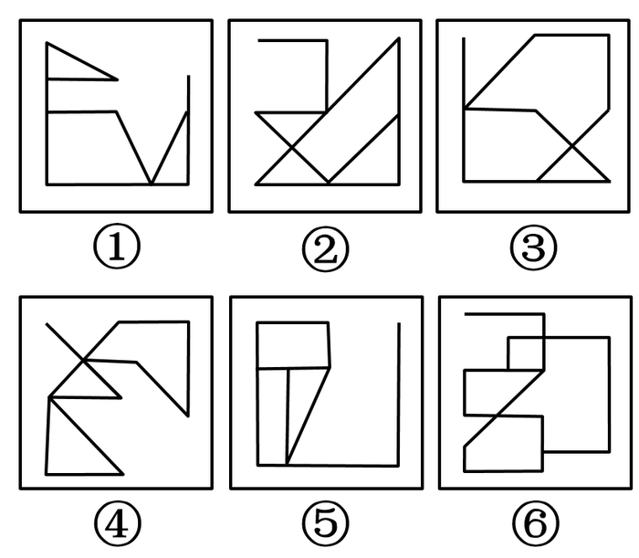

# 数量规律-笔画数（奇点计数）

考点：[[20-考点/判断推理/图形推理/数量规律-笔画数（奇点计数）|图形推理 / 数量规律-笔画数（奇点计数）]]

**问法模型**：“六个图形分为两类，使每一类都有各自共同特征”的分组分类问法 → 元素组成不同且属性规律不通时，转向数量规律，优先检查端点/奇点定笔画数

## 推理链
1. 第1步：观察六图，元素组成不同，对称性、开闭性、曲直等属性规律无法一致分组，但①～⑥每幅图都出现明显“线头/端点”（如①上方三角形右侧尖头、⑤右侧独立竖线的上端点、④左侧交叉出头线），提示笔画数考点
2. 第2步：套用一笔画判定规则——连通图中奇点（引出奇数条线的点，含端点）数为0或2时可一笔画；奇点数为2n时最少笔画数为n笔
3. 第3步：逐点清数图①⑤⑥：每图奇点合计均为4个（出头端点与奇度交叉点合并计入），故均为2笔画图形
4. 第4步：逐点清数图②③④：每图奇点合计均为2个，均为标准一笔画图形
5. 第5步：按笔画数分组——①⑤⑥同为2笔画一组，②③④同为1笔画一组，与选项D“①⑤⑥，②③④”吻合

**最快解法**：⚡ 数奇点定笔画口诀：见到“线头/端点”直接数奇点——奇点2个=一笔画，奇点4个=两笔画；快速扫描得②③④均2个奇点（一笔画）、①⑤⑥均4个奇点（两笔画），锁定D

## 易错点
- ⚠ 只数图上露在外的“线头端点”，漏数线条交叉处引出奇数条线的交点，导致奇点数数错
- ⚠ 忽略一笔画前提是图形连通，误把多部分图形也套用奇点公式
- ⚠ 把“端点多”误判为开闭性等属性规律，在属性维度空耗时间而未转向数量规律

## 母题抽象
> 🧩 当分组分类题元素组成不同、属性规律无效且图形带明显线头端点时，用“数奇点→定笔画数”方法：奇点0或2个为一笔画、奇点4个为两笔画，按笔画数完成二分

**同类特征**：六个图形分组分类问法、元素组成不同、无明显属性规律、每图均有明显端点/线头、线条交叉的连通图、按笔画数一分为二

## 相关题
- [[10-真题/判断推理/图形推理/10204454 数量规律-部分数（黑白球连通区域数做和）|10204454]]（甘肃 2024，相关度2）
- [[10-真题/判断推理/图形推理/10297050 数量规律-特殊计数（线条穿过小白球的数量）|10297050]]（天津 2025，相关度2）
- [[10-真题/判断推理/图形推理/10297262 数量规律-面的形状种类（封闭面种类数分组）|10297262]]（浙江 2025，相关度2）
- [[10-真题/判断推理/图形推理/10297314 数量规律-交点数（曲直交点）|10297314]]（浙江 2025，相关度2）
- [[10-真题/判断推理/图形推理/11454020 数量规律-小元素按行排布（每行个数自上而下递增1）|11454020]]（选调 2024，相关度2）

---

### 题干

把下面的六个图形分为两类，使每一类图形都有各自的共同特征或规律，分类正确的一项是：

### 选项
- A. ①③④，②⑤⑥
- B. ①③⑤，②④⑥
- C. ①②⑥，③④⑤
- D. ①⑤⑥，②③④　✅

### 官方解析
本题为分组分类题目。元素组成不同，且无明显属性规律，考虑数量规律。题干图形均出现明显端点，考虑笔画数，图①⑤⑥的奇点数都是4，为2笔画图形；图②③④的奇点数都是2，为1笔画图形，即①⑤⑥一组，②③④一组。
故正确答案为D。

### 给定材料
（无）
