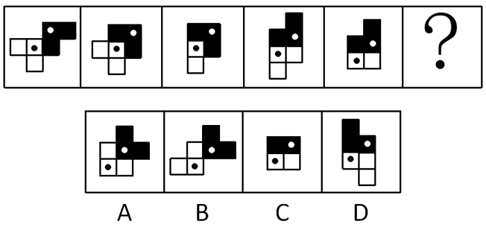

# 位置规律-旋转（黑白子图形分开看、交替旋转）

考点：[[20-考点/判断推理/图形推理/位置规律-旋转（黑白子图形分开看、交替旋转）|图形推理 / 位置规律-旋转（黑白子图形分开看、交替旋转）]]

**问法模型**：问号处填入最合适图形使呈现规律 → 元素组成相同优先考虑位置规律；整体无规律则拆成黑色L形与白色L形两个子图形分别找旋转规律

## 推理链
1. 第1步：五幅图均由一个黑色L形（含白点）和一个白色L形（含黑点）两个子图形构成，元素组成相同，优先考虑位置规律
2. 第2步：整体平移/旋转均无统一规律，故将黑色L形与白色L形'分开看'，逐段比较相邻两图
3. 第3步：图1→图2：黑色L形顺时针旋转，白色L形位置不变
4. 第4步：图2→图3：黑色L形不动，白色L形逆时针旋转，且重叠的小正方形呈现黑色
5. 第5步：图3→图4、图4→图5重复验证：奇数步'黑转白不动'、偶数步'白转黑不动'，交替规律成立
6. 第6步：图5→？为第5步（奇数步），应为黑色L形顺时针旋转、白色L形位置不变，对照选项仅A符合

**最快解法**：⚡ 交替旋转口诀法：奇数步黑L顺时针转、白L不动；偶数步白L逆时针转、黑L不动（重叠显黑）。图4→图5刚完成'白转'，故图5→？回到'黑转白不动'，直接锁定A

## 易错点
- ⚠ 只看图形整体，发现无统一规律后放弃，忽略'黑白两个L形分开看'
- ⚠ 旋转方向记混：黑色L是顺时针、白色L是逆时针且交替进行，方向弄反易误选B或D
- ⚠ 忽略重叠小正方形'呈现黑色'的覆盖细节，误判图形元素在增减

## 母题抽象
> 🧩 当题干图形由两个可分离的子图形构成且整体无规律时，分开看各自的位置变化，若呈'一个转另一个不动'的交替旋转，则按步数奇偶确定下一步谁转、往哪转

**同类特征**：元素组成相同、黑白两个L形子图形、整体无规律→分开看、交替旋转（一个转一个不动）、顺时针与逆时针交替、重叠部分呈黑色

## 相关题
- [[10-真题/判断推理/图形推理/2172768 位置规律（旋转-翻转）|2172768]]（海南 2021，相关度1）
- [[10-真题/判断推理/图形推理/10204458 位置规律-平移（特征交点沿内圈循环平移）|10204458]]（甘肃 2024，相关度1）
- [[10-真题/判断推理/图形推理/10204614 图形推理-位置规律（旋转+翻转交替循环）|10204614]]（黑龙江 2024，相关度1）
- [[10-真题/判断推理/图形推理/10297399 位置规律—平移（多黑块分组循环平移）|10297399]]（四川 2025，相关度1）
- [[10-真题/判断推理/图形推理/11226892 位置规律-九宫格小元素沿固定循环链移动|11226892]]（上海 2025，相关度1）

---

### 题干

从所给的四个选项中，选择最合适的一个填入问号处，使之呈现一定的规律性：

### 选项
- A. A　✅
- B. B
- C. C
- D. D

### 官方解析

图形1、2、4元素组成相同，考虑位置规律。题干图形明显分成黑色L形和白色L形，整体无规律考虑分开看。观察发现，从图一到图二，黑色L形顺时针旋转，白色L形位置不变；从图二到图三，白色L形逆时针旋转，黑色L形位置不变，同时有一块黑色小正方形与白色小正方形重叠，呈现黑色；从图三到图四，黑色L形顺时针旋转，白色L形位置不变；从图四到图五，白色L形逆时针旋转，黑色L形位置不变，同时有一块黑色小正方形与白色小正方形重叠，呈现黑色；根据上述规律，从图五到？处，应该是：黑色L形顺时针旋转，白色L形位置不变，对应A项。

故正确答案为A。

### 给定材料
（无）
