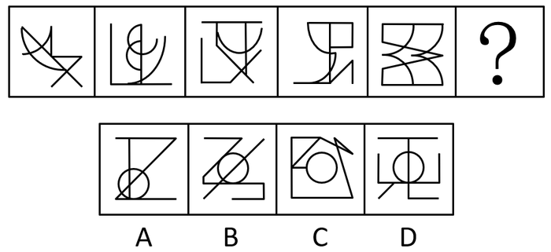

# 数量规律-曲直交点数与曲线数的倍数运算关系

考点：[[20-考点/判断推理/图形推理/数量规律-曲直交点数与曲线数的倍数运算关系|图形推理 / 数量规律-曲直交点数与曲线数的倍数运算关系]]

**问法模型**：'选择最合适的一个填入问号处使之呈现规律性'＋图形中曲线直线交叉明显 → 采用'曲直交点数与曲线数构建运算规律'模型

## 推理链
1. 第1步：题干五幅图元素组成不同，且无对称、封闭、曲直性等明显属性共性，转向数量规律
2. 第2步：观察图形特征，曲线与直线交叉明显（如第1、2幅图弧线与折线大量穿插），锁定数'曲线与直线的交点'
3. 第3步：逐图数曲直交点数，依次为4、6、2、4、8，单独看无递增或循环规律
4. 第4步：再数每幅图曲线条数：2、3、1、2、4，对照发现规律：曲直交点数=曲线数×2（4=2×2、6=2×3、2=2×1、4=2×2、8=2×4）
5. 第5步：问号处图形须满足'曲直交点数=曲线数×2'；代入选项，A/B/C/D均只有1条曲线，故目标曲直交点数应为2
6. 第6步：逐项数曲直交点：A项5个（原图视觉为4个）、B项4个、C项1个、D项2个，仅D项满足2=2×1，故选D

**最快解法**：⚡ 倍数验证法：先数题干曲直交点（4、6、2、4、8）与曲线数（2、3、1、2、4），发现'交点数=曲线数×2'；因四个选项都只有1条曲线，直接找曲直交点恰为2的选项，秒锁D

## 易错点
- ⚠ 只数单一数量（总交点或曲线数）发现无规律就放弃，没想到两组数量间的倍数运算关系
- ⚠ 数交点时误把直线与直线的交点、曲线自身的端点计入'曲直交点'，导致计数偏差
- ⚠ A项图片不清晰致曲直交点数在4与5之间误判，但无论4还是5都不等于2×1，不影响D成立

## 母题抽象
> 🧩 当图形元素组成不同、属性无规律且曲线直线交叉明显时，分别数'曲直交点数'与'曲线数'，验证两者是否成倍数/差值运算关系，再以'曲线数×倍数'反推选项所需交点数

**同类特征**：元素组成不同且无明显属性规律、曲线与直线同时出现且交叉明显、曲直交点数呈运算规律、曲直交点数=曲线数×2、问号处选项均只有一条曲线

## 相关题
- [[10-真题/判断推理/图形推理/14403697 图形推理-数量规律（外框边数与内部元素个数作差恒定分组）|14403697]]（山东 2025，相关度1）
- [[10-真题/判断推理/图形推理/16070043 数量规律-灰色多边形边数与白色面数量的差值运算分组|16070043]]（贵州 2026，相关度1）
- [[10-真题/判断推理/图形推理/16070177 数量规律-部分数（黑白块分堆-同色连通区域数）|16070177]]（重庆 2026，相关度1）
- [[10-真题/判断推理/图形推理/2423328 图形推理-数量规律（内部线条与外框角端点相接个数）|2423328]]（甘肃 2019，相关度1）
- [[10-真题/判断推理/图形推理/2661764 数量规律-数直角个数（组内等差递增）|2661764]]（天津 2019，相关度1）

---

### 题干

从所给的四个选项中，选择最合适的一个填入问号处，使之呈现一定的规律性：

### 选项
- A. A
- B. B
- C. C
- D. D　✅

### 官方解析
图形元素组成不同，且无明显属性规律，考虑数量规律。观察发现，题干出现明显的曲线和直线，且线条交叉明显，考虑数曲线与直线的交点数，分别是：4、6、2、4、8，同时，图形的曲线数为：2、3、1、2、4，发现规律为：图形的曲直交点数是曲线数的两倍。所以？处图形也应该符合此规律。选项中，曲直交点数分别为：5、4、1、2，均只有一条曲线，只有D项满足规律，曲直交点数是曲线数的两倍。
故正确答案为D。
注：本题由于A项图片不清晰，根据原图的视觉效果A项应为4个曲直交点，但放大后，A项应为5个曲直交点，由于考虑到考场的真实情况，所以视频解析中老师是按照考场思维进行讲解的。

### 给定材料
（无）
