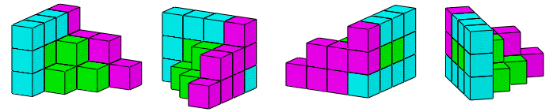

# 立体拼合（三视图定位+逐层扣除求缺失块）

考点：[[20-考点/判断推理/图形推理/立体拼合（三视图定位+逐层扣除求缺失块）|图形推理 / 立体拼合（三视图定位+逐层扣除求缺失块）]]

**问法模型**：给出正方体堆叠多面体的正视图与后视图，问①②③拼合后问号处图形 → 立体拼合模型：先由视图定各层块数上限，再定位大块、逐层扣除缺口得剩余件

## 推理链
1. 第1步：由正视图和后视图提取整体结构信息：'横行和竖列最多均有4个正方体'，即整体底层为4×4骨架，且'第二层最多有3个小立方体'。
2. 第2步：观察已知部件：'②最下方为4个正方体'，'①最下方可以拼为4个正方体'，且'①第二行有3个小立方体'——①②是占格最多的大块，优先定位。
3. 第3步：定方位：'①和②正方体数量最多的行列会放置在主视图的左后方'；再由'第二层最多有3个小立方体'与'①第二行有3个小立方体'对应，确定'①在后视图的最前面'。
4. 第4步：拼合衔接：'②最下面多出来的正方体可以和①最下方缺少的正方体进行拼合'，即①②在底层互补成完整底层骨架。
5. 第5步：逐层扣量求③：拼合①②后'第二层缺少3个正方体'，故③必须含第二层3个正方体，排除第二层块数不符的C、D两项。
6. 第6步：二级辨析A、B：'下层的正方体位置不同'，而'①②拼合后最左侧不缺正方体'，③须补在其余方向的底层缺口处，B的底层方块位置与之吻合，B项当选。

**最快解法**：⚡ 分层扣除法：先读后视图定各层块数上限（底层4、第二层最多3），将①②按'最长行靠后、第二行3块的①靠前'定位并底层互补拼合；逐层扣除得'第二层缺3块'排除C、D；再对A、B做底层缺角位置二级辨析（最左侧不缺块），锁定B。

## 易错点
- ⚠ 只比较选项与①②的总块数，不逐层扣除第二层'缺3个正方体'，误选块数相近但层级分布不符的C或D
- ⚠ 忽视后视图为背面观察（左右与正视图相反），把①'第二行3块'的朝向定位放反，导致缺口方向判断错误
- ⚠ A、B差异仅在底层正方体位置，未做'①②拼合后最左侧不缺正方体'的二级辨析而误选A

## 母题抽象
> 🧩 当题干给出正方体堆叠体的两视图并要求多块拼合时，先用视图确定各层块数上限与最大块部件的靠后/靠前位置，再逐层扣除已拼合部分得剩余缺口形状，最后对同层块数的选项做缺角位置的二级辨析。

**同类特征**：同时给出正视图和后视图、相同正方体堆叠的多面体、三个多面体①②③组合拼合、问号处求缺失部件、选项间仅底层方块位置有细微差异

## 相关题
- [[10-真题/判断推理/图形推理/2448540 立体拼合（多视图还原+组件拼合互补）|2448540]]（国考 2020，相关度1）
- [[10-真题/判断推理/图形推理/2456395 立体拼合（多面体拆分组合-凹凸对应）|2456395]]（浙江 2020，相关度1）

---

### 题干

左图给定的是由相同正方体堆叠而成多面体的正视图和后视图。该多面体可以由①、②和③三个多面体组合而成，问以下哪一项能填入问号处？

### 选项
- A. A
- B. B　✅
- C. C
- D. D

### 官方解析

本题考查立体拼合。

观察题干给出的多面体可知，横行和竖列最多均有4个正方体，其中②最下方为4个正方体，①最下方可以拼为4个正方体，则①和②正方体数量最多的行列会放置在主视图的左后方。根据题干后视图可知，第二层最多有3个小立方体，①第二行有3个小立方体，所以①在后视图的最前面，并且②最下面多出来的正方体可以和①最下方缺少的正方体进行拼合，如上图所示。拼合后可知，第二层缺少3个正方体，排除C、D两项。对比A、B两项可知，下层的正方体位置不同，①②拼合后最左侧不缺正方体，据此B项当选。

故正确答案为B。

### 给定材料
（无）
