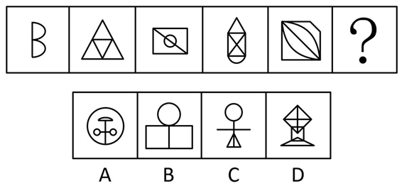

# 数量规律-一笔画（笔画数-奇点计数）

考点：[[20-考点/判断推理/图形推理/数量规律-一笔画（笔画数-奇点计数）|图形推理 / 数量规律-一笔画（笔画数/奇点计数）]]

**问法模型**：问号处填入最合适图形使之呈现规律性 → 元素组成不同且无属性规律时，转向数量规律，优先验证笔画数（一笔画）

## 推理链
1. 第1步：题干五幅图元素组成不同，观察对称、封闭、曲直等属性均无明显统一规律，锁定数量规律
2. 第2步：第一幅图是'日'字变形、第四幅图是'田'字变形，'日''田'是经典一笔画母型，提示用奇点法验证笔画数：奇点数为0或2则一笔画
3. 第3步：逐图数奇点：图1'日'变形奇点2个；图2大三角形内接倒三角形，各交点度数均为偶数、奇点0个；图3矩形加对角线加内切圆，仅对角线所连两角为奇点、共2个；图4'田'变形（六边形内含交叉线）奇点2个；图5正方形加对角线加弧线奇点2个——题干全部为一笔画图形
4. 第4步：逐项数奇点：A项圆内独立十字线条端点多、奇点≥4个，两笔画；C项圆、横线、小三角形组合存在4个奇点，两笔画；D项风筝形内交叉线加底座存在4个奇点，两笔画；B项圆形与下方双格矩形相切，切点及各角点度数均为偶数、奇点0个，一笔画
5. 第5步：只有B项与题干'均为一笔画'的规律一致，故选B

**最快解法**：⚡ 奇点计数法+排除法：由'日''田'变形快速锁定一笔画考点，数各图奇点（度数为奇数的点），题干均为0或2个；选项中只有B奇点数为0（一笔画），A、C、D奇点数≥4（两笔画），直接选B

## 易错点
- ⚠ 漏数T字形交点（度数为3）等奇点，或把相切点误判为奇点导致笔画数算错
- ⚠ 只见多部分图形（如A项圆与内部线条分离）就排除，忽略应按各连通部分最少笔画数相加判断
- ⚠ 在封闭区域数、线条数等常规数量规律上纠缠，未及时由'日''田'变形联想到一笔画高频考点

## 母题抽象
> 🧩 当题干图形元素组成不同、无属性规律，且出现'日''田''中'等字变形或多端点交叉线条时，用奇点计数法验证一笔画规律，选奇点数为0或2的选项

**同类特征**：日字变形、田字变形、元素组成不同、无明显属性规律、多交点/多端点线条、一笔画

## 相关题
- [[10-真题/判断推理/图形推理/19283874 数量规律-一笔画（笔画数-奇点计数）|19283874]]（国考 2025，相关度4）
- [[10-真题/判断推理/图形推理/2280971 图形推理-数量规律-笔画数（一笔画与奇点数）|2280971]]（四川 2018，相关度3）
- [[10-真题/判断推理/图形推理/2742162 数量规律-笔画数（一笔画判定）|2742162]]（江苏 2021，相关度3）
- [[10-真题/判断推理/图形推理/5518363 数量规律-一笔画与部分数|5518363]]（湖北 2021，相关度3）
- [[10-真题/判断推理/图形推理/10204454 数量规律-部分数（黑白球连通区域数做和）|10204454]]（甘肃 2024，相关度2）

---

### 题干

从所给的四个选项中，选择最合适的一个填入问号处，使之呈现一定的规律性：

### 选项
- A. A
- B. B　✅
- C. C
- D. D

### 官方解析
元素组成不同，且无明显属性规律，考虑数量规律。观察发现，题干第一幅图形为“日”字变形，第四幅图形为“田”字变形，考虑笔画数。题干都是一笔画图形，A、C、D三项均为两笔画，B项为一笔画，只有B项符合。
故正确答案为B。

### 给定材料
（无）
