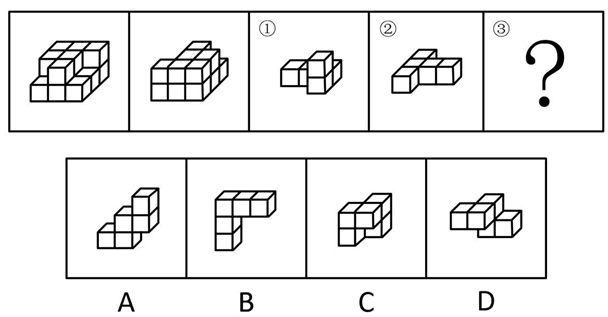
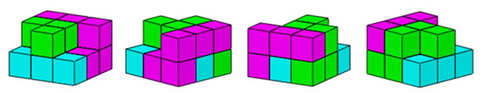

# 立体拼合（多视图还原+组件拼合互补）

考点：[[20-考点/判断推理/图形推理/立体拼合（多视图还原+组件拼合互补）|图形推理 / 立体拼合（多视图还原+组件拼合互补）]]

**问法模型**：题干给出同一多面体的正视图和后视图以及组件①②，求第三组件③ → 立体拼合模型：先由两个相对视角还原整体形状，再把①②嵌入，剩余空位经旋转后与选项凹凸互补者即为答案

## 推理链
1. 第1步：题干说明整体是'由相同正方体堆叠而成多面体'，且左图给出其'正视图和后视图'——两个前后相对的视角互补，可还原出以3×3为底的两层阶梯形整体，前部留有台阶状空缺
2. 第2步：立体拼合规则：①、②、③三个组件均可在空间中三维旋转，拼合时须与整体空位凹凸互补、不重叠不留缝，且满足块数守恒（整体块数=①+②+③）
3. 第3步：先嵌入形状最独特的②（呈L形的长臂组件），使其长臂卡入上层凹槽；再将①（带凸起的小台阶形）放入前部台阶空缺处，二者互不重叠
4. 第4步：观察剩余空位的轮廓：为前后两排错位相接的凹槽形，逐项旋转比对——A为三层阶梯形、B为直角长L形、C为2×2厚实块形，其凸起方向与剩余空位均无法互补
5. 第5步：仅D项经旋转后凸起与凹陷与剩余空位完全咬合，拼合后即还原左图整体，故③为D

**最快解法**：⚡ 立体拼合三步法（先大后小、先角后中）：①由正、后视图还原整体轮廓并粗数块数守恒；②优先嵌入形状最独特的L形组件②；③放入①后，把剩余空位在心里旋转，与四个选项逐一凹凸比对，仅D完全互补

## 易错点
- ⚠ 忽略组件可在三维空间旋转，只按选项图中原始朝向硬套而误判形状不符
- ⚠ 后视图的观察方向与正视图相反（左右、前后镜像），还原整体时方位弄反导致空位形状看错
- ⚠ 只数小正方体个数不验证凹凸形状，误选块数相同但无法嵌入的干扰项（如A、C）

## 母题抽象
> 🧩 当题干给出同一多面体的两个相对视角图并要求补全第三个拼合组件时，用'视图还原整体→嵌入已知组件→剩余空位旋转匹配'的立体拼合流程，同时验证块数守恒与凹凸互补

**同类特征**：相同正方体堆叠的多面体、正视图和后视图（两个相对视角）、①、②和③三个多面体组合、填入问号处（求缺失组件）、立体拼合、凹凸互补

## 相关题
- [[10-真题/判断推理/图形推理/12881949 立体拼合-多块拼合正方体（凹凸互补+旋转）|12881949]]（广东 2025，相关度2）
- [[10-真题/判断推理/图形推理/18649987 立体拼合（多面体拆分组合+旋转匹配）|18649987]]（选调 2025，相关度2）
- [[10-真题/判断推理/图形推理/2719441 立体拼合（多面体切割重组，凹凸互补）|2719441]]（国考 2021，相关度2）
- [[10-真题/判断推理/图形推理/5104943 立体拼合（小方块拼块嵌合）|5104943]]（天津 2022，相关度2）
- [[10-真题/判断推理/图形推理/5510151 立体拼合（小方块数量守恒+凹凸互补）|5510151]]（广西 2023，相关度2）

---

### 题干

左图给定的是由相同正方体堆叠而成多面体的正视图和后视图。该多面体可以由①、②和③三个多面体组合而成，问以下哪一项能填入问号处？

### 选项
- A. A
- B. B
- C. C
- D. D　✅

### 官方解析

本题考查立体拼合，如图所示，立体图可以由①②以及D项拼合而成。

故正确答案为D。

### 给定材料
（无）
