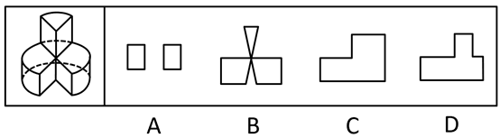
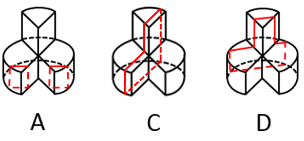

# 截面图（立体图形剖切规律）

考点：[[20-考点/判断推理/图形推理/截面图（立体图形剖切规律）|图形推理 / 截面图（立体图形剖切规律）]]

**问法模型**：“以下哪个不可能是该立体图形的截面”（选非题）→ 对每个选项构造一个剖切平面验证能否截出，唯一无法截出者即为答案

## 推理链
1. 第1步：观察左图立体：顶部为三棱柱（顶面呈三角形、有虚线棱），下部连有半圆柱曲面（虚线弧示曲面轮廓），是“平面+圆柱曲面”的组合体
2. 第2步：调用截面规律——平面截棱柱平面得直线多边形，平面截圆柱曲面得矩形或含弧线图形，倾斜剖切可同时经过不同结构得到组合形状；且单平面截同一连通立体不会产生“仅以一点相连的两片”截面
3. 第3步：A项为两个分离长方形：竖直平面只剖到两个半圆柱“叶片”而避开中间连接部分，即可得到两个各自独立的长方形，故A可截出
4. 第4步：C项为L形（台阶形）：竖直剖切经过半圆柱与相邻较低部分可得；D项为带小凸起的图形：斜向剖切使截面同时经过高、低两部分可得，故C、D均可截出
5. 第5步：B项图形中部收窄成点、左右两片仅以该点相连且上端另有尖角凸起，这种“掐腰点接触”结构无法由任一平面截该立体得到，故B不可能
6. 第6步：本题为选非题，A、C、D均能截出，只有B不可能，故正确答案为B

**最快解法**：⚡ 选非题+排除法：先构造最明显可截出的选项——竖切两侧“叶片”得A的两个长方形、竖切台阶得C的L形、斜切得D的带凸起图形，逐一排除后剩余的B（两片仅点相连的“掐腰”形）即不可能截面

## 易错点
- ⚠ 漏看“不可能/选非”问法，误把能截出的选项当答案
- ⚠ 误以为截面必须是单一连通图形，看到A是两个分离长方形就错选A
- ⚠ 被B的对称外形迷惑，误以为斜切可以截出，忽略单一平面截同一立体不可能产生仅以一点相连的两片截面

## 母题抽象
> 🧩 当题干给出“平面+圆柱曲面”组合立体并问“哪个不可能是截面”时，先对每项构造剖切平面（竖切局部、竖切整体、斜切）排除可截项；若某选项呈“两片仅一点相连”等奇异结构，即为截不出的一项

**同类特征**：截面图、选非题（选不可能项）、组合立体（三棱柱+半圆柱曲面）、两个分离长方形可截出、L形/带凸起形可截出、点相连“掐腰”截面不可能

## 相关题
- [[10-真题/判断推理/图形推理/2367822 立体图形-截面图（镂空框架立体的可截性判断，选非题）|2367822]]（江苏 2019，相关度2）
- [[10-真题/判断推理/图形推理/2262006 立体拼合-小方块组合还原（着色六面体）|2262006]]（广东 2019，相关度1）
- [[10-真题/判断推理/图形推理/2374751 截面图-空心立体（空心圆柱）的截面可能性判断|2374751]]（广东 2019，相关度1）
- [[10-真题/判断推理/图形推理/2374752 空间重构-立方体展开图（相对面判定排除）|2374752]]（广东 2019，相关度1）
- [[10-真题/判断推理/图形推理/2448497 截面图（多面体剖切·选非题）|2448497]]（国考 2020，相关度1）

---

### 题干

左图为给定的立体图形，将其从任一面剖开，以下哪个不可能是该立体图形的截面？

### 选项
- A. A
- B. B　✅
- C. C
- D. D

### 官方解析

本题考查截面图，逐一分析选项。如下图如所示，A、C、D三项均可以截出，B项无法截出。 

 本题为选非题，故正确答案为B。

### 给定材料
（无）
