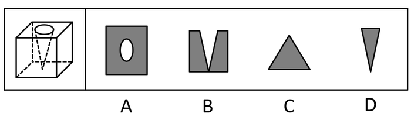

# 截面图-立体挖孔（正方体内挖圆锥孔）截面可切性判定（选非题）

考点：[[20-考点/判断推理/图形推理/截面图-立体挖孔（正方体内挖圆锥孔）截面可切性判定（选非题）|图形推理 / 截面图-立体挖孔（正方体内挖圆锥孔）截面可切性判定（选非题）]]

**问法模型**：题干问'从任意角度剖开，哪一项不可能是它的截面图'（选非）→ 对每个选项反向构造切割平面验证可切性，唯一构造不出切法者即为答案

## 推理链
1. 第1步：题干立体为正方体，顶面开圆形孔口，虚线显示孔壁自圆口向下收敛于底部一点，即内部挖去一个圆锥形孔
2. 第2步：所用方法为构造切面法——外轮廓由切割平面截外立方体得到，孔洞形状由同一平面截内圆锥孔得到，二者必须由同一个平面同时产生、形状必须匹配
3. 第3步：B项——按官方解析'从正上方切入，垂直向下切'，过锥尖的竖直平面截立方体得矩形，截圆锥孔得两条斜边交于锥尖，合成带V形缺口的图形（锥尖近底面时缺口直达底边，与B图两块分离的形状一致），可截出，排除
4. 第4步：C项——按官方解析'从六面体棱上切入，斜切，保证三条边等长'，切面斜切掉一个角且不触及圆孔，得实心等边三角形，可截出，排除
5. 第5步：D项——同样'从六面体棱上切入，斜切'，控制切入深度'保证两条边等长'，得实心等腰三角形，可截出，排除
6. 第6步：A项——'矩形外框+椭圆孔'无法同时实现：水平切时外框是正方形、孔是圆形；斜切虽可能使锥孔截面呈椭圆，但外框随之不再是大致正矩形，或切面会同时截到顶面圆口使孔洞边界不封闭成椭圆，矩形与椭圆无法由同一平面同时截出
7. 第7步：BCD均可确定截出，A无法截出；本题为选非题，故正确答案为A

**最快解法**：⚡ 构造切面法+排除法：先给BCD找到明确切法——B过锥尖竖直下切得V形缺口图，C贴棱斜切不碰孔得等边三角形，D贴棱斜切控深得等腰三角形；再验证A：水平切得'方形+圆孔'、斜切则外框变形或孔不封闭，'矩形+椭圆'构造不出，选A

## 易错点
- ⚠ 选非题看反，把'不可能的截面'当成'可能的截面'，误选能截出的BCD
- ⚠ 误以为斜切就能同时得到'矩形外框+椭圆孔'，忽略外轮廓形状会随切面倾斜而改变（水平切时外框是正方形、孔是圆而非椭圆）
- ⚠ 忽略内部圆锥孔的存在或忽略'外框与孔必须由同一刀（同一平面）同时切出'，只单独验证孔或外框的形状

## 母题抽象
> 🧩 当题干出现'简单立体（正方体/柱体）+内部孔洞，问不可能的截面图'时，用构造切面法逐项验证：先确定产生该外轮廓所需的切面方向，再检验同一平面截孔洞所得形状是否匹配，内外形状无法由同一平面同时产生者即为答案

**同类特征**：正方体内挖圆锥形孔、顶面圆形开口、虚线锥面、问'不可能是截面图'（选非）、选项含'外框+内孔'图与实心三角形图、需逐项构造切割平面验证

## 相关题
（暂无）

---

### 题干

左图为给定的立体，从任意角度剖开，右边哪一项不可能是它的截面图？

### 选项
- A. A　✅
- B. B
- C. C
- D. D

### 官方解析

本题考查截面图，逐一分析选项。

A项：无法切出。

B项：从图形正上方切入，垂直向下切即可得到，排除；

C项：从图形六面体棱上切入，斜切，保证三条边等长，即可得到，排除；

D项：从图形六面体棱上切入，斜切，保证两条边等长，即可得到，排除。

本题为选非题，故正确答案为A。

注：A项截面中椭圆和长方形的中心可能存在重合的情况，但无法确定椭圆和长方形的大小比例、椭圆与长方形框的距离比例、椭圆和长方形的中心重合等是否可以同时满足，而BCD三个选项可以确定能够截出，故粉笔答案定为A项。

### 给定材料
（无）

> [!note] 复核版本状态
> 原题不可计分（official_self_contradiction；来源记录的答案键/竞争项：A）；仅当前明确标注的编辑版按答案A计分。
> 详细原题疑点、修订题面、解析和证据见下方独立复核记录。

<!-- CODEX-ANSWER-REVIEW:BEGIN -->
### 本次独立复核

**复核结论：** `resolved`（答案与解析已核定）

**原题计分状态：** 不计分（`official_self_contradiction`：题源答案或解析与数据复算冲突）。来源中记录的答案键/竞争项：A；这些记录不代表原题已核准答案。

**原题疑点与处理：**

江苏 2020 〔20-考点/判断推理/图形推理/截面图-立体挖孔（正方体内挖圆锥孔）截面可切性判定（选非题）〕 — 官方解析对A项的否定理由（'无法确定椭圆和长方形的大小比例、距离比例、中心重合等是否可以同时满足'）表述偏松、论证力不足；更严格的几何理由是：外框为矩形要求切面…

**当前计分版本：** 明确标注的编辑版；未列出的题干、材料或选项沿用固定题源。答案不回填为原题答案。

**计分答案：** A（可计分）

**复核解析：**

修复版选A。A画有矩形外轮廓和完整闭合椭圆孔；B是向外敞开的三角缺口，C、D是实心三角形，不含闭合椭圆孔。该椭圆确能由同一平面切出：令立方体为[0,1]^3，圆锥孔顶点为(1/2,1/2,0)，z=1处半径为1/4，故锥面满足(x−1/2)^2+(y−1/2)^2=(z/4)^2。取切面z=2(y−1/2)+3/8。它与立方体的截面为矩形，y范围为5/16至13/16、z范围为0至1；令X=x−1/2、Y=y−1/2，锥面交线为X^2+(3/4)(Y−1/16)^2=3/256，是完全落在矩形内、中心与矩形中心重合的椭圆。因此原题把A判为“不可能”是错误的。B可由过圆锥轴的竖直平面切出；C可由x+y+z=1/2切出，且不与圆锥孔相交；D可由10x+10y+2z=1切出，该三角截面也避开圆锥孔。因此原“哪项不可能”没有正确选项。本修复版明确改问闭合椭圆孔，唯一答案A。

**修订题干：**

【编辑修复版：原选非题经几何核验无正确选项】左图为正方体内挖去一个圆锥形孔。下列候选截面中，哪一项包含由切面与圆锥孔相交形成的完整闭合椭圆形孔洞边界？（本题只判断孔洞边界形状。）

**相关信息：**

立体截面—切面与锥面的交线。倾斜切面可使圆锥孔截成椭圆；外轮廓与孔洞边界必须由同一切面共同产生。原题错误与修复版题干均已明确标注。

**核对依据与来源边界：**

- 固定题源：[原题文件](https://github.com/Mentat-Uran/kaogongzhentizhengliu/blob/84ab93d4b64b61d897bece8a1c0a5bab06b4feb2/10-%E7%9C%9F%E9%A2%98/%E5%88%A4%E6%96%AD%E6%8E%A8%E7%90%86/%E5%9B%BE%E5%BD%A2%E6%8E%A8%E7%90%86/2452532%20%E6%88%AA%E9%9D%A2%E5%9B%BE-%E7%AB%8B%E4%BD%93%E6%8C%96%E5%AD%94%EF%BC%88%E6%AD%A3%E6%96%B9%E4%BD%93%E5%86%85%E6%8C%96%E5%9C%86%E9%94%A5%E5%AD%94%EF%BC%89%E6%88%AA%E9%9D%A2%E5%8F%AF%E5%88%87%E6%80%A7%E5%88%A4%E5%AE%9A%EF%BC%88%E9%80%89%E9%9D%9E%E9%A2%98%EF%BC%89.md)；内容版本 `84ab93d4b64b61d897bece8a1c0a5bab06b4feb2`，源 Markdown blob `4c5e2fb5d5807cc14f7d24521944ef010aad4dbb`.
- **核心依据：** 固定版本题图与立体参数的几何构造。令锥面(x−1/2)^2+(y−1/2)^2=(z/4)^2，切面z=2(y−1/2)+3/8，交线精确化为X^2+(3/4)(Y−1/16)^2=3/256，椭圆闭合且在外矩形内。另以y=1/2构造B缺口；x+y+z=1/2构造不触孔的等边三角形C；10x+10y+2z=1构造不触孔的窄等腰三角形D。原选非题无正确项；修复题干只问闭合椭圆孔，A唯一。
- 固定题图/公式图：`90-图片/题目图/16edf0498ab82f9.png`, `90-图片/题目图/16edf07e86ca3bb.png`.

<!-- CODEX-ANSWER-REVIEW:END -->
