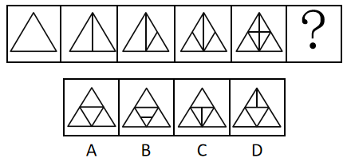

# 图形推理-数量规律（数交点）

考点：[[20-考点/判断推理/图形推理/图形推理-数量规律（数交点）|图形推理 / 图形推理-数量规律（数交点）]]

**问法模型**：『填入问号处使之呈现一定规律性』且图形元素组成不同、无属性规律 → 逐一统计交点数，验证是否构成等差数列

## 推理链
1. 第1步：题干五个图形均为同一三角形外框内部逐次添加线条，元素组成不同，对称、曲直等属性规律不明显
2. 第2步：图形线条交叉明显，按官方解析考虑数量规律中的数交点（线条相交的点及顶点均计入）
3. 第3步：依次统计交点数：图1为单纯三角形，3个顶点共3个交点；图2内部一条竖线与底边相交，共4个交点
4. 第4步：图3、图4、图5在线条逐次增加后交点数依次为5、6、7，构成公差为1的等差数列
5. 第5步：依规律问号处图形交点数应为8，逐项数选项：A为6个、B为8个，C、D均不为8
6. 第6步：只有B项交点数为8，与数列规律衔接，故选B

**最快解法**：⚡ 数交点法：从左到右快速数每图交点得3、4、5、6、7，直接找交点数为8的选项即B（注意顶点和线条与边的接触点都要数）

## 易错点
- ⚠ 漏数顶点，误以为只数内部线条的交叉点
- ⚠ 漏数线条与底边的接触点（如图2竖线与底边的交点）
- ⚠ 选项A、D的内接/内含三角形结构干扰视线，错数其交点个数

## 母题抽象
> 🧩 当题干图形为同一外框内部逐次增加线条、元素组成不同且属性无规律时，优先数交点，验证是否为等差数列，再按公差选下一项

**同类特征**：同一三角形外框内部加线、线条交叉明显、元素组成不同、无属性规律、交点数等差递增、问号处延续数列

## 相关题
- [[10-真题/判断推理/图形推理/2042102 数量规律-交点数（点数量递增）|2042102]]（江苏 2017，相关度3）
- [[10-真题/判断推理/图形推理/2136734 数量规律-一笔画（奇点数与最少笔画数）|2136734]]（河南 2017，相关度3）
- [[10-真题/判断推理/图形推理/2393995 图形推理-数量规律（交点数）|2393995]]（青海 2019，相关度3）
- [[10-真题/判断推理/图形推理/12019740 数量规律-交点数（曲直交点）|12019740]]（浙江 2026，相关度2）
- [[10-真题/判断推理/图形推理/12100996 图形推理-对称性（单条对称轴方向交替）+数量规律（交点数等差递增）|12100996]]（江苏 2025，相关度2）

---

### 题干

请从所给的四个选项中，选出最恰当的一项填入问号处，使之呈现一定的规律性。

### 选项
- A. A
- B. B　✅
- C. C
- D. D

### 官方解析
元素组成不同，且无明显属性规律，考虑数量规律。观察发现，图形线条交叉明显，考虑数交点，题干每个图形交点的数量分别为：3、4、5、6、7，所以？处交点数应为8个。
故正确答案为B。

### 给定材料
（无）
