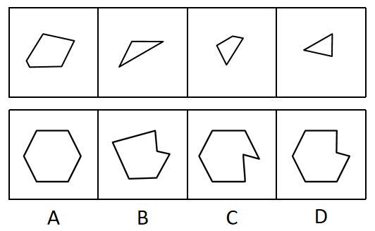

# 平面拼合（平行且等长线段相消）

考点：[[20-考点/判断推理/图形推理/平面拼合（平行且等长线段相消）|图形推理 / 平面拼合（平行且等长线段相消）]]

**问法模型**：四个碎片只能平移拼成一个轮廓且答案唯一 → 用'平行且等长相消'法消去拼接公共边，再比对剩余外围轮廓

## 推理链
1. 第1步：提取题干四个碎片特征：一个角部被斜切的不规则四边形、一个细长三角形、一个小型凹边形、一个小三角形，且题干限定只能上、下、左、右平移，不能旋转
2. 第2步：拼合规则——两块碎片以某条边贴合时，该公共边两侧'平行且等长'，在最终轮廓中相互抵消、不再出现
3. 第3步：将四个碎片的边按'平行且等长'两两配对消去，未被消去的边即为拼合后的外围轮廓
4. 第4步：消去公共边后，整体轮廓主体为六边形骨架，但右侧因小三角形、小凹边形碎片拼接形成一个内凹缺口
5. 第5步：对照A项，为规则六边形、无任何缺口，与碎片拼合后必然保留的凹凸轮廓不符，排除
6. 第6步：对照B项，整体为不规则五边形带外凸尖角，与消去后应保留的六边形主体轮廓不符，排除
7. 第7步：C、D右侧均有缺口，但C的缺口为深V形内凹，其方向和深度与碎片3、4平移贴合后保留的边不匹配，而D的缺口位置、形状与消去后剩余边完全吻合
8. 第8步：故拼合轮廓为D

**最快解法**：⚡ 平行且等长相消法：先把四个碎片两两找平行且等长的边作为贴合公共边消去，再数外围剩余边的走向，重点比对C、D右侧缺口的位置与形状即可快速锁定D

## 易错点
- ⚠ 忽略'只能平移、不能旋转'的限制，把碎片旋转后再拼，导致缺口方向判断错误
- ⚠ 轮廓大体相似就草率选C，未细致辨析C与D右侧缺口的形状、深度差异
- ⚠ 忘记消去贴合的公共边，把所有碎片外边都保留，导致轮廓边数和形状对不上

## 母题抽象
> 🧩 当题干给出若干小图形且限定'只能平移拼合'时，用平行且等长相消法消去两两贴合的公共边，再用剩余轮廓（尤其是缺口的位置、方向与形状）排除同形选项

**同类特征**：平面拼合、只能上下左右平移、四个多边形碎片、平行且等长相消、六边形轮廓带右侧缺口、C与D缺口形状辨析

## 相关题
- [[10-真题/判断推理/图形推理/16095271 图形推理-平面拼合（平行且等长相消）|16095271]]（江苏 2024，相关度3）
- [[10-真题/判断推理/图形推理/17900982 图形推理-平面拼合（平行且等长相消）|17900982]]（江苏 2024，相关度3）
- [[10-真题/判断推理/图形推理/2172310 平面拼合（平移拼合-平行且等长相消）|2172310]]（江苏 2018，相关度3）
- [[10-真题/判断推理/图形推理/2367808 图形推理-平面拼合（平移拼合·平行且等长相消）|2367808]]（江苏 2019，相关度3）
- [[10-真题/判断推理/图形推理/2367986 图形推理-平面拼合（平行且等长相消）|2367986]]（江苏 2019，相关度3）

---

### 题干

下面四个图形中，只有一个是由上面的四个图形拼合（只能通过上、下、左、右平移）而成的，请把它找出来。

### 选项
- A. A
- B. B
- C. C
- D. D　✅

### 官方解析

本题考查平面拼合，可采用平行且等长相消的方式解题。消去平行且等长的线段后进行组合即可得到轮廓图，即为D选项。平行且等长相消的方式如下图所示。

故正确答案为D。

### 给定材料
（无）
