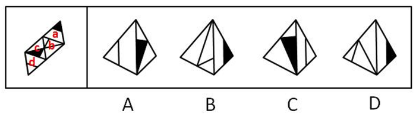
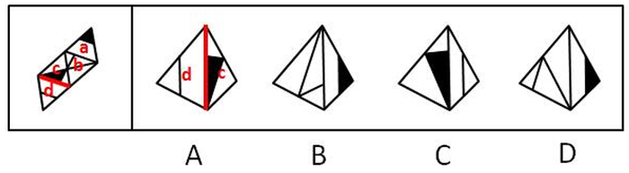
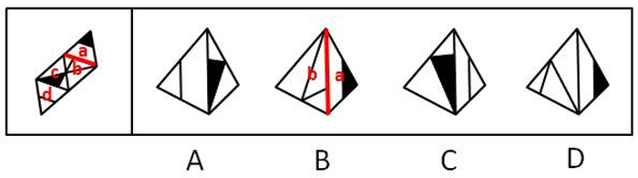

# 空间重构-四面体（三棱锥）折叠：相邻面公共边与图案相对位置验证

考点：[[20-考点/判断推理/图形推理/空间重构-四面体（三棱锥）折叠：相邻面公共边与图案相对位置验证|图形推理 / 空间重构-四面体（三棱锥）折叠：相邻面公共边与图案相对位置验证]]

**问法模型**：“纸盒外表面展开图，哪一项能由它折叠而成”→四面体空间折叠题，采用公共边（邻边）定位法，逐项验证图案相对公共边的左右位置与相交关系后排除

## 推理链
1. 第1步：题干为四面体展开图，将四个面依次标注为面a、b、c、d；特征图案：面a有黑色小三角形、面c有阴影三角形与交叉线、面b有短竖线、面d有一个三角形
2. 第2步：折叠规律——四面体各面两两相邻，每条公共边两侧图案的左右指向、相交关系在折叠前后不变，以'图案+公共边'为锚点核对相对位置
3. 第3步：A项核对：题干中面c的阴影三角形与面d中三角形底边右侧相挨，A项中阴影三角形却与面d三角形底边左侧相挨，左右关系翻转，排除
4. 第4步：B项核对：题干中面b的短竖线偏向面b与面a公共边的左侧，B项中短竖线偏向该公共边右侧，位置不符，排除
5. 第5步：C项核对：面c阴影三角形与面d三角形底边的相挨位置、面b短竖线相对公共边的方向均与题干一致，当选
6. 第6步：D项核对：题干中面b的短竖线一端交于面b与面a的公共边上，D项中该短竖线未与公共边相交，相交关系缺失，排除；综上选C

**最快解法**：⚡ 公共边定位法＋排除法：先在展开图上给四个面标a/b/c/d，找出'图案端点是否触及公共边'与'图案偏公共边左/右侧'两处细节，逐项比对A（左右挨边翻转）、B（短竖线左右偏向）、D（短竖线是否交公共边），唯C全部吻合

## 易错点
- ⚠ 四面体折叠后图案相对公共边的左右指向会随视角翻转，只看'哪两个面相邻'不核对'在公共边哪一侧'会误选A或B
- ⚠ 忽略短竖线端点是否交于公共边这一细节（D项仅差这一处），只看图案属于哪个面而放过相交关系
- ⚠ 展开图中公共边需先准确认定（面a与面b、面c与面d的邻接边），公共边找错则整题位置判断全错

## 母题抽象
> 🧩 当题干出现四面体（三棱锥）展开图且各面有线条、阴影等有向图案时，先标面名，以'图案与公共边的左右位置＋是否触及公共边'为验证点，逐项排除定答案

**同类特征**：

## 相关题
（暂无）

---

### 题干

下面给定的是纸盒外表面的展开图，右边哪一项能由它折叠而成？请把它找出来。

### 选项
- A. A
- B. B
- C. C　✅
- D. D

### 官方解析

将题干展开图中的面依次标注为面a、b、c、d，如下图：

A项：题干中，面c的阴影三角形和面d中的三角形底边右侧挨着，选项面c中阴影三角形与面d中的三角形底边左侧挨着，选项和题干不一致，排除；

B项：题干中，面b的短竖线偏向于面a公共边的左侧，选项面b中短竖线偏向于和面a公共边的右侧，选项和题干不一致，排除；

C项：与题干一致，当选；

D项：题干中，面b有短竖线交于面b与面a的公共边，选项中面b无短竖线交于面b与面a的公共边，选项与题干不一致，排除。

故正确答案为C。

### 给定材料
（无）
