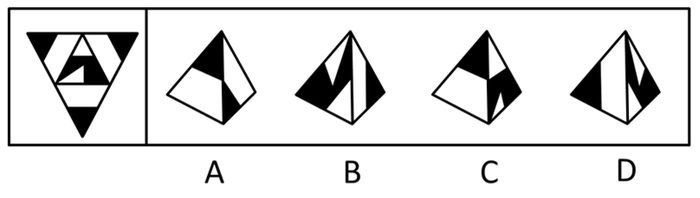
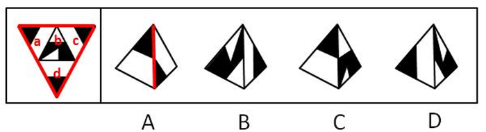

# 空间重构-四面体展开图折叠（公共边-公共点图案相邻关系定位）

考点：[[20-考点/判断推理/图形推理/空间重构-四面体展开图折叠（公共边-公共点图案相邻关系定位）|图形推理 / 空间重构-四面体展开图折叠（公共边/公共点图案相邻关系定位）]]

**问法模型**：给出四面体展开图与四个立体视图 → 采用公共边描边法+公共点法逐项比对图案相邻关系后排除

## 推理链
1. 第1步：展开图是大等边三角形内部再分出4个小三角形（标注为面a、b、c、d），各面由黑色/白色/阴影小三角形拼成不同图案
2. 第2步：四面体折叠规律——任意两面必共一条公共边，任意三个面共一个公共点，公共边两侧的图案在折叠后必须保持题干中的相邻关系
3. 第3步：对照A项，题干中面a、c、d三个面两两之间的公共边两侧均是'黑三角形与黑三角形相邻'，而A项中黑三角形挨着空白区域，公共边关系不符，排除A
4. 第4步：对照C项，题干中面b左侧的阴影与其他面的黑色小三角形没有公共点，而C项中二者出现公共点，公共点关系不符，排除C
5. 第5步：对照D项，按展开图折叠后的方位关系，面b中白色小直角三角形不可能落在选项所示的角落位置，排除D
6. 第6步：B项各面图案及公共边/公共点上的相邻关系均与展开图一致，故正确答案为B

**最快解法**：⚡ 公共边描边法：先在展开图上给a、c、d两两公共边描出'黑三角对黑三角'的标记，直接排除A；再用公共点法看面b左侧阴影与黑三角是否共点排除C；最后检查面b白色小直角三角形的方位排除D，剩余B即为答案

## 易错点
- ⚠ 只核对各面自身图案而不核对公共边两侧图案的相邻关系，误判A项成立
- ⚠ 忽略公共点上多面图案的交汇情况，漏看C项'阴影与黑色小三角形有无公共点'这一细节
- ⚠ 忽视四面体折叠时面会翻转的镜像变化，误把D项中白色小直角三角形的错误方位当成一致

## 母题抽象
> 🧩 当题干出现四面体（三棱锥）展开图且各面为黑白几何图案时，用公共边描边法+公共点法，验证选项中公共边两侧及公共点交汇处图案是否与展开图一致

**同类特征**：四面体（三棱锥）展开图、四个面均为黑白三角形拼成的图案、问法为'哪一项能由它折叠而成'、选项为立体锥体视图、判定依据是公共边/公共点上的图案相邻关系

## 相关题
- [[10-真题/判断推理/图形推理/2742065 空间重构-四面体折叠（公共边法-标号描点定位）|2742065]]（江苏 2021，相关度1）
- [[10-真题/判断推理/图形推理/4651814 空间重构-多面体折叠（相邻面公共边特征核对）|4651814]]（江苏 2022，相关度1）

---

### 题干

下面给定的是纸盒外表面的展开图，右边哪一项能由它折叠而成？请把它找出来。

### 选项
- A. A
- B. B　✅
- C. C
- D. D

### 官方解析

将题干展开图中的面依次标注为面a、b、c、d，如下图：

A项：题干中，面a、c、d三个面两两之间的公共边如下图所示，均是黑三角形与黑三角形两两相邻，选项中黑三角形挨着空白区域，选项和题干不一致，排除；

B项：与题干一致，当选；

C项：题干中，面b左侧的阴影和其他面的黑色小三角形没有公共点，选项中有公共点，选项和题干不一致，排除； 

D项：选项中，面b中白色小直角三角形不可能在所示的角落中，选项和题干不一致，排除。

故正确答案为B。

### 给定材料
（无）
