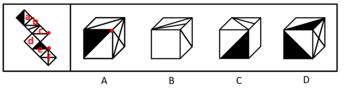
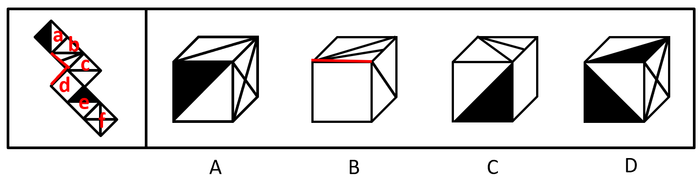
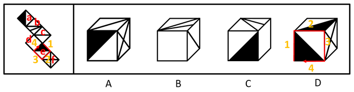

# 空间重构-六面体折叠（相对面排除+相邻面公共边-公共点验证）

考点：[[20-考点/判断推理/图形推理/空间重构-六面体折叠（相对面排除+相邻面公共边-公共点验证）|图形推理 / 空间重构-六面体折叠（相对面排除+相邻面公共边/公共点验证）]]

**问法模型**：给出展开图问'哪一项能由它折叠而成' → 空间重构模型：对每个选项先判定其三个面是否含相对面排除，再用公共边/公共点细节验证剩余候选

## 推理链
1. 第1步：将展开图六个面依次标号为a、b、c、d、e、f，各面图案为黑/白三角形与直线的组合，题干隐含相对面关系：a与c相对、b与e相对
2. 第2步：规则一：相对面在立体图中不能同时出现；规则二：相邻面用公共边上的交点数、公共点发出的线条与角的特征验证
3. 第3步：A项含面c、面f及a/e之一——若为面a，则面a与面c是相对面不能同时出现；若为面e，展开图中c、e、f的公共点发出两条直线和一个黑色锐角，而选项只发出一条线和一个黑色锐角，排除
4. 第4步：B项含面b、c、d，面b与面d的公共边上存在两个交点，而选项中只有一一个交点，与展开图不一致，排除
5. 第5步：C项含面b、面d及a/e之一——若为面e，则面b与面e是相对面不能同时出现；若为面a，则三面相邻位置与图案指向均与展开图一致，当选
6. 第6步：D项含面a、e、f，展开图中面f与面e及面a的白三角形相邻，而选项中面f与顶面的黑三角形相邻，颜色指向不符，排除；综上答案为C

**最快解法**：⚡ 相对面排除法+公共点法：先对每个选项做'三面中是否含相对面（a-c、b-e）'判断锁定第三面身份，再用公共点发出的线条数（A项二线一锐角vs一线一锐角）和公共边交点数（B项两点vs一点）快速排错，C项验证面a与b、d相邻一致直接锁定

## 易错点
- ⚠ 未先判定选项中相似的黑/白三角形面究竟是面a还是面e，把相对面误当作可同时出现的面（A、C两项的关键分水岭）
- ⚠ 只核对面的图案种类，忽略公共点发出的线条数量和公共边上的交点个数（A、B两项的排除依据）
- ⚠ D项忽略三角形颜色的指向差异：展开图中面f相邻的是白三角形，选项中却是黑三角形

## 母题抽象
> 🧩 当题干给出六面体展开图且选项呈现三个相邻面时，先检查每项是否含相对面排除，再对剩余项用公共边交点数、公共点发出的线条与三角形颜色指向等细节逐一验证

**同类特征**：六面体展开图折叠、选项呈现三个相邻面、相对面不能同时出现、公共点线条数/公共边交点数、黑白色三角形指向、阶梯形展开图

## 相关题
- [[10-真题/判断推理/图形推理/12019707 空间折叠（六面体折纸盒）——相对面排除＋公共边画边法-公共点引线法|12019707]]（广东 2026，相关度2）
- [[10-真题/判断推理/图形推理/18899566 空间重构-折纸盒（相对面排除+无中生有面排除）|18899566]]（上海 2021，相关度2）
- [[10-真题/判断推理/图形推理/2742184 空间重构-六面体折叠（相对面排除+公共点引线验证）|2742184]]（江苏 2021，相关度2）
- [[10-真题/判断推理/图形推理/12561915 空间重构-六面体折叠（相对面排除+公共点法）|12561915]]（浙江 2024，相关度1）
- [[10-真题/判断推理/图形推理/16070182 空间重构-六面体展开图折叠（相对面排除＋相邻面数字方向验证）|16070182]]（湖北 2026，相关度1）

---

### 题干

下面给定的是纸盒外表面的展开图，右边哪一项能由它折叠而成？请把它找出来。

### 选项
- A. A
- B. B
- C. C　✅
- D. D

### 官方解析

将展开图的面均标上序号，如下图。

A项：选项出现了面c、面f，以及面a、面e中的一个，如果是面a，则面a和面c是相对面，不能同时出现；如果是面e，则面c、面e面f存在公共点，展开图中公共点发射出两条直线和一个黑色锐角，而选项只发射一条线和一个黑色锐角，选项与题干不一致，排除；

B项：选项出现了面b、面c和面d，面b和面d存在公共边，公共边上存在两个交点，而选项只有一个交点，选项与题干不一致，排除；

C项：选项出现了面b、面d，以及面a和面e中的一个，如果是面e，则面b与面e是相对面，不能同时出现；如果是面a，则选项与题干一致，当选；

D项：选项出现了面a、面e和面f。题干展开图中，面f和面e及面a中的白三角形均相邻，而选项中面f和顶面的黑三角形相邻，选项与题干展开图不一致，排除。

故正确答案为C。

### 给定材料
（无）
