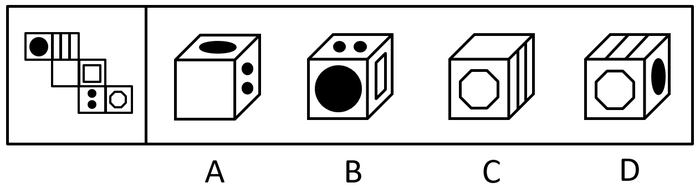
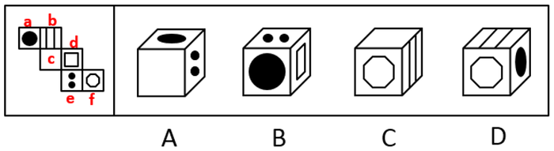
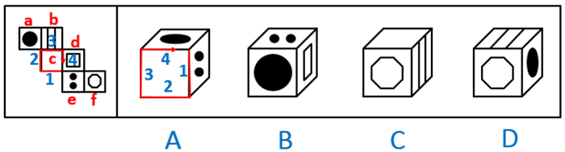

# 空间重构-六面体折叠（相对面排除＋公共边画边法）

考点：[[20-考点/判断推理/图形推理/空间重构-六面体折叠（相对面排除＋公共边画边法）|图形推理 / 空间重构-六面体折叠（相对面排除＋公共边画边法）]]

**问法模型**：“右边哪一项能由它折叠而成”→空间重构题：先用相对面“同现即排除”，剩余项再用公共边画边法验证相邻面相对位置。

## 推理链
1. 第1步：给展开图六面标号——面a＝实心圆●、面b＝三条竖线、面c＝空白面、面d＝双正方形（回字）、面e＝两点、面f＝空心圆○（选项透视中呈八边形轮廓）。
2. 第2步：由阶梯型展开图定位三组相对面：面a↔面d、面c↔面f（面b↔面e），规则为相对面折叠后不能同时出现在同一三维视图中。
3. 第3步：B项出现面e、a、d，其中面a与面d为相对面，同现矛盾，排除；C项出现面c、f、b，其中面c与面f为相对面，同现矛盾，排除。
4. 第4步：A项出现面a、c、e，无相对面冲突，改用公共边画边法：面c与面e相邻，选项中两者相交成直角的两条边即折叠后的公共边，以该公共边为起点对面c依次画边1~4。
5. 第5步：对照边序——展开图中面c的第2条边对应面a，而A项中面c的第4条边对应面a，相邻相对位置不一致，排除A。
6. 第6步：D项出现面b（三竖线，顶面）、面f（圆，正面）、面a（实心圆，右面），三面互不为相对面且相邻位置与展开图一致，当选D。

**最快解法**：⚡ 相对面排除＋画边法两步走：第一步扫选项找相对面——B中a与d同现、C中c与f同现，直接排除B、C；第二步对无相对面冲突的A用画边法——以c、e公共边为起点给面c画边，展开图2号边邻面a而选项4号边邻面a，排除A；剩下D直接锁定。

## 易错点
- ⚠ 忽略空白面也是六个面之一：面c为空白面，误以为A项正面“无图案”就不参与判定，导致不会对A用画边法排查而误选A。
- ⚠ 透视变形干扰：圆在顶面呈椭圆、圆圈轮廓呈八边形，若按“形状”而非“图案种类”对应展开图，容易错认面。
- ⚠ A项无相对面冲突，单靠相对面排除法排不掉，不掌握公共边画边法（以公共边为起点画边定相邻方向）就会误选A。

## 母题抽象
> 🧩 当题干给出六面体外表面展开图问“哪项能折叠而成”时：先找三组相对面，选项中相对面同现直接排除；剩余选项以相邻两面公共边为起点对面画边1~4，比对展开图与选项中各边所贴合的面是否一致，完全一致者当选。

**同类特征**：纸盒外表面展开图、问“哪一项能由它折叠而成”、相对面不能同时出现、公共边画边法定相邻方向、阶梯型（2-2-2错位）展开图、圆、竖线、点、空白等简单图案面

## 相关题
- [[10-真题/判断推理/图形推理/2022314 空间重构-六面体折叠（相对面排除+相邻面公共边指向）|2022314]]（吉林 2016，相关度2）
- [[10-真题/判断推理/图形推理/2172377 空间重构-六面体折叠（相对面排除＋相邻面特征定位）|2172377]]（江苏 2018，相关度2）
- [[10-真题/判断推理/图形推理/2172868 空间重构-纸盒折叠（相对面排除+相邻面公共边-公共点图案定位）|2172868]]（广州市考 2018，相关度2）
- [[10-真题/判断推理/图形推理/2367800 空间重构-六面体折叠（折纸盒：相对面排除+相邻面公共边特征）|2367800]]（江苏 2019，相关度2）
- [[10-真题/判断推理/图形推理/2376503 空间重构-纸盒折叠（相对面排除法）|2376503]]（吉林 2019，相关度2）

---

### 题干

下面给定的是纸盒外表面的展开图，右边哪一项能由它折叠而成？请把它找出来。

### 选项
- A. A
- B. B
- C. C
- D. D　✅

### 官方解析

将展开图的面均标上序号，如下图。

A项：选项出现了面a、面c和面e，面c和面e存在构成直角的两条边，该边为面c和面e的公共边，在展开图和选项中，以两个面的公共边为起点对面c进行画边，展开图中2对应面a，选项则是4对应面a，选项与题干不一致，排除；

B项：选项出现了面e、面a和面d，面a和面d是相对面，不能同时出现，选项与题干不一致，排除；

C项：选项出现了面c、面f和面b，面c和面f是相对面，不能同时出现，选项与题干不一致，排除；

D项：选项出现了面b、面f和面a，选项与题干一致，当选。

故正确答案为D。

### 给定材料
（无）
