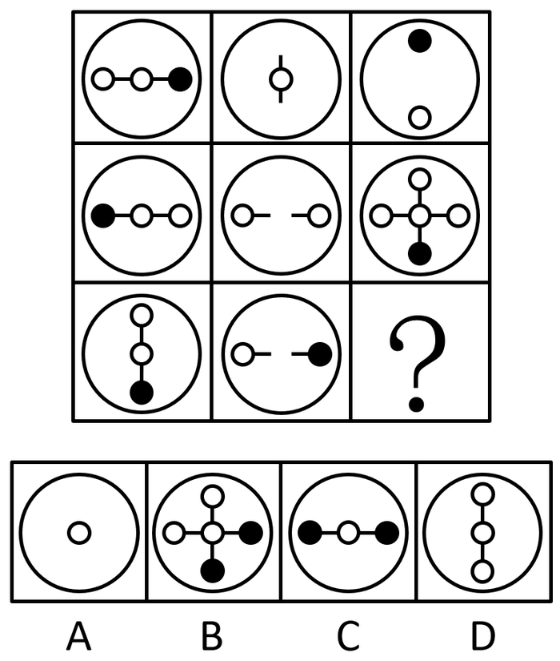

# 样式规律-位置旋转（逆时针90°）+叠加去同存异（求异）复合规律

考点：[[20-考点/判断推理/图形推理/样式规律-位置旋转（逆时针90°）+叠加去同存异（求异）复合规律|图形推理 / 样式规律-位置旋转（逆时针90°）+叠加去同存异（求异）复合规律]]

**问法模型**：九宫格'填入问号使之呈现一定规律性'且各图元素组成相似 → 按行寻找'先旋转再求异（去同存异）'的复合规律，用前两行验证后套用到第三行

## 推理链
1. 第1步：九宫格中每格均由大圆外框+线段连接黑白小圆构成，元素组成相似，优先考虑样式规律，且需结合位置变化（官方解析：'元素组成相似，优先考虑样式规律'）
2. 第2步：验证第一行——图1为横线上'白-白-黑'三圆，逆时针旋转90°后右端黑圆转到上方、左端白圆转到下方，变为竖排'上黑-中白-下白'；与图2（竖线+中间白圆）叠加求异：共同拥有的竖线段和中间白圆被去掉，只留上方黑圆与下方白圆，恰为图3
3. 第3步：验证第二行——图1为横排'黑-白-白'，逆时针旋转90°后变为竖排'上白-中白-下黑'；与图2（左右各一个带横线段的白圆、中间断开）求异：竖线段、上白圆、下黑圆、中白圆、左右白圆均为一方独有而保留，合成图3的十字形，规律成立
4. 第4步：第三行应用——图1为竖排'上白-中白-下黑'，逆时针旋转90°后：上方白圆转到左侧、下方黑圆转到右侧，变为横排'左白-中白-右黑'
5. 第5步：与图2（左白圆带线段、右黑圆带线段、中间断开）叠加去同存异：左侧白圆两图均有→去掉，右侧黑圆两图均有→去掉，重合的横线段→去掉，仅剩旋转后图1独有的中间白圆，与官方解析'只保留中间的圆'一致
6. 第6步：对照选项：A项仅大圆中心一个白圆，符合；B项为十字五圆（未消去）、C项三圆横排（未消去两端）、D项竖排三圆（未旋转），均排除

**最快解法**：⚡ 位置+样式复合口诀'先转再减'：第三行图1逆时针转90°得'左白-中白-右黑'，与图2'左白-右黑'逐位相消（去同存异），两端重合全消、只剩中间白圆，秒选A

## 易错点
- ⚠ 旋转方向弄反：若误用顺时针90°，黑白圆位置上下颠倒，对照选项时会错乱
- ⚠ 忽略线段也参与求异：只盯着黑白小圆消去，误以为剩余线段要保留在答案中
- ⚠ 跳过前两行验证或把'去同存异'误当'直接叠加/求同'：会把B项十字形误认为正确答案

## 母题抽象
> 🧩 当九宫格各图外框一致、内部由线段和黑白小圆组成、元素组成相似时，按行验证'位置变换（旋转/翻转）+样式叠加（去同存异）'的复合规律，验证成立后再应用到问号处

**同类特征**：九宫格、元素组成相似、大圆外框+线段连接黑白小圆、黑白圆位置轮换、旋转与求异复合规律、按行递推验证

## 相关题
- [[10-真题/判断推理/图形推理/10204610 样式规律-加减同异（去同存异），九宫格列规律|10204610]]（辽宁 2024，相关度2）
- [[10-真题/判断推理/图形推理/10297349 样式规律-黑白运算|10297349]]（浙江 2025，相关度2）
- [[10-真题/判断推理/图形推理/10297407 样式规律-黑白运算（定义叠加）|10297407]]（四川 2025，相关度2）
- [[10-真题/判断推理/图形推理/12019768 样式规律-加减同异（求同）与位置旋转的复合规律|12019768]]（浙江 2026，相关度2）
- [[10-真题/判断推理/图形推理/12101004 样式规律-黑白运算（九宫格逐位置叠加）|12101004]]（江苏 2025，相关度2）

---

### 题干

请从所给的四个选项中，选出最恰当的一项填入问号处，使之呈现一定的规律性。

### 选项
- A. A　✅
- B. B
- C. C
- D. D

### 官方解析
元素组成相似，优先考虑样式规律。九宫格先看第一行，图1逆时针旋转90度再与图2求异得到图3，第二行规律一致，第三行图1逆时针旋转90度再与图2求异，只保留中间的圆。
故正确答案为A。

### 给定材料
（无）
