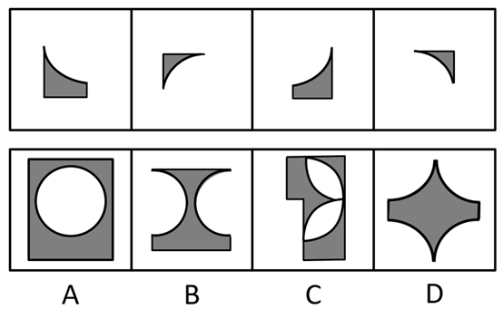
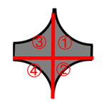

# 平面拼合-平行且等长相消（仅平移重组）

考点：[[20-考点/判断推理/图形推理/平面拼合-平行且等长相消（仅平移重组）|图形推理 / 平面拼合-平行且等长相消（仅平移重组）]]

**问法模型**：问'哪个图形可由左边四个图形仅通过上、下、左、右平移拼合而成' → 采用平面拼合的'平行且等长相消'模型，对接直边消去内部线段，剩余外轮廓对照选项

## 推理链
1. 第1步：题干限定'只能通过上、下、左、右平移'，即四个碎片不能旋转、不能翻转，每块碎片中唯一一段四分之一圆弧的凹凸朝向在拼合后保持不变
2. 第2步：观察左侧四个碎片，均由'一段四分之一圆弧＋两条直边'构成，直边是拼合的对接面，弧线只能留在外轮廓上
3. 第3步：用平行且等长相消法：把四个碎片的直边两两正对接拼合，凡平行且等长的公共边成为内部线段被消去
4. 第4步：四条弧线全部落在最外圈且凹向朝内、均匀分布，内部直边全部相消后，外轮廓为'四个尖角＋四段内凹圆弧'的四角星形
5. 第5步：对照选项：A为带圆孔的矩形（无内凹弧角），B左右各一段凹弧且带平底，C为直边不规则块且弧线朝向不一，均与相消后的轮廓不符
6. 第6步：只有D是四段内凹圆弧与四个尖角构成的四角星，与等长相消后的外轮廓完全一致，故选D

**最快解法**：⚡ 平行且等长相消法＋排除法：四个碎片直边两两对接、内部平行等长线段全部消去，数外轮廓上'内凹弧的数量与朝向'——须为四段均匀内凹弧，排除A（无弧角）、B（仅两段凹弧）、C（弧朝向不一致），直接锁定D

## 易错点
- ⚠ 误以为碎片可以旋转或翻转拼合，导致弧线朝向判断错误
- ⚠ 忽略弧线只能留在外轮廓，误把弧线当内部边界消去
- ⚠ 内部直边未消尽，被C这类含弧直边混合轮廓干扰误选

## 母题抽象
> 🧩 当题干给出多个含弧碎片且限定'只能平移拼合'时，用平行且等长相消法：直边两两对接消内部线段，剩余外轮廓（含弧线凹凸朝向）与选项逐一对照验证

**同类特征**：平面拼合、只能上、下、左、右平移、碎片含四分之一圆弧、平行且等长相消、外轮廓拼合图形、选项轮廓差异明显可用排除法

## 相关题
- [[10-真题/判断推理/图形推理/10975247 图形推理-平面拼合（平行且等长相消法）|10975247]]（江苏 2024，相关度3）
- [[10-真题/判断推理/图形推理/16095258 图形推理-平面拼合（平行且等长相消）|16095258]]（江苏 2024，相关度3）
- [[10-真题/判断推理/图形推理/16095267 图形推理-平面拼合（平移拼合·平行且等长相消）|16095267]]（江苏 2024，相关度3）
- [[10-真题/判断推理/图形推理/2172313 平面拼合-平行且等长相消（三角形拼合轮廓）|2172313]]（江苏 2018，相关度3）
- [[10-真题/判断推理/图形推理/2367807 图形推理-平面拼合（平行且等长相消）|2367807]]（江苏 2019，相关度3）

---

### 题干

右边四个图形中，只有一个是由左边的四个图形拼合（只能通过上、下、左、右平移）而成的，请把它找出来。

### 选项
- A. A
- B. B
- C. C
- D. D　✅

### 官方解析

本题考查平面拼合，可采用平行且等长相消的方式解题。消去平行且等长的线段后进行组合可得到轮廓图，即为D项。平行且等长相消的方式如下图所示：

故正确答案为D。

### 给定材料
（无）
