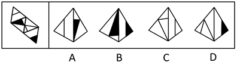
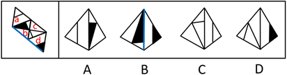
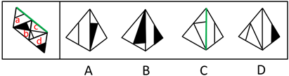
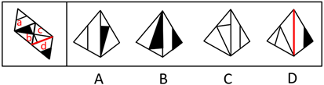

# 空间重构-四面体折叠（公共边法）

考点：[[20-考点/判断推理/图形推理/空间重构-四面体折叠（公共边法）|图形推理 / 空间重构-四面体折叠（公共边法）]]

**问法模型**：给出四面体展开图、问'哪一项能由它折叠而成' → 采用公共边法，核对相邻两面公共边与面上图案的相对位置关系逐项排除

## 推理链
1. 第1步：题干展开图是一个大三角形分割成的面a、b、c、d四个小面，各面带有直线、黑色/白色三角形等图案，属四面体折叠题
2. 第2步：四面体折叠后相邻两面必有唯一公共边，面上图案与公共边的关系（是否挨边、有无交点、颜色朝向）折叠前后保持不变
3. 第3步：B项由面b、d构成——展开图中面b的白三角挨着面d（蓝色公共边），B项中却是面b的黑三角挨着面d，颜色不符，排除
4. 第4步：C项由面a、c构成——展开图中面a内的线挨着公共边（绿色线），C项中面a的线未挨着公共边，位置不符，排除
5. 第5步：D项由面c、d构成——展开图中面c与面d的公共边（红色线）与面c内的直线有交点，D项中无交点，排除
6. 第6步：A项各相邻面公共边与图案的位置关系均与展开图一致，故选A

**最快解法**：⚡ 公共边法（描边定位）：先识别每个选项由哪两个面拼合而成，再回展开图定位该两面的公共边，按'是否挨边→有无交点→颜色朝向'三要素核对图案与公共边的关系，快速排除B、C、D，锁定A

## 易错点
- ⚠ 只核对两个面的形状而忽略公共边与图案的相对位置，误选形状相似项
- ⚠ B项黑白三角颜色看反：展开图中挨着面d的是白三角，选项中变成黑三角
- ⚠ D项漏看'公共边与面内直线有无交点'这一细节
- ⚠ 折叠方向（向里折/向外折）判断失误导致镜像错误

## 母题抽象
> 🧩 当题干出现四面体展开图（大三角形分割为四个小面）且各面带有线条、黑白三角形等图案特征时，用公共边法，逐一验证选项中相邻两面公共边与图案的相对位置（挨边情况、交点有无、颜色朝向）是否与展开图一致

**同类特征**：四面体展开图、大三角形分割为四个小面、各面带直线与黑白三角图案、问'哪一项能由它折叠而成'、选项呈现相邻两面的立体视图、公共边与图案位置关系

## 相关题
- [[10-真题/判断推理/图形推理/2367814 空间重构-四面体折叠（相邻面公共边与特征线-箭头指向检验）|2367814]]（江苏 2019，相关度2）
- [[10-真题/判断推理/图形推理/2367988 空间重构-四面体展开图折叠（公共边法）|2367988]]（江苏 2019，相关度2）
- [[10-真题/判断推理/图形推理/11367779 空间重构-六面体折叠（相对面排除＋公共边特征验证）|11367779]]（江苏 2025，相关度1）
- [[10-真题/判断推理/图形推理/1789614 空间重构-四面体展开图（画边法-唯一点法）|1789614]]（江苏 2016，相关度1）
- [[10-真题/判断推理/图形推理/1805286 空间重构-立体折叠（五棱柱展开图，相邻面黑白关系排除）|1805286]]（上海 2016，相关度1）

---

### 题干

左边给定的是纸盒外表面的展开图，右边哪一项能由它折叠而成？请把它找出来。

### 选项
- A. A　✅
- B. B
- C. C
- D. D

### 官方解析

将题干展开图中的面依次标注为面a、b、c、d，如下图：

A项：与题干一致，当选；

B项：选项由面b、d构成，题干展开图中面b的白三角挨着面d（蓝色的线），选项中面b的黑三角挨着面d（蓝色的线），选项和题干不一致，排除；

C项：选项由面a、c构成，题干展开图中面a中的线挨着公共边（绿色的线），选项中面a中的线没有挨着公共边（绿色的线），选项与题干不一致，排除；

D项：选项由面c、d构成，题干展开图中面c和面d的公共边（红色的线）与面c内的直线有交点，选项中面c和面d的公共边（红色的线）与面c内的直线无交点，选项与题干不一致，排除。

故正确答案为A。

### 给定材料
（无）
